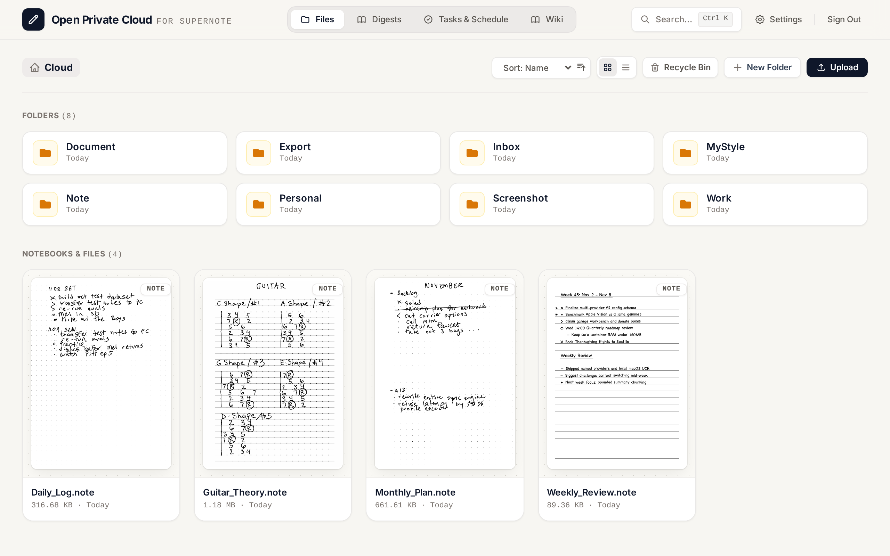
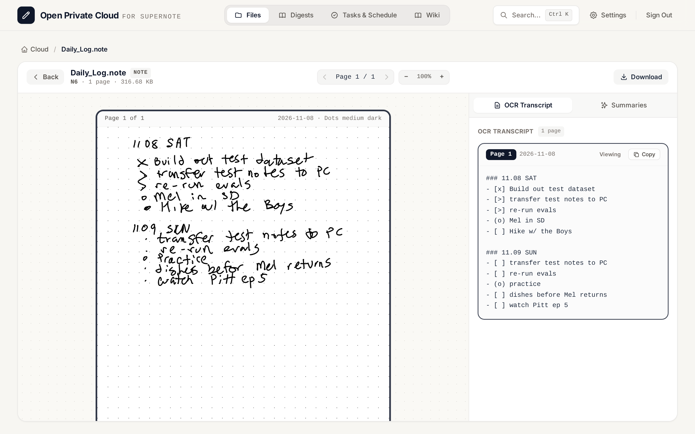
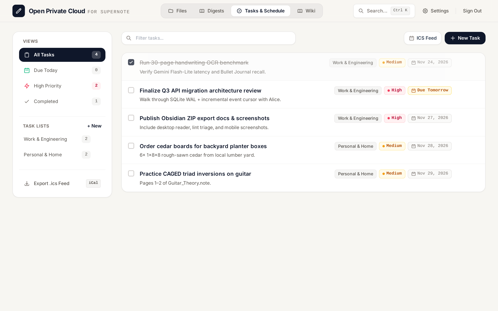
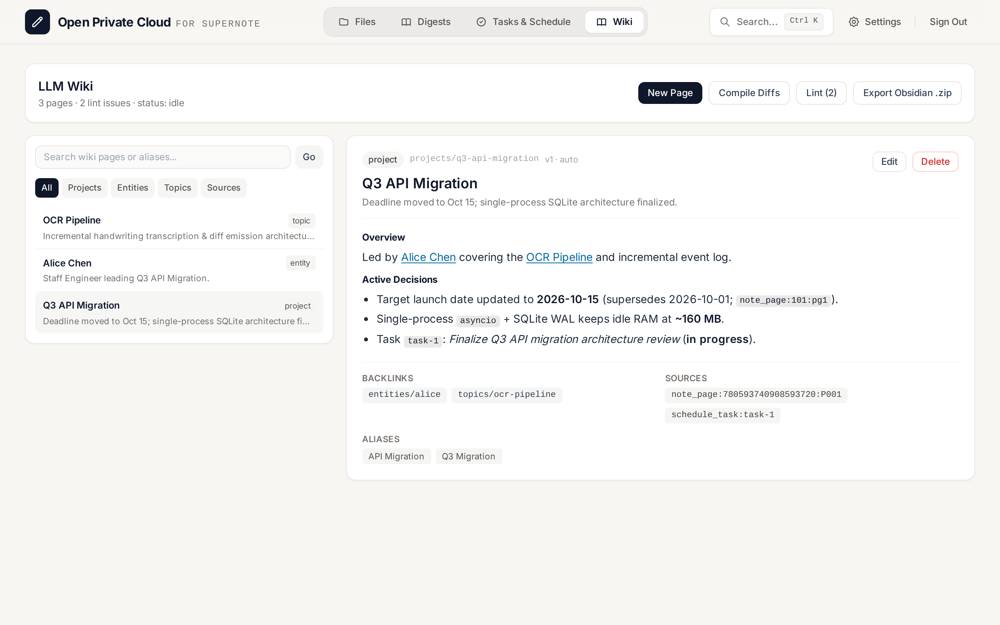

# Open Private Cloud for Supernote

A lightweight, self-hosted Python private cloud server, offline `.note` toolkit, and optional AI knowledge hub for your Ratta Supernote (Nomad, A5 X2 Manta, A5 X, A6 X).

<p align="center">
  
</p>

[](https://github.com/allenporter/supernote)
[](https://allenporter.github.io/supernote/)
[](https://github.com/allenporter/supernote/blob/main/LICENSE)

> **Unofficial Community Project:** We love [Ratta](https://supernote.com/)'s hardware and built this project for the Supernote community. It is an independent open-source project and is not affiliated with, endorsed by, or sponsored by Shanghai Ratta Smart Technology Co., Ltd. *Supernote* and *Ratta* are trademarks of Shanghai Ratta Smart Technology Co., Ltd.

---

## Start Small—Everything Is Optional

Unlike the official multi-container Java, MariaDB, and Redis Private Cloud stack (~2 GB+ RAM), Open Private Cloud runs in a single Python process backed by SQLite. Every major feature is an optional component that isn't even imported when turned off, so you only pay for what you use:

| Tier | Memory Footprint | What's Included | AI Required? |
| :--- | :--- | :--- | :---: |
| **1. Bare Sync Server** | ~135 MB RAM | Drop-in Private Cloud sync for Raspberry Pi / NAS, storage quotas (`web_enabled: false`, `mcp_enabled: false`) | No |
| **2. Web Workspace & Integrations** | ~160 MB idle (~310 MB peak) | 4-tab Web UI (Files, Digests, Tasks, Wiki), `.ics` calendar feeds, webhooks, native page-keyword search | No |
| **3. Optional AI & Knowledge Hub** | ~160 MB idle + chosen model | Handwriting & diagram OCR, standalone image OCR, hybrid semantic search, opt-in LLM Wiki + Obsidian export, MCP server for Claude/Cursor | Optional (Gemini or local Ollama/vLLM) |
| **4. Offline `.note` Toolkit** | CLI / library only | Parse `.note` files, convert to PDF/PNG/SVG, or author Bullet Journal `.note` files from Markdown—no server needed | No |

---

## What Do You Want to Do?

| If you want to… | Start here |
| :--- | :--- |
| Replace Ratta's 2 GB Private Cloud stack on a Raspberry Pi, NAS, or Docker host | [Self-Hosting & Quickstart Guide](docs/guides/bootstrap_guide.md) |
| Choose between Google Gemini, local Ollama/vLLM, Apple Vision, or zero AI | [Choosing an AI Provider](docs/guides/ai_providers.md) |
| Transcribe handwriting, Bullet Journals, Mermaid diagrams, and whiteboard photos | [Handwriting OCR & Multimodal Workflows](docs/guides/ocr_and_multimodal.md) |
| Search across years of notebooks by keyword or meaning | [Search & Retrieval](docs/guides/search.md) |
| Turn your synced notes and tasks into an Obsidian-ready personal wiki | [LLM Wiki](docs/guides/llm_wiki.md) |
| Connect Claude Desktop, Claude Code, or Cursor to read notes and inspect sketches | [MCP Server & AI Assistants](docs/guides/mcp.md) |
| Sync Supernote To-Dos to Apple Reminders, Google Calendar, or Home Assistant | [Webhooks, iCal (`.ics`) & Integrations](docs/guides/webhooks_and_integrations.md) |
| Convert or author `.note` files offline from the terminal or Python | [CLI Reference](docs/reference/cli_reference.md) · [`supernote.notebook`](supernote/notebook/README.md) |

---

## Quick Tour of the Web UI

Browse synced folders with rendered `.note` cover thumbnails, open handwritten pages side-by-side with AI Markdown transcripts (including rendered Mermaid diagrams), review reading digests, manage synced tasks, or curate your opt-in LLM Wiki—all in a mobile-friendly editorial Web UI.

<p align="center">
  
</p>

<p align="center">
  
</p>

<p align="center">
  
</p>

<p align="center">
  
</p>

---

## Quick Start

For Docker Compose, Caddy/Nginx reverse proxies, and backups, see the [Self-Hosting & Quickstart Guide](docs/guides/bootstrap_guide.md).

### 1. Start the server

**Zero-AI sync server (Python or Docker):**

```bash
pip install "supernote[server]"
supernote serve
```

```bash
docker run -d -p 8080:8080 -v $(pwd)/storage:/data --name supernote-server ghcr.io/allenporter/supernote:latest
```

To run in **Bare Sync Mode (~135 MB RAM)** without the Web UI or MCP server:

```bash
SUPERNOTE_WEB_ENABLED=false SUPERNOTE_MCP_ENABLED=false supernote serve
```

**Add optional AI (Google Gemini default or local Ollama/vLLM):**

Set `SUPERNOTE_GEMINI_API_KEY` to enable handwriting OCR, summaries, and hybrid search with `gemini-3.5-flash-lite` and `gemini-embedding-2` (or point `config/config.yaml` at a local Ollama, llama.cpp, or vLLM server so notes never leave your network). See [Choosing an AI Provider](docs/guides/ai_providers.md) for OCR/search benchmarks, local configs, and API data-retention policies.

### 2. Create your admin account

The first registered user becomes the administrator and closes public registration:

```bash
supernote admin --url http://localhost:8080 user add you@example.com
```

### 3. Pair your Supernote

1. On your tablet, open **Settings → Sync → Supernote Cloud** and choose **Private Cloud**.
2. Enter your server URL (for example, `http://192.168.1.5:8080`) and sign in with your new account.
3. Tap **Sync**.

---

## Documentation

### Guides
- [Self-Hosting & Quickstart](docs/guides/bootstrap_guide.md)
- [Choosing an AI Provider](docs/guides/ai_providers.md) (Gemini vs. local Ollama/vLLM vs. no AI, benchmarks, and data policies)
- [Handwriting OCR & Multimodal Workflows](docs/guides/ocr_and_multimodal.md)
- [Search & Retrieval](docs/guides/search.md)
- [LLM Wiki](docs/guides/llm_wiki.md)
- [MCP Server & AI Assistants](docs/guides/mcp.md)
- [Webhooks, iCal (`.ics`) & Integrations](docs/guides/webhooks_and_integrations.md)

### Reference & Operations
- [Configuration Reference](docs/reference/configuration.md) (`config.yaml` & `SUPERNOTE_*` environment variables)
- [CLI Reference](docs/reference/cli_reference.md) (`supernote` local, cloud, and admin commands)
- [Prometheus & Grafana Monitoring](docs/reference/monitoring.md)
- [Security & Threat Model](docs/reference/security.md)
- [OCR Benchmarks](evals/ocr/RESULTS.md) · [Search & Embedding Benchmarks](evals/search/RESULTS.md)

### Architecture & Python SDK
- [Server Component Catalog](docs/architecture/components.md) · [Server & Sync Protocol](docs/architecture/server_architecture.md) · [Binary `.note` Format Spec](docs/architecture/notebook_spec.md)
- Python packages: [`supernote.server`](supernote/server/README.md) · [`supernote.client`](supernote/client/__init__.py) · [`supernote.notebook`](supernote/notebook/README.md) · [`supernote.models`](supernote/models/README.md)

---

## Installation & Contributing

```bash
pip install supernote              # Offline .note parser, converter & Markdown authoring
pip install "supernote[client]"    # + Async Cloud API client & cloud/admin CLI
pip install "supernote[server]"    # + Private Cloud server, Web UI, AI & MCP
pip install "supernote[all]"       # Everything
```

Contributions are welcome! See [Contributing](docs/CONTRIBUTING.md) and the [Database Migration Guide](docs/architecture/schema_migration_guide.md) to get started locally with `./script/bootstrap`, `./script/test`, `./script/lint`, and `./script/docs`.
