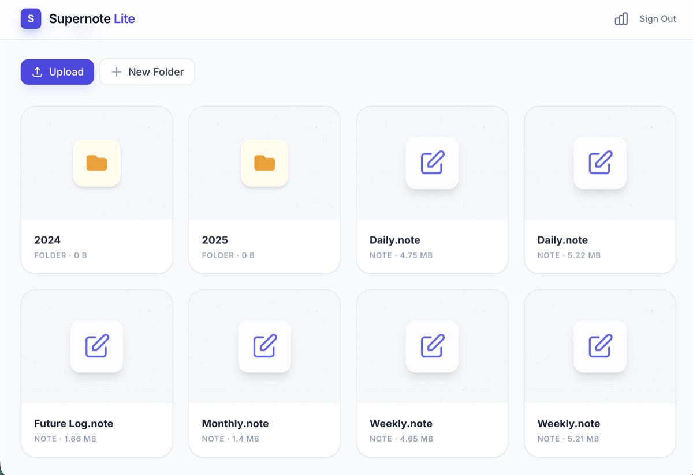
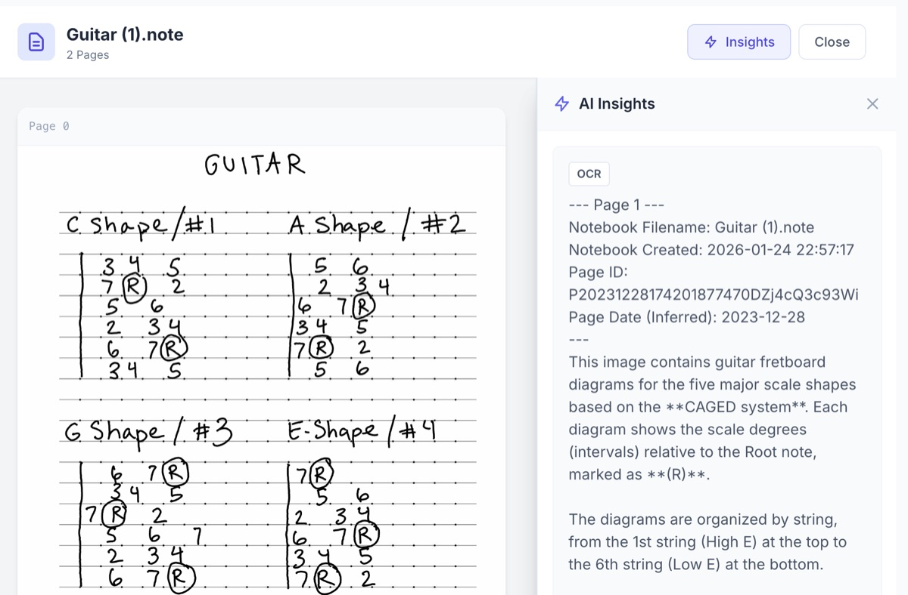
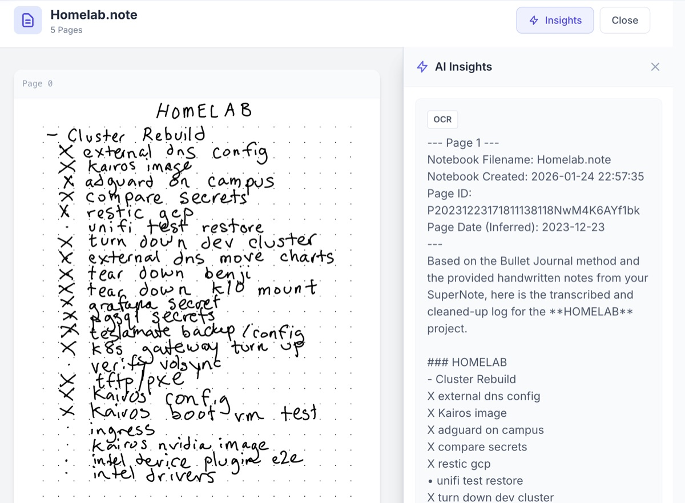
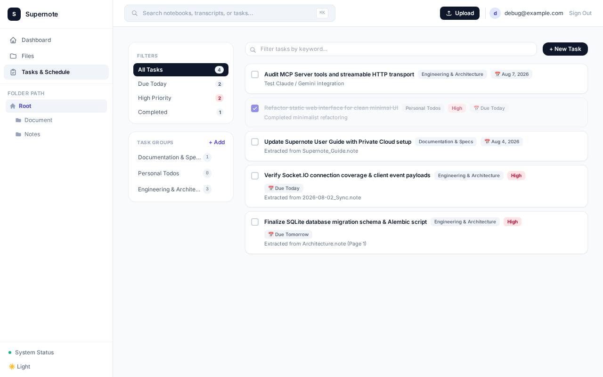
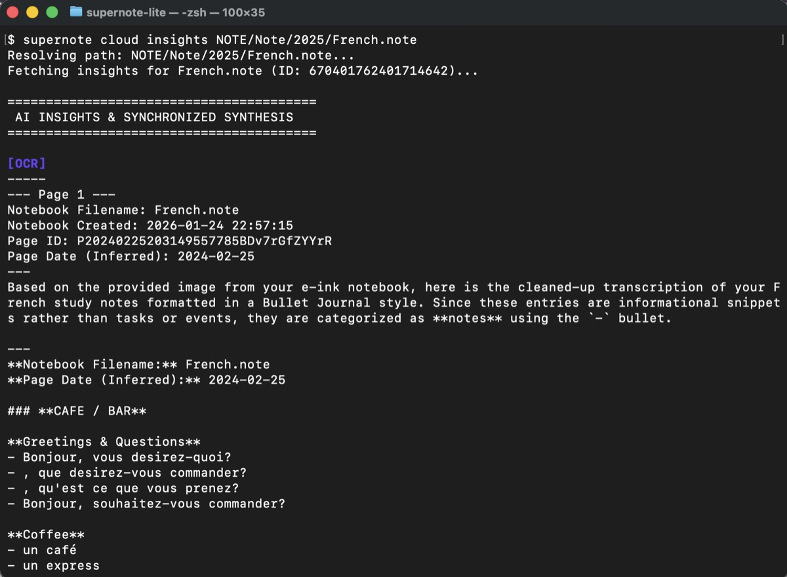
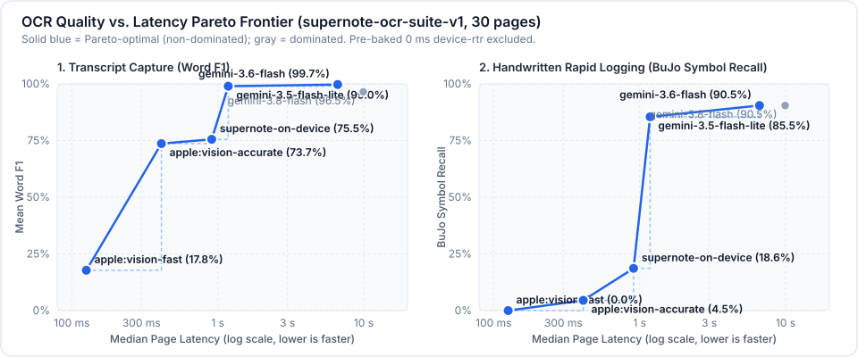
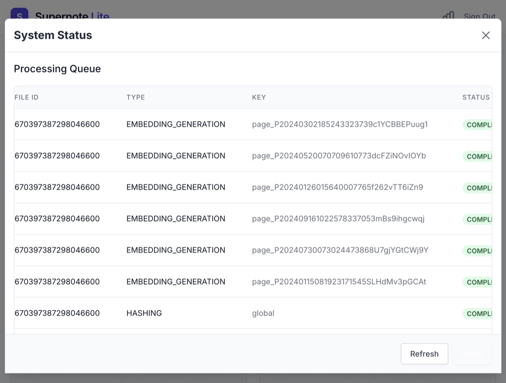
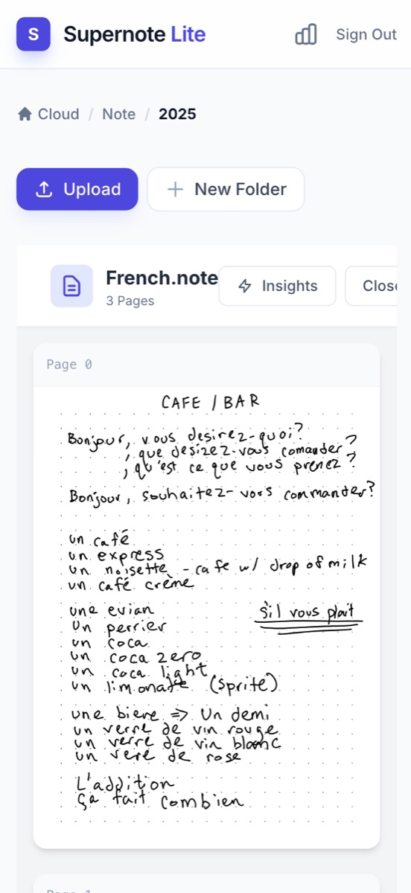

# Supernote Private Cloud & Knowledge Hub

**A lightweight, self-hosted private cloud server and optional AI intelligence layer for your Ratta Supernote.**

This toolkit is a self-hosted, SQLite-based implementation of the **Supernote Private Cloud** protocol. It provides a simple and resource-efficient sync server with a minimal resource footprint (~135MB flat in bare sync mode, or ~160MB idle and ~310MB peak when rendering and processing large notebooks). It implements **100% of the community [Supernote OpenAPI Specification](api-spec/openapi.yaml)**, and can optionally be enhanced with an **AI-driven synthesis engine**—transforming your handwritten notes into structured, searchable knowledge using Google Gemini or local OpenAI-compatible models (such as Ollama).

<p align="center">
  
</p>

[](https://allenporter.github.io/supernote/)
[](LICENSE)

## Why Supernote Private Cloud & Knowledge Hub?

This project is designed to be **fully compatible** with the official Supernote Private Cloud protocol, serving as a lightweight alternative that operates on a single SQLite database and runs comfortably on low-power NAS setups and home lab servers:

- **⚡ Lightweight Sync**: Runs on a simple, efficient Python/Asyncio stack with SQLite. Consumes ~135MB in bare sync mode, or ~160MB idle (~310MB peak) with the Web UI, MCP server, and background notebook processing enabled.
- **📋 OpenAPI Spec Compliant**: Implements **100% of the community [Supernote OpenAPI specification](api-spec/openapi.yaml)**.
- **🛡️ Private & Secure**: You own your database and files. Runs locally on your NAS or local server with no external data leakage.
- **🖥️ Sleek Web UI**: Browse notes, manage tasks, and export iCalendar (`.ics`) task feeds for Home Assistant, Apple Calendar, Google Calendar, and Outlook.
- **📜 Optional AI Synthesis**: When configured with an AI provider (Google Gemini or a local OpenAI-compatible model such as Ollama), it automatically transcribes handwriting and generates summaries (Daily, Weekly, Monthly).
- **🔍 Optional Semantic Search**: Vectorizes content for concept-based search across all notebooks.
- **🤖 Agent Ready (MCP)**: Securely connect your notes to AI agents (Claude, Gemini, ChatGPT) via the built-in [Model Context Protocol](https://modelcontextprotocol.io/) server.

## Synthesis & AI in Action

Beyond simple storage, Supernote provides an active processing pipeline to increase the utility of your notes:

1.  **Sync**: Your device uploads `.note` files using the official Private Cloud protocol.
2.  **Transcribe**: The server extracts pages and uses a vision model (Gemini or local VLM) to OCR your handwriting.
3.  **Synthesize**: AI Analyzers review your journals to find tasks, themes, and summaries.
4.  **Index**: Every word is vectorized, enabling semantic search across your entire library.

### Web Interface

The integrated frontend allows you to review your notes, manage task lists, and view AI insights side-by-side.

<p align="center">
  
  
</p>

<p align="center">
  
</p>

## Quick Start

You can run the server either as a **Lite Sync Server (Zero-Config)** or with the **AI & Semantic Search features enabled**.

### 1. Launch the Server

Choose one of the options below to start the server.

#### Option A: Lite Sync Server (Zero-Config)
No API keys or external services required. Runs locally with SQLite (~160MB idle, ~310MB peak when rendering notebook previews).

*   **Using Python**:
    ```bash
    pip install "supernote[server]"
    supernote serve
    ```
*   **Using Docker**:
    ```bash
    # Build the docker image locally
    docker build -t supernote .

    # Run the container (maps the local storage/ folder to the container's /data volume)
    docker run -d \
      -p 8080:8080 \
      -v $(pwd)/storage:/data \
      --name supernote-server \
      supernote
    ```
*   **Bare Sync Mode (~135MB flat RAM)**: To run a minimal headless sync server without the Web UI, background PNG rasterization, or MCP server, disable `web_enabled` and `mcp_enabled` via environment variables or `config.yaml`:
    ```bash
    SUPERNOTE_MCP_ENABLED=false SUPERNOTE_WEB_ENABLED=false supernote serve
    ```
    ```yaml
    # config/config.yaml
    mcp_enabled: false
    web_enabled: false
    ```

#### Option B: AI & Knowledge Hub (With Gemini — Recommended)
Enables high-accuracy handwriting transcription (`99.0%–99.7%` Word F1), Bullet Journal Rapid Logging task extraction, summarization, and semantic search (see [Choosing an AI Provider & OCR Benchmarks](#choosing-an-ai-provider--ocr-benchmarks)). Requires a Google Gemini API Key—Gemini offers both a **Free tier** (`$0`, where API data may be used to train models) and a **Paid tier** (fractions of a cent per notebook, where your data is **not** used to train models; see [Cloud API Privacy](#3-cloud-api-privacy-model-training--data-retention)).

*   **Using Python**:
    ```bash
    export SUPERNOTE_GEMINI_API_KEY="your-gemini-api-key"
    pip install "supernote[all]"
    supernote serve
    ```
*   **Using Docker**:
    ```bash
    # Build the docker image locally
    docker build -t supernote .

    # Run the container with your Gemini API key
    docker run -d \
      -p 8080:8080 \
      -v $(pwd)/storage:/data \
      -e SUPERNOTE_GEMINI_API_KEY="your-gemini-api-key" \
      --name supernote-server \
      supernote
    ```

#### Option C: AI & Knowledge Hub (With a Local Model)
Runs the same features against a model server on your own hardware, such as [Ollama](https://ollama.com/), llama.cpp, vLLM or LM Studio, so your notes never leave your network. You need a vision-capable chat model for OCR and summaries, and an embedding model for search. Configure the `openai` provider in `config/config.yaml` (`/data/config/config.yaml` in Docker) as described in the [server AI configuration](supernote/server/README.md#ai-configuration). On macOS, Apple's native Vision framework (`provider: apple` with `vision-accurate`) is also supported as a zero-key offline fallback for basic prose search, though it is **not recommended** for structured notes, diagrams, or Bullet Journal Rapid Logging (see [benchmarks below](#choosing-an-ai-provider--ocr-benchmarks)).

When the server runs in Docker and Ollama runs on the host, use `http://host.docker.internal:11434/v1` as the `base_url` (on Linux, also pass `--add-host=host.docker.internal:host-gateway`).

### 2. Bootstrap Your User

Once the server is running, register your administrator account:

*   **Using Python CLI**:
    ```bash
    # Create the initial admin account
    supernote admin --url http://localhost:8080 user add you@example.com

    # Authenticate your CLI
    supernote cloud login you@example.com --url http://localhost:8080
    ```
*   **Using Docker CLI**:
    ```bash
    # Create the initial admin account
    docker exec -it supernote-server supernote admin --url http://localhost:8080 user add you@example.com
    ```

### 3. Connect Your Device

1. On your Supernote, go to **Settings > Sync > Private Cloud**.
2. Enter your server URL (e.g., `http://192.168.1.5:8080`).
3. Log in with the email and password you created in Step 2.
4. Tap **Sync** to begin syncing your notes.

### 4. Explore Your Insights

Once your notes sync and process, you can view the AI synthesis from the terminal or browser:

```bash
# Get a high-level summary and transcription
supernote cloud insights /Notes/NOTE/Journal.note

# Semantic search across all notebooks
supernote cloud search "What were my project goals for February?"
```

<p align="center">
  
</p>

You can access the insights from the MCP server at `http://<your ip:port>/mcp`

> [!TIP]
> **Semantic Search**: Supernote doesn't just look for words—it understands concepts. Searching for "budget" will find notes about "expenses" or "money," even if the specific word isn't there.

## Choosing an AI Provider & OCR Benchmarks

**We recommend Google Gemini (`gemini-3.6-flash` or `gemini-3.5-flash-lite`) as the primary AI provider.** Across both our own [30-page Supernote OCR evaluation suite](evals/ocr/RESULTS.md) and recent independent multimodal leaderboards, Gemini's Flash family sits squarely on the vision price-performance Pareto frontier—delivering near-zero handwriting word error rates, full Bullet Journal Rapid Logging structure extraction, and sub-cent notebook costs in a single pass.

<p align="center">
  
</p>

### 1. Supernote Handwriting & Bullet Journal Benchmark ([`evals/ocr/`](evals/ocr/))

Evaluated across `30` pages (`25` real handwritten `.note` pages spanning messy Bullet Journal Rapid Logging, two-column diagrams/guitar tablature, French/Spanish/Turkish notes, and stylized/overlapping strokes, plus `5` synthetic Bullet Journal fixtures; full metrics in [`evals/ocr/RESULTS.md`](evals/ocr/RESULTS.md)):

| Provider / Model | Pages | Word F1 | Mean CER | Content CER | Handwritten BuJo Symbols¹ | All BuJo Symbols | Median Latency |
| :--- | ---: | ---: | ---: | ---: | ---: | ---: | ---: |
| **`gemini:gemini-3.5-flash-lite`** *(Best Value / Speed)* | 30 | **99.0%** | **2.3%** | **1.4%** | **85.5%** | **95.8%** | **1.18 s** |
| **`gemini:gemini-3.6-flash`** *(Highest Capture)* | 30 | **99.7%** | 4.2%² | 3.6% | **90.5%** | **97.3%** | 6.63 s |
| `gemini:gemini-3.8-flash` | 30 | 96.5% | 5.6%² | 5.4% | **90.5%** | **97.3%** | 9.93 s |
| `supernote-on-device` (`MyScript iink 4.1.0`) | 25 | 75.5% | 17.2% | 16.7% | 18.6% | 18.6% | 0.91 s |
| `device-rtr` *(embedded `.note` layer)* | 8 | 77.7% | 12.8% | 12.0% | — | — | — |
| `apple:vision-accurate` *(macOS local fallback)* | 30 | 73.7% | 21.7% | 20.7% | 4.5% | 49.7% | 0.41 s |
| `apple:vision-fast` *(printed-text detector)* | 30 | 17.8% | 72.8% | 70.7% | 0.0% | 8.7% | 0.13 s |

*¹ Hand-drawn Rapid Logging signifiers (`•`, `X`, `>`, `<`, `o`, `-`, `*`) on real handwritten `bujo_daily` + `bujo_monthly` pages (Gemini also achieves `100%` nested indentation and `100%` `~~strikethrough~~` recall vs `0%` on Apple Vision and `0%` strikethrough on device).*
*² `gemini-3.6-flash` and `gemini-3.8-flash` emit optional ASCII `|` fret-alignment pipes on dense guitar tablature (`99.3%` Word F1 on `diagram_and_layout` for `3.6-flash`); `3.8-flash` had `1` `>90 s` reasoning timeout on a 12-fret grid.*

**Key Takeaways from `evals/ocr/`:**
- **Near-ceiling accuracy even on Gemini's smallest model**: `gemini-3.5-flash-lite` makes almost zero word-reading errors (`99.0%` Word F1, `0.0%` Median CER) in `1.18 s` per page at roughly `~$0.0005` per page (**>1,500 notebook pages per `$1`**). `gemini-3.6-flash` pushes overall Word F1 to `99.7%` and multilingual CER to `2.3%` (`99.4%` Word F1 across French, Spanish, and Turkish notes).
- **Why Apple Vision is supported, not recommended**: We support `provider: apple` (`vision-accurate`) on macOS for users who want a strictly offline, zero-setup fallback for basic English prose search (`93.0%` Word F1 on clean `english_prose`). However, overall it performs no better than the tablet's own built-in recognition (`73.7%` vs `75.5%` Word F1), scrambles multi-column and 2D diagram reading order (`30.2%` CER), degrades sharply on stylized or overlapping strokes (`43.6%` CER), and cannot accept a prompt—losing almost all hand-drawn Bullet Journal task symbols (`4.5%`), indentation (`0%`), and strikethroughs (`0%`). (`vision-fast` targets machine-printed text and is unsuitable for handwriting.)

### 2. Why Gemini Over Claude for Multimodal Note Processing?

Across mid-to-late 2026 industry multimodal benchmarks—[**Artificial Analysis MMMU-Pro**](https://artificialanalysis.ai/) (college-level visual/diagram reasoning with text shortcuts removed), [**Vals AI MMMU-Pro & MortgageTax**](https://www.vals.ai/benchmarks) (multimodal comprehension and scanned document extraction), and [**LMArena Vision**](https://lmarena.ai/) (blind human pairwise evaluation on images, screenshots, and documents)—Google's native multimodal Flash models match or outperform Anthropic's much pricier tiers at a fraction of the token cost and latency:

| Tier | Model (Release) | API List Price (In / Out per 1M) | LMArena Vision (Elo, Nov 2026) | MMMU-Pro (Artificial Analysis) | MMMU-Pro (Vals AI) | MortgageTax Doc OCR (Vals AI) | Throughput (AA) |
| :--- | :--- | :--- | ---: | ---: | ---: | ---: | ---: |
| **Lite / Budget** | **Gemini 3.5 Flash-Lite** (Jul 2026) | **`$0.30 / $2.50`** | **1268** | **79.0%** | **83.6%** | **68.7%** | **289 tok/s** |
| | Claude Haiku 4.5 / 5.5 (Oct 2025 / Oct 2026) | `$1.00 / $5.00` → `$0.10 / $0.50` | <1253 | 58.5% *(4.5)* | 46.1% *(4.5)* | 62.2% *(4.5)* | 92 / 232 tok/s |
| **Workhorse** | **Gemini 3.6 Flash** (Jul 2026) | **`$0.75 / $3.75`**\* | **1297** | **83.2%** | **88.4%** | **67.6%** | **189 tok/s** |
| | **Gemini 3.8 Flash** (Sep 2026) | **`$0.75 / $3.75`**\* | **1316** | **85.6%** | **89.1%** | 65.3% | 112 tok/s |
| | Claude Sonnet 5 / 5.5 (Jun / Sep 2026) | `$2.00 / $10.00` | 1272 / 1283 | 77.3% *(5)* | 83.0% *(5)* | **70.0%** *(5)* | 100 / 153 tok/s |
| **Frontier** | **Gemini 4 Carbon** (Oct 2026) | `$4.00 / $20.00` | — | **89.3%** (#1) | — | — | 66 tok/s |
| | Claude Opus 5 / 5.5 (Jul / Sep 2026) | `$5.00 / $25.00` → `$4.00 / $20.00` | 1317 / **1324** | 84.7% / 87.7% | **89.9%** *(5)* | **72.1%** *(5)* | 68 / 114 tok/s |

*\*Promotional list rate through Dec 31, 2026 (`$1.50 / $7.50` standard; `50%` lower via Batch API). Benchmark figures aggregated from Artificial Analysis, Vals AI, and LMArena as of Nov 2026.*

- **Flash-Lite beats or matches mid-tier models at budget pricing**: `Gemini 3.5 Flash-Lite` (`$0.30 / $2.50` per 1M tokens) scores `79.0%` on Artificial Analysis MMMU-Pro and `83.6%` on Vals AI MMMU-Pro—ahead of `Claude Haiku 4.5` by `>20` percentage points and even edging out `Claude Sonnet 5` (`77.3%` / `83.0%`) at **~5–6× lower cost** and **~3× higher output speed**.
- **Workhorse Flash rivals Frontier Opus on vision**: On LMArena Vision and MMMU-Pro, `Gemini 3.6 Flash` (`1297` Elo, `88.4%` Vals MMMU-Pro) and `Gemini 3.8 Flash` (`1316` Elo, `89.1%` Vals MMMU-Pro) both rank **ahead of `Claude Sonnet 5.5` (`1283` Elo)** while landing within `1` Elo point of `Claude Opus 5` (`1317` Elo) at roughly **one-fifth the price**.

### 3. Cloud API Privacy, Model Training & Data Retention

Google Gemini offers both a **Free tier** (which uses API data to train and improve models) and a **Paid tier** (which **does not** train on your data), while OpenAI and Anthropic exclude commercial API traffic from model training by default:

| Provider & Tier | Used to Train Models? | Default API Log Retention | Official Policy Citations |
| :--- | :--- | :--- | :--- |
| **Google Gemini API — Paid Tier** *(Cloud Billing enabled)* | **No** — prompts, page images, and outputs are excluded from training and product improvement; Google acts as a Data Processor. | Short-term abuse monitoring only; optional project logs in AI Studio default to `55` days (configurable to `7` days or off; [ZDR](https://docs.cloud.google.com/gemini-enterprise-agent-platform/resources/zero-data-retention) on Vertex AI / Enterprise). | [Gemini Paid Services Terms](https://aistudio.google.com/docs/terms#data-use-paid) · [Logs Policy](https://aistudio.google.com/docs/logs-policy) · [Google DPA](https://business.safety.google/processorterms/) |
| **Google Gemini API — Free Tier** *(no billing linked)* | **Yes** *(outside EEA, UK & Switzerland)* — inputs/outputs may be used to train Google models and reviewed by human annotators. | Retained for product improvement (Google advises *not* submitting personal or confidential data on the unpaid tier). | [Gemini Unpaid Services Terms](https://aistudio.google.com/docs/terms#data-use-unpaid) |
| **OpenAI API** (`api.openai.com`) | **No** by default (since March 2023, unless explicitly opted in). | Up to `30` days for abuse monitoring before deletion; Zero Data Retention (ZDR) available for eligible organizations. | [OpenAI Platform Data Controls](https://developers.openai.com/api/docs/guides/your-data) |
| **Anthropic Claude API** (`api.anthropic.com`) | **No** by default under Commercial Terms without express permission. | Not retained by default on standard endpoints, or up to `30` days on covered models / safety monitoring; ZDR available on request. | [Commercial Terms](https://www.anthropic.com/legal/commercial-terms) · [Training Policy](https://privacy.claude.com/en/articles/7996868-is-my-data-used-for-model-training) · [API Data Retention](https://platform.claude.com/docs/en/manage-claude/api-and-data-retention) |
| **Local Self-Hosted** (`Ollama`, `llama.cpp`, `vLLM`, macOS `Vision`) | **Never** — `100%` local execution. | None (`0` external transmission; notes never leave your server/LAN). | — |

> [!NOTE]
> **Gemini Free vs. Paid Tier**: Leaving Cloud Billing off lets you run Gemini on the **Free tier** at `$0` for testing or non-sensitive notes, whereas linking an active [Cloud Billing account](https://aistudio.google.com/docs/terms#paid-services) to your Google AI Studio project switches your API key to the **Paid tier** (`>1,500` pages per `$1` on `gemini-3.5-flash-lite`) so personal notebooks are never used for model training or human review.

## Features Deep Dive

- **Official Protocol Compatibility**: Implements the official **Supernote Private Cloud** protocol for seamless device synchronization. While Ratta's official service provides a robust and managed sync experience, this project allows for local data ownership and custom background processing.
- **Notebook Parsing**: Native, high-fidelity conversion of `.note` files to PDF, PNG, SVG, or plain text.
- **Developer API**: Modern `asyncio` client to build your own automation around Supernote data.
- **iCalendar Feed Export (.ics)**: Preview, copy, and download task feeds in RFC 5545 VTODO `.ics` format for Home Assistant, Apple Calendar, Google Calendar, and Outlook.
- **Observability**: Built-in request tracing and background task monitoring.

<p align="center">
  
  
</p>

## Installation

```bash
# Install specific components
pip install supernote              # Notebook parsing only
pip install supernote[server]      # + Private server & AI features
pip install supernote[client]      # + API Client

# Full installation (recommended for server users)
pip install supernote[all]
```

## Local Development Setup

To set up the project for development, please refer to the [Contributing Guide](docs/CONTRIBUTING.md).

## CLI Usage

```bash
# Server & Admin
supernote serve                      # Start the cloud
supernote admin user list           # Manage your users

# AI Synthesis & Insights
supernote cloud insights /Note.note # View synthesis from CLI

# File Operations
supernote cloud ls /                # List remote files
supernote cloud download /Note.note # Download to local machine
```

## Notebook Operations & Developer API

You can use the built-in notebook parser or async client directly in your own Python applications:

```python
from pathlib import Path
from supernote.notebook import PdfConverter, load_notebook

note = load_notebook("journal.note")
pdf_bytes = PdfConverter(note).convert(-1)  # Multi-page PDF conversion
Path("journal.pdf").write_bytes(pdf_bytes)
```

```python
from supernote.client import Supernote

async with await Supernote.login("user@example.com", "password", host="http://localhost:8080") as sn:
    files = await sn.device.list_folder("/")
```

The notebook parser originally started as a fork of [supernote-tool](https://github.com/jya-dev/supernote-tool) with lighter dependencies and modern type hints. All credit goes to the original authors for providing the foundational parser utility.

## Customizing AI Prompts

You can customize the prompts used for Gemini OCR (transcription) and Summarization by pointing the server to a custom prompts directory.

### 1. Configuration
Set the custom prompts directory using either:
*   **Environment Variable**:
    ```bash
    export SUPERNOTE_PROMPTS_DIR="path/to/your/prompts"
    ```
*   **Config File (`config.yaml`)**:
    ```yaml
    prompts_dir: "path/to/your/prompts"
    ```

### 2. Directory Structure
The custom prompts directory should mirror the structure of the default prompts:
```text
my-prompts/
├── ocr/                     # Prompt templates for handwriting OCR
│   ├── common/              # Appended to all OCR requests
│   │   └── legend.md
│   ├── default/             # Fallback default OCR prompt
│   │   └── system.md
│   └── daily/               # Custom OCR prompt for "daily" notebooks
│       └── prompt.md
└── summary/                 # Prompt templates for summaries
    ├── common/              # Appended to all summary requests
    │   └── instruction.md
    ├── default/             # Fallback default summary prompt
    │   └── prompt.md
    └── daily/               # Custom summary prompt for "daily" notebooks
        └── prompt.md
```

### 3. Filename-Based Prompt Routing
The server dynamically routes prompts based on the notebook's file name:
1.  When a notebook (e.g., `Daily.note` or `Weekly_Review.note`) is synced, the lowercased stem of the filename is extracted (`daily` or `weekly_review`).
2.  The server looks under the `ocr/` and `summary/` directories for a subfolder matching that stem (e.g., `daily/` or `weekly_review/`).
3.  If found, the templates inside that custom folder are loaded. If not found, it falls back to the `default/` templates.
4.  Templates found in the `common/` folder are always concatenated first.

## Contributing

We welcome contributions! Please see our [Contributing Guide](docs/CONTRIBUTING.md) for details on:
- Local development setup
- Project architecture
- Using **Ephemeral Mode** for fast testing
- AI Skills for agentic interaction

## Acknowledgments

This project is in support of the amazing [Ratta Supernote](https://supernote.com/) product and community. It aims to be a complementary, unofficial offering that is fully compatible with the official [Private Cloud protocol](https://support.supernote.com/Whats-New/setting-up-your-own-supernote-private-cloud-beta).

### Choosing Your Private Cloud Experience

While the official Supernote Private Cloud by Ratta provides a production-grade managed sync experience, this toolkit offers a highly efficient self-hosted alternative with opt-in AI enhancement.

| Capability | Official Private Cloud (Ratta) | Supernote Private Cloud (This Project) |
|------------|-------------------------------|-----------------------------|
| **Core Sync** | ✅ Robust & Validated | ✅ Fully Compatible (100% OpenAPI compliant) |
| **Memory Footprint**| ⚠️ High (~2 GB+ RAM required) | **⚡ Low (~135MB bare sync, ~160MB idle / ~310MB active full)** |
| **AI Analysis** | Basic OCR (Device-side) | **Optional: AI-powered Transcriptions & Synthesis (Gemini or Local Models)** |
| **Search** | Path/Filename | **Optional: Semantic Concept Search** |
| **Stack** | Java / Spring Boot + Redis + MariaDB | Python / Asyncio + SQLite |
| **Database** | Heavy MariaDB Instance | **Single SQLite File** |

**This toolkit is a great fit if:**
- You want a **lightweight, resource-friendly** private cloud that runs easily on a basic NAS or low-power server.
- You want **100% compliance** with the local OpenAPI sync protocols.
- You want **AI-generated summaries** and insights from your notebooks (optional).
- You want to perform **semantic searches** across your entire handwriting library (optional).
- You want to integrate your notes into local scripts via a Python API or CLI.
- You want to use the **Model Context Protocol (MCP)** to [chat with your notes](docs/mcp.md) using AI agents.

## Community Projects

- [jya-dev/supernote-tool](https://github.com/jya-dev/supernote-tool) - Original parser foundation.
- [awesome-supernote](https://github.com/fharper/awesome-supernote) - Curated resource list.
- [sn2md](https://github.com/dsummersl/sn2md) - Supernote to text/image converter.
