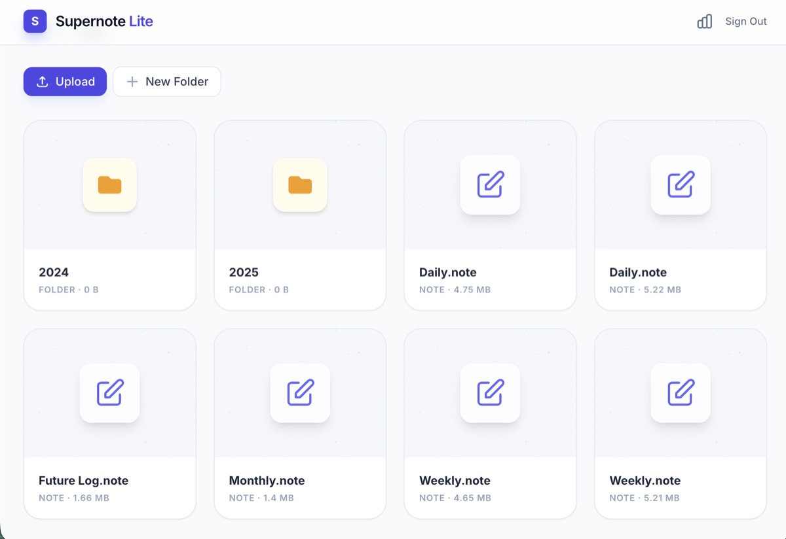
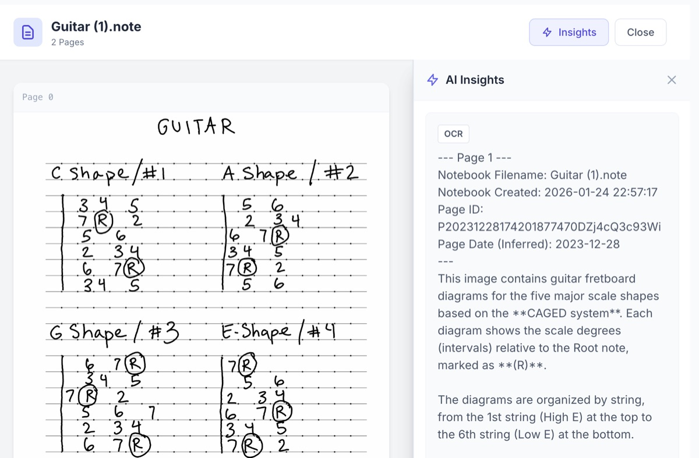
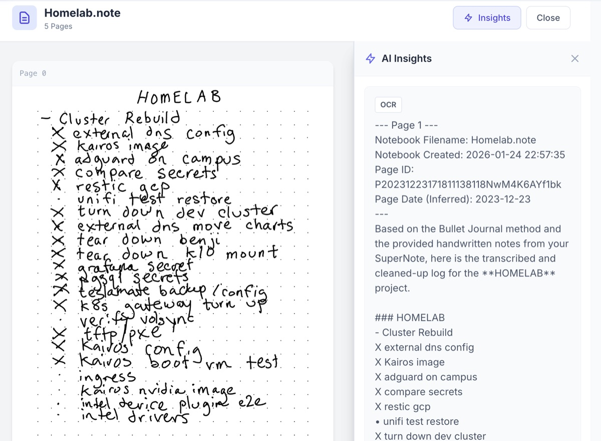
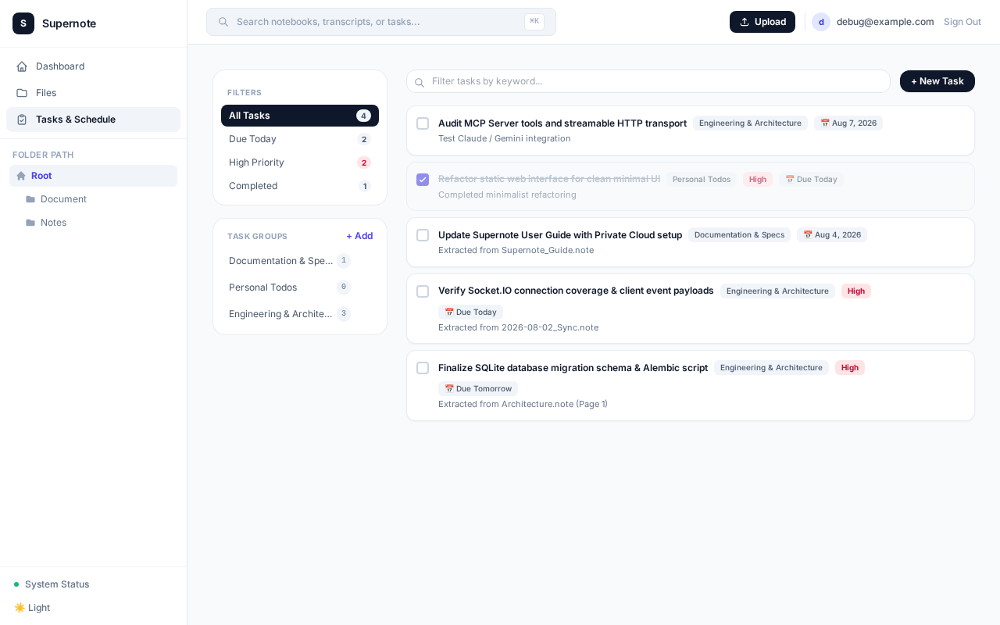
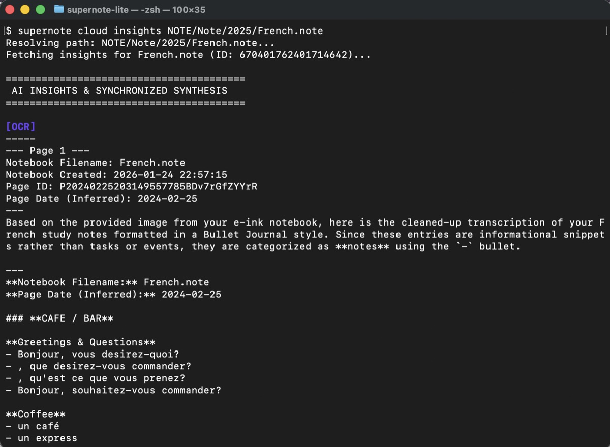
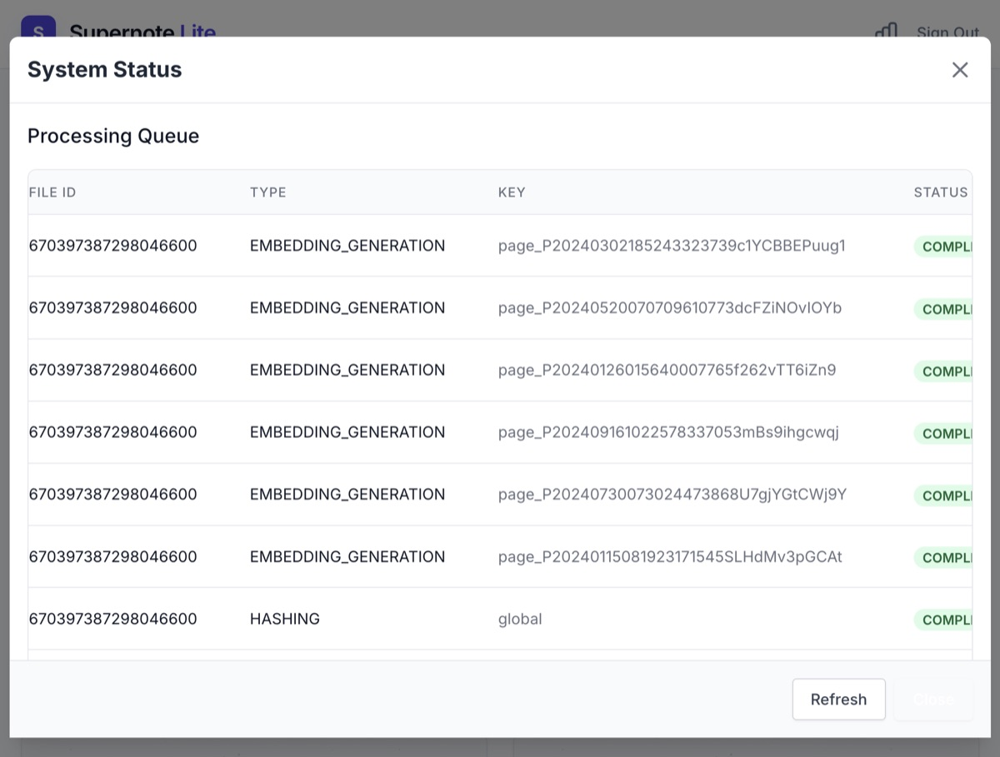
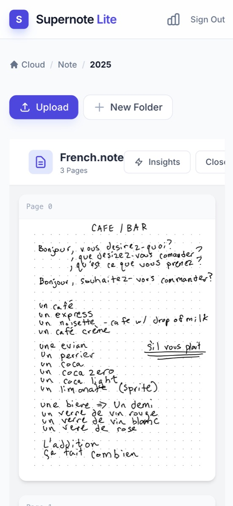
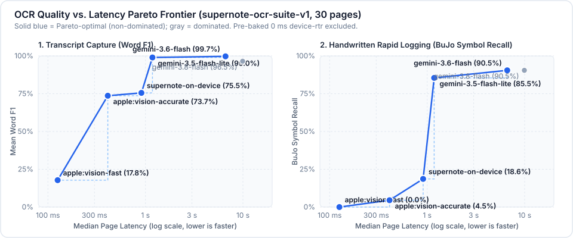

# Open Private Cloud for Supernote

**A lightweight, self-hosted Python private cloud server, binary `.note` parser & authoring library, and optional AI intelligence layer for your Ratta Supernote.**

<p align="center">
  
</p>

[](https://github.com/allenporter/supernote)
[](https://allenporter.github.io/supernote/)
[](https://github.com/allenporter/supernote/blob/main/LICENSE)

> **Unofficial Community Project:** We love [Ratta](https://supernote.com/)'s products and built this toolkit to support the Supernote community. It is an independent, open-source project and is not affiliated with, endorsed by, or sponsored by Shanghai Ratta Smart Technology Co., Ltd. *Supernote* and *Ratta* are trademarks of Shanghai Ratta Smart Technology Co., Ltd.

`supernote` is an open-source Python toolkit for Supernote hardware (Nomad, A5 X2 Manta, A5 X, A6 X) built around three core components:
1. **A Lightweight Private Cloud Server (`supernote.server`)**: A single-process `asyncio` + SQLite server that implements **100% of the community [Supernote OpenAPI Specification](api-spec/openapi.yaml)** in ~135 MB of RAM (bare sync mode) or ~160 MB idle / ~310 MB peak when rendering and processing notebooks with the Web UI, [Model Context Protocol (MCP)](docs/mcp.md) server, and optional AI synthesis engine.
2. **A Standalone `.note` Parser, Converter & Authoring Library (`supernote.notebook`)**: Read binary `.note` and `.mark` files, export pages to PDF (with clickable links), PNG, vector SVG, or plain text, or author and append Bullet Journal spreads directly into `.note` files from Markdown.
3. **An Async Python Client SDK & CLI (`supernote.client`, `supernote.cli`)**: Automate file sync, task lists, semantic search, static Bearer API keys (`sn_...`), and real-time Socket.IO sync notifications from Python or the terminal.

---

## Why Open Private Cloud for Supernote?

### Native Tablet Sync in ~135 MB of RAM (No Java, MariaDB, or Redis)
While the official Supernote Private Cloud stack orchestrates multi-container Java/Spring Boot, MariaDB, and Redis services (~2 GB+ RAM), Open Private Cloud runs in a single Python `asyncio` process backed by a single SQLite file and content-addressable blob storage. Point your tablet's native **Settings → Sync → Private Cloud** to your server and tap **Sync**—it runs effortlessly on a Raspberry Pi, NAS, or low-memory home lab server with two-tier volume and per-user storage quotas.

### Incremental Handwriting OCR, Summaries & Semantic Search
Handwriting recognition on e-ink hardware drains battery and struggles with dense cursive, diagrams, and Bullet Journal signifiers. When a notebook syncs to Open Private Cloud, a background pipeline hashes every page (`PageHashingModule`), skips unchanged and blank pages automatically, and processes only modified pages using Vision LLMs (**Google Gemini** `gemini-3.5-flash-lite` by default, or **local models via Ollama / vLLM / llama.cpp**):
- **High-Fidelity Transcripts**: Converts handwritten pages, tables, diagrams, and Bullet Journal Rapid Logging symbols (`•`, `X`, `>`, `<`, `-`, `*`, `~~strikethroughs~~`) into structured Markdown.
- **Executive Summaries**: Synthesizes multi-page notebooks into scannable summaries with key takeaways.
- **Concept Search**: Vectorizes content so you can search across years of handwritten notebooks by meaning (`"Where did I sketch the backyard drainage plan?"`), not just filenames.

### Built-In MCP Server & Static Bearer API Keys (`sn_...`)
Out of the box, the server hosts a spec-compliant **[Model Context Protocol (MCP)](docs/mcp.md)** server (`list_notebooks`, `search_notebook_chunks`, `get_notebook_transcript`) supporting both **Dynamic OAuth 2.1 (IndieAuth)** for interactive desktop agents (Claude Desktop, Cursor) and revocable **Static Bearer API Keys (`sn_...`)** for headless scripts and CLI automation.

### Filename & Page-Style Driven Custom AI Prompts
Drop custom Markdown prompt templates into your `prompts_dir` (`ocr/daily/prompt.md`, `summary/meeting_notes/prompt.md`, or `ocr/style_cornell/prompt.md`), and the server automatically routes matching notebooks (by filename stem or page stationery style) through your custom instructions while injecting native device page keywords (`PAGE_KEYWORDS`). See **[AI Pipeline, Custom Prompts & MCP Server](docs/mcp.md)** for full prompt routing details.

### Live Calendar Feeds (`.ics`), Webhooks & Prometheus/Grafana Observability
- **iCalendar (`VTODO`) Feeds**: Tasks created on your Supernote tablet are automatically exposed as an RFC 5545 `.ics` feed (`/api/schedule/feed.ics`) for Apple Reminders/Calendar, Google Calendar, Outlook, and **Home Assistant**.
- **Signed Outbound Webhooks**: Receive HMAC-SHA256 signed HTTP callbacks (`note.sync_completed`) the instant a notebook finishes syncing.
- **Production Monitoring**: Built-in `/metrics` endpoint with reference [Prometheus recording/alerting rules and a 13-panel Grafana dashboard](docs/monitoring.md).

### Offline Binary `.note` Parser, Converter & Cooperative Markdown Authoring
You don't need to run a server to use `supernote`. Use the CLI (`supernote analyze`, `supernote convert`, `supernote create`, `supernote merge`, `supernote reconstruct`) or `supernote.notebook` to export `.note` files to PDF/PNG/SVG, or programmatically generate and append stylized stationery templates, simulated handwriting, and hidden flashcard layers (`LAYER1`–`LAYER3`) onto `.note` files.

---

## Documentation Map

| Guide / Reference | What You'll Learn |
| :--- | :--- |
| **[Self-Hosting & Quickstart Guide](docs/bootstrap_guide.md)** | Deploying via Python or Docker Compose, bootstrapping your Admin account, pairing your Supernote tablet, reverse proxies (Caddy/Nginx), and SQLite/blob backups. |
| **[Configuration Reference](docs/configuration.md)** | Complete reference for `config.yaml` and `SUPERNOTE_*` environment variables, storage quotas, Gemini, named local OpenAI-compatible servers (Ollama/vLLM), and macOS Vision. |
| **[AI Pipeline, Custom Prompts & MCP Server](docs/mcp.md)** | How the 5-stage OCR/Embedding/Summary pipeline works, routing custom prompts by filename or `page_style`, static API keys (`sn_...`), and connecting Claude or Cursor via MCP. |
| **[OCR Provider Benchmarks](evals/ocr/RESULTS.md)** | 30-page Supernote handwriting & Bullet Journal benchmark comparing Gemini 3.5 Flash-Lite, Gemini 3.6/3.8 Flash, Supernote On-Device (`MyScript iink`), and Apple Vision. |
| **[Prometheus & Grafana Monitoring](docs/monitoring.md)** | Scraping `/metrics`, importing the reference Grafana dashboard, and configuring Prometheus recording and alerting rules. |
| **[Webhooks, iCal (`.ics`) & Integrations](docs/webhooks_and_integrations.md)** | Subscribing to RFC 5545 `VTODO` task feeds in Apple/Google/Outlook calendars and Home Assistant, plus HMAC-signed outbound webhooks. |
| **[CLI Reference (`supernote`)](docs/cli_reference.md)** | Every command and flag for local `.note` conversion and authoring (`create`), server hosting (`serve`), cloud operations, API keys (`cloud keys`), search, and admin management. |
| **[Server & Sync Protocol Architecture](supernote/server/ARCHITECTURE.md)** | Deep dive into the Supernote Private Cloud wire protocol (challenge-response auth, 3-step CAS sync, Socket.IO) and our Python/SQLite implementation. |
| **[Binary `.note` Format Specification](docs/notebook_spec.md)** | Byte-level layout of Supernote `.note` and `.mark` headers, footers, metadata blocks (`schema.py`), layers, and `RATTA_RLE` / `RATTA_RLE_X2` bitmap compression. |

### Python Package & API Reference

- **`supernote.server`**: [Open Private Cloud Server, Services & Routes](supernote/server/README.md) (`supernote.server.config.ServerConfig`, `supernote.server.app.create_app`)
- **`supernote.client`**: [Async Cloud Client SDK](supernote/client/__init__.py) (`supernote.client.Supernote`, `supernote.client.device.DeviceClient`, `supernote.client.schedule.ScheduleClient`, `supernote.client.extended.ExtendedClient`)
- **`supernote.notebook`**: [Notebook Parser, Converter & Authoring Library](supernote/notebook/README.md) (`supernote.notebook.load_notebook`, `supernote.notebook.PdfConverter`, `supernote.notebook.author.NotebookAuthor`, `supernote.notebook.renderer.MarkdownRenderer`)
- **`supernote.models`**: [Protocol DTOs & VOs](supernote/models/README.md) (`supernote.models.file_device`, `supernote.models.schedule`, `supernote.models.summary`, `supernote.models.extended`, `supernote.models.webhook`)

---

## Choosing Your Private Cloud Experience

While the official Supernote Private Cloud by Ratta provides a production-grade managed sync experience, Open Private Cloud offers a lightweight self-hosted alternative with opt-in AI enhancement:

| Capability | Official Private Cloud (Ratta) | Open Private Cloud (Bare Sync Mode) | Open Private Cloud (Full Knowledge Hub) |
| :--- | :--- | :--- | :--- |
| **Core Sync** | Robust & Validated | 100% OpenAPI Compliant | 100% OpenAPI Compliant |
| **Memory Footprint** | High (~2 GB+ RAM required) | **Low (~135 MB flat RAM)** | **Low (~160 MB idle / ~310 MB active peak)** |
| **Stack & Database** | Multi-container (Java + Redis + MariaDB) | Python / `asyncio` + single SQLite file | Python / `asyncio` + single SQLite file |
| **Web UI & Tasks** | Built-in Web UI | Disabled (`web_enabled: false`) | Editorial Web UI + `.ics` Calendar Feeds |
| **AI Analysis** | Basic OCR (Device-side) | None | Optional: AI Transcriptions & Synthesis (Gemini or Local Models) |
| **Search** | Path / Filename | Path / Filename | Optional: Cross-Notebook Semantic Concept Search |
| **AI Agent Access (MCP)** | None | Disabled (`mcp_enabled: false`) | Built-in OAuth 2.1 & Static API Key MCP Server |

<p align="center">
  
  
</p>

<p align="center">
  
</p>

---

## Quick Start

For full deployment instructions (including `docker-compose.yml`, Caddy/Nginx reverse proxies, and backups), see the **[Self-Hosting & Quickstart Guide](docs/bootstrap_guide.md)**.

### Launch the Server

#### Option A: Lite Sync Server (Zero-Config)
No API keys or external services required. Runs locally with SQLite (~160 MB idle, ~310 MB peak when rendering notebook previews).

*   **Using Python**:
    ```bash
    pip install "supernote[server]"
    supernote serve
    ```
*   **Using Docker**:
    ```bash
    docker build -t supernote .
    docker run -d \
      -p 8080:8080 \
      -v $(pwd)/storage:/data \
      --name supernote-server \
      supernote
    ```
*   **Bare Sync Mode (~135 MB flat RAM)**: To run a minimal headless sync server without the Web UI, background PNG rasterization, or MCP server, disable `web_enabled` and `mcp_enabled` via environment variables or `config.yaml`:
    ```bash
    SUPERNOTE_MCP_ENABLED=false SUPERNOTE_WEB_ENABLED=false supernote serve
    ```
    ```yaml
    # config/config.yaml
    mcp_enabled: false
    web_enabled: false
    ```

#### Option B: AI & Knowledge Hub (With Gemini, Recommended)
Enables handwriting transcription, summarization, and semantic search using `gemini-3.5-flash-lite` by default. Requires a Google Gemini API Key (available on both a `$0` Free tier that trains on API data and a Paid tier that does not; see [Choosing an AI Provider](#choosing-an-ai-provider)).

*   **Using Python**:
    ```bash
    export SUPERNOTE_GEMINI_API_KEY="your-gemini-api-key"
    pip install "supernote[all]"
    supernote serve
    ```
*   **Using Docker**:
    ```bash
    docker build -t supernote .
    docker run -d \
      -p 8080:8080 \
      -v $(pwd)/storage:/data \
      -e SUPERNOTE_GEMINI_API_KEY="your-gemini-api-key" \
      --name supernote-server \
      supernote
    ```

#### Option C: AI & Knowledge Hub (With a Local Model)
Runs the same features against a model server on your own hardware, such as [Ollama](https://ollama.com/), llama.cpp, vLLM, or LM Studio, so your notes never leave your network. You need a vision-capable chat model for OCR and summaries, and an embedding model for search. Configure the `openai` provider in `config/config.yaml` (`/data/config/config.yaml` in Docker) as described in the [Configuration Reference](docs/configuration.md). On macOS, Apple's native Vision framework (`provider: apple` with `vision-accurate`) is also supported as an offline fallback for basic prose search, though it is not recommended for structured notes, diagrams, or Bullet Journal Rapid Logging (see [Choosing an AI Provider](#choosing-an-ai-provider)).

When the server runs in Docker and Ollama runs on the host, use `http://host.docker.internal:11434/v1` as the `base_url` (on Linux, also pass `--add-host=host.docker.internal:host-gateway`).

### Bootstrap Your User

Once the server is running, register your administrator account (the first user registered automatically receives Admin privileges and closes public registration):

*   **Using Python CLI**:
    ```bash
    # Create the initial admin account
    supernote admin --url http://localhost:8080 user add you@example.com

    # Authenticate your CLI
    supernote cloud login you@example.com --url http://localhost:8080
    ```
*   **Using Docker CLI**:
    ```bash
    docker exec -it supernote-server supernote admin --url http://localhost:8080 user add you@example.com
    ```

### Connect Your Device

1. On your Supernote, go to **Settings > Sync > Supernote Cloud** and select **Private Cloud**.
2. Enter your server URL (e.g., `http://192.168.1.5:8080`).
3. Log in with the email and password you created in Step 2.
4. Tap **Sync** to begin syncing your notes.

### Explore Your Insights

Once your notes sync and process, you can view the AI synthesis from the terminal, browser, or MCP server (`http://<your-ip>:8081/mcp`):

```bash
# Get a high-level summary and transcription
supernote cloud insights /NOTE/Note/Journal.note

# Semantic search across all notebooks
supernote cloud search "What were my project goals for February?"
```

<p align="center">
  
</p>

<p align="center">
  
  
</p>

---

## Choosing an AI Provider

We recommend Google Gemini (`gemini-3.5-flash-lite` by default, or `gemini-3.6-flash`) for OCR, summarization, and embeddings based on our [30-page Supernote OCR benchmark](evals/ocr/RESULTS.md) and public multimodal evaluations. Quality for summaries and handwriting OCR extraction may be lower when using smaller local or other OpenAI-compatible models.

<p align="center">
  
</p>

### Supernote OCR Benchmark ([`evals/ocr/`](evals/ocr/))

Results across 30 `.note` pages (25 real handwritten pages covering Bullet Journal Rapid Logging, two-column diagrams and guitar tablature, French/Spanish/Turkish notes, and overlapping strokes, plus 5 synthetic Bullet Journal fixtures; full breakdown in [`evals/ocr/RESULTS.md`](evals/ocr/RESULTS.md)):

| Provider / Model | Pages | Word F1 | Mean CER | Content CER | Handwritten BuJo Symbols | All BuJo Symbols | Median Latency |
| :--- | ---: | ---: | ---: | ---: | ---: | ---: | ---: |
| `Gemini 3.5 Flash-Lite` | 30 | 99.0% | 2.3% | 1.4% | 85.5% | 95.8% | 1.18 s |
| `Gemini 3.6 Flash` | 30 | 99.7% | 4.2% | 3.6% | 90.5% | 97.3% | 6.63 s |
| `Gemini 3.8 Flash` | 30 | 96.5% | 5.6% | 5.4% | 90.5% | 97.3% | 9.93 s |
| `Supernote On-Device` (`MyScript iink 4.1.0`) | 25 | 75.5% | 17.2% | 16.7% | 18.6% | 18.6% | 0.91 s |
| `Apple Vision Accurate` | 30 | 73.7% | 21.7% | 20.7% | 4.5% | 49.7% | 0.41 s |
| `Apple Vision Fast` | 30 | 17.8% | 72.8% | 70.7% | 0.0% | 8.7% | 0.13 s |

- **Gemini**: `gemini-3.5-flash-lite` (the default) reads nearly every word accurately (99.0% Word F1, 0.0% Median CER) in ~1.2 s per page for under `$0.001` per page, while preserving Bullet Journal signifiers (`•`, `X`, `>`, `<`, `o`, `-`, `*`), nested indentation (100%), and `~~strikethroughs~~` (100%). `gemini-3.6-flash` reaches 99.7% Word F1 and 2.3% multilingual CER; its higher diagram CER comes from adding ASCII `|` fret dividers on guitar tablature (99.3% Word F1 on those pages).
- **Apple Vision**: Supported on macOS (`vision-accurate`) as an offline fallback for plain English prose (93.0% Word F1 on `english_prose`), **not** as a recommended provider. Overall accuracy matches the tablet's built-in recognizer (73.7% vs 75.5% Word F1), multi-column layouts are read out of order (30.2% diagram CER), and because Vision cannot take a prompt it drops almost all handwritten Bullet Journal task symbols (4.5% recall) and strikethroughs (0%). Avoid `vision-fast`, which only detects machine-printed text.

### Multimodal Benchmarks: Gemini vs. Claude

Recent results (Jun–Nov 2026) from [Artificial Analysis](https://artificialanalysis.ai/) (`MMMU-Pro`), [Vals AI](https://www.vals.ai/benchmarks) (`MMMU-Pro` and `MortgageTax` scanned-form extraction), and [LMArena Vision](https://lmarena.ai/) across model tiers:

| Model | Release | API Price (In / Out per 1M) | LMArena Vision (Elo) | MMMU-Pro (AA) | MMMU-Pro (Vals) | MortgageTax (Vals) |
| :--- | :--- | :--- | ---: | ---: | ---: | ---: |
| `Gemini 3.5 Flash-Lite` | Jul 2026 | `$0.30 / $2.50` | 1268 | 79.0% | 83.6% | 68.7% |
| `Claude Haiku 5.5` | Oct 2026 | `$0.10 / $0.50` (≤100k) | — | — | — | — |
| `Gemini 3.6 Flash` | Jul 2026 | `$0.75 / $3.75`\* | 1297 | 83.2% | 88.4% | 67.6% |
| `Gemini 3.8 Flash` | Sep 2026 | `$0.75 / $3.75`\* | 1316 | 85.6% | 89.1% | 65.3% |
| `Claude Sonnet 5` | Jun 2026 | `$2.00 / $10.00` | 1272 | 77.3% | 83.0% | 70.0% |
| `Claude Sonnet 5.5` | Sep 2026 | `$2.00 / $10.00` | 1283 | — | — | — |
| `Gemini 4 Carbon` | Oct 2026 | `$4.00 / $20.00` | — | 89.3% | — | — |
| `Claude Opus 5` | Jul 2026 | `$5.00 / $25.00` | 1317 | 84.7% | 89.9% | 72.1% |
| `Claude Opus 5.5` | Sep 2026 | `$4.00 / $20.00` | 1324 | 87.7% | — | — |

*\*Promotional rate through Dec 31, 2026 (`$1.50 / $7.50` standard; 50% lower via Batch API).*

`Gemini 3.5 Flash-Lite` matches `Claude Sonnet 5` on `MMMU-Pro` at roughly one-sixth the price, while `Gemini 3.6 Flash` and `Gemini 3.8 Flash` score ahead of `Claude Sonnet 5` and `5.5` on `LMArena Vision` and close to `Claude Opus 5` at a fraction of the cost.

### API Privacy, Training & Data Retention

Google Gemini offers both a **Free tier** that trains on API data and a **Paid tier** (enabled by linking a [Cloud Billing account](https://aistudio.google.com/docs/terms#paid-services) to your Google AI Studio project) that does not. Commercial API traffic on OpenAI and Anthropic is excluded from training by default:

| Provider & Tier | Used to Train Models? | Default API Log Retention | Policy Citations |
| :--- | :--- | :--- | :--- |
| **Gemini API (Paid tier)** | **No** (Google acts as Data Processor) | Abuse monitoring; optional AI Studio project logs default to 55 days (configurable to 7 days or off; [ZDR](https://docs.cloud.google.com/gemini-enterprise-agent-platform/resources/zero-data-retention) on Enterprise/Vertex AI) | [Paid Services Terms](https://aistudio.google.com/docs/terms#data-use-paid), [Logs Policy](https://aistudio.google.com/docs/logs-policy), [Google DPA](https://business.safety.google/processorterms/) |
| **Gemini API (Free tier)** | **Yes** (outside EEA, UK, and Switzerland; includes human review) | Retained for product improvement (avoid for private or sensitive notes) | [Unpaid Services Terms](https://aistudio.google.com/docs/terms#data-use-unpaid) |
| **OpenAI API** (`api.openai.com`) | **No** (unless opted in) | Up to 30 days for abuse monitoring; ZDR available for eligible orgs | [OpenAI Data Controls](https://developers.openai.com/api/docs/guides/your-data) |
| **Anthropic Claude API** (`api.anthropic.com`) | **No** under Commercial Terms | Not retained by default on standard endpoints, or up to 30 days on covered models; ZDR available | [Commercial Terms](https://www.anthropic.com/legal/commercial-terms), [Training Policy](https://privacy.claude.com/en/articles/7996868-is-my-data-used-for-model-training), [Data Retention](https://platform.claude.com/docs/en/manage-claude/api-and-data-retention) |
| **Local models** (`Ollama`, `llama.cpp`, `vLLM`, `apple`) | **No** | Local only; notes never leave your server | — |

---

## Installation

```bash
# Install specific components
pip install supernote              # Standalone .note parser, converter & authoring only
pip install "supernote[server]"    # + Open Private Cloud server, Web UI, AI & MCP
pip install "supernote[client]"    # + Async Cloud API client & cloud/admin CLI
pip install "supernote[server,apple]"  # + macOS Vision OCR fallback

# Full installation (recommended for server users)
pip install "supernote[all]"
```

---

## CLI Usage

See the **[CLI Reference](docs/cli_reference.md)** for all commands and flags.

```bash
# Server & Admin
supernote serve                                    # Start Open Private Cloud
supernote admin user list                          # Manage users
supernote admin user set-quota you@example.com 5G  # Set per-user storage quota

# Offline Notebook Parsing, Conversion & Authoring
supernote convert journal.note journal.pdf -a      # Export .note to PDF
supernote create daily.note --markdown "# Daily Log\n\n* - [ ] Ship release"

# Cloud File Operations & AI Synthesis
supernote cloud ls /                               # List remote files
supernote cloud download /NOTE/Note/Journal.note   # Download to local machine
supernote cloud insights /NOTE/Note/Journal.note   # View AI summary & OCR transcript
supernote cloud search "Q1 roadmap"                # Semantic vector search

# Static API Keys & Headless Automation
supernote cloud keys create "Automation" --expires-days 90
supernote cloud keys list
supernote cloud keys revoke <key-id>
supernote cloud --url http://localhost:8080 --api-key sn_... ls /
```

Headless scripts can also set `SUPERNOTE_URL` and `SUPERNOTE_API_KEY` in the environment instead of running `supernote cloud login`.

---

## Notebook Operations & Developer API

### Parse, Convert & Author `.note` Files (`supernote.notebook`)
See the **[Notebook Parser, Converter & Authoring Guide](supernote/notebook/README.md)** for full details:

```python
from pathlib import Path
from supernote.notebook import PdfConverter, load_notebook
from supernote.notebook.author import create_notebook

# Convert an existing .note file to a multi-page PDF with clickable links
note = load_notebook("journal.note")
pdf_bytes = PdfConverter(note).convert(-1, enable_link=True)
Path("journal.pdf").write_bytes(pdf_bytes)

# Author a new .note file directly from Bullet Journal Markdown
note_bytes = create_notebook(
    "# Daily Log\n\n* - [ ] Review ==architecture spec== #engineering",
    style="stylized",
    background="dots",
    auto_toc=True,
)
Path("daily.note").write_bytes(note_bytes)
```

### Automate Cloud Sync, Tasks & Search (`supernote.client`)
See the **[Python Client SDK Guide](supernote/client/__init__.py)** for the complete async API:

```python
from supernote.client import Supernote
from supernote.client.extended import ExtendedClient

# Authenticate with email/password (`Supernote.login`) or a static API key (`sn_...`)
async with Supernote.from_token("sn_...", host="http://localhost:8080") as sn:
    files = await sn.device.list_folder("/")

    ext = ExtendedClient(sn.client)
    hits = await ext.search("architecture trade-offs", top_n=5)
    for hit in hits.results:
        print(f"{hit.file_name} (p.{hit.page_index + 1}): {hit.score:.0%}")
```

The notebook parser originally started as a fork of [supernote-tool](https://github.com/jya-dev/supernote-tool) with lighter dependencies and modern type hints. All credit goes to the original authors for providing the foundational parser utility.

---

## Contributing & Community

We welcome issues, feature requests, and pull requests on **[GitHub (`allenporter/supernote`)](https://github.com/allenporter/supernote)**! Please see our **[Contributing Guide](docs/CONTRIBUTING.md)** and **[Database Migration Guide](docs/schema_migration_guide.md)** for details on local development (`./script/bootstrap`, `./script/test`, `./script/lint`, `./script/docs`), Ephemeral Mode (`supernote serve --ephemeral`), and AI Skills.

### Community Projects

- [jya-dev/supernote-tool](https://github.com/jya-dev/supernote-tool) — Original parser foundation.
- [awesome-supernote](https://github.com/fharper/awesome-supernote) — Curated resource list.
- [sn2md](https://github.com/dsummersl/sn2md) — Supernote to text/image converter.
