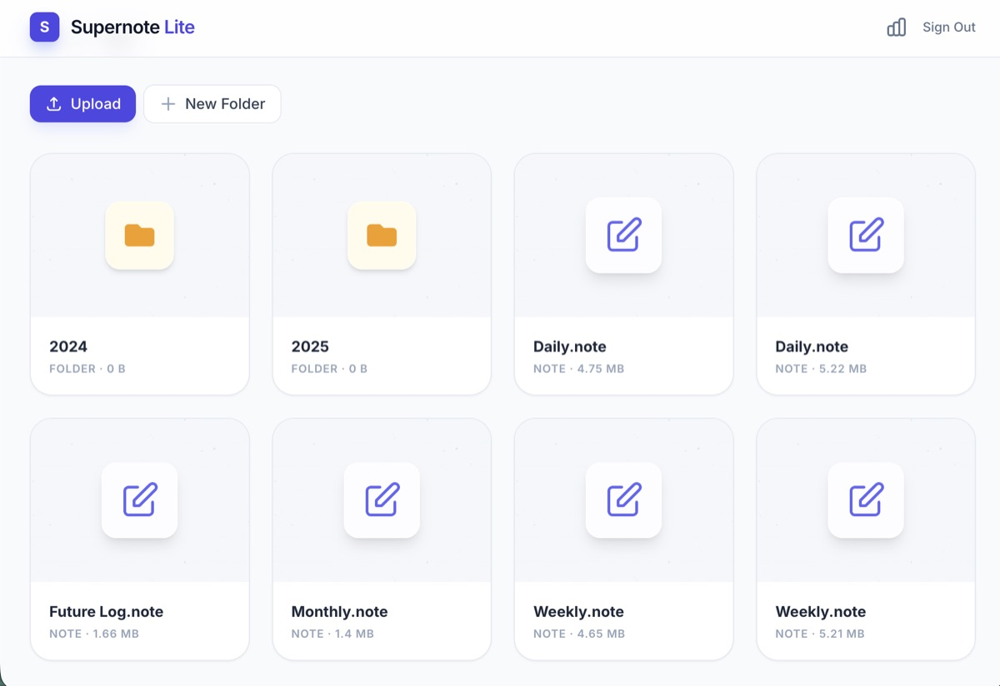
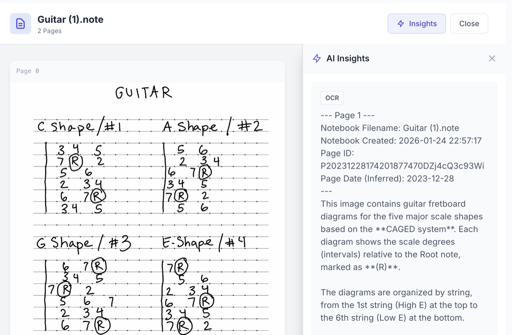
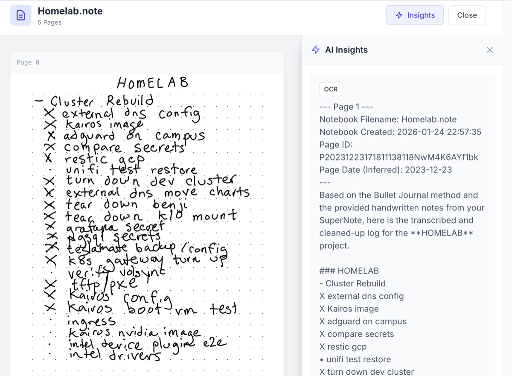
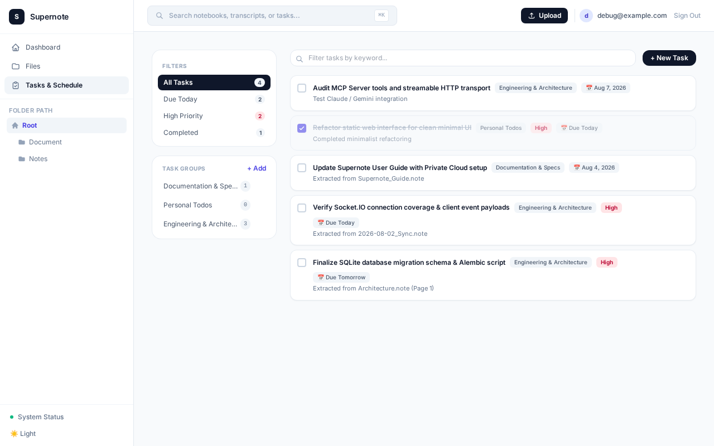
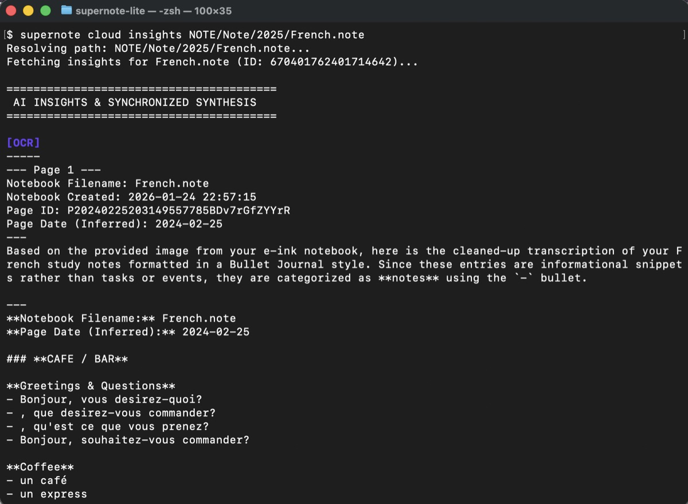
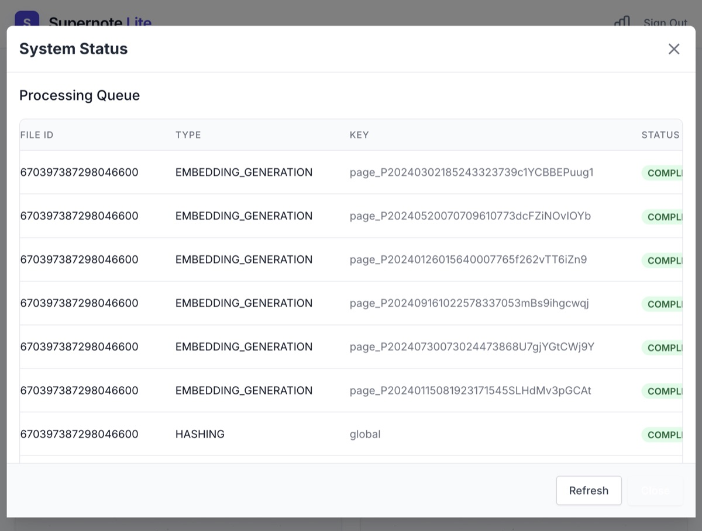
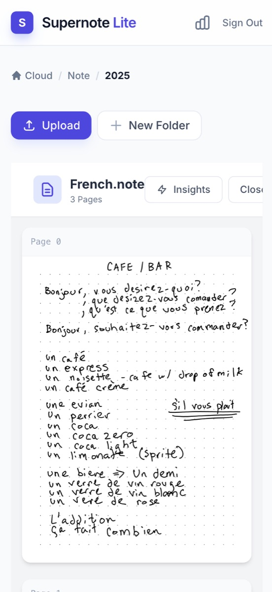

# Supernote Private Cloud & Knowledge Hub

**Turn your Ratta Supernote into a self-hosted, searchable knowledge base—or work with `.note` files directly from Python and the command line.**

[](https://allenporter.github.io/supernote/)
[](https://github.com/allenporter/supernote/blob/main/LICENSE)

`supernote` is an open-source, all-in-one toolkit for Supernote devices (Nomad, A5 X2 Manta, A5 X, A6 X) built around three core components:
1. **A Lightweight Private Cloud Server (`supernote.server`)**: A drop-in replacement for the official Ratta Private Cloud that runs in a single Python process with a single SQLite database—plus an optional AI synthesis pipeline and MCP server.
2. **A Standalone `.note` Parser & Converter (`supernote.notebook`)**: Read binary `.note` files and export pages to PDF (with clickable links), PNG, vector SVG, or plain text with zero cloud dependencies.
3. **An Async Python SDK & CLI (`supernote.client`, `supernote.cli`)**: Script file sync, task lists, semantic search, and real-time sync notifications from Python or your terminal.

<p align="center">
  
</p>

---

## Killer Features

### 1. Native Tablet Sync in ~135 MB of RAM (No Java, MariaDB, or Redis)
The official Supernote Private Cloud stack requires orchestrating Java/Spring Boot, MariaDB, and Redis containers (~2 GB+ RAM). `supernote` implements **100% of the [Supernote Private Cloud OpenAPI specification](https://github.com/allenporter/supernote/blob/main/api-spec/openapi.yaml)** in a single `asyncio` process backed by SQLite and content-addressable file storage. Point your tablet's built-in **Settings → Sync → Private Cloud** to your server and tap **Sync**—it runs effortlessly on a Raspberry Pi, NAS, or micro VPS.

### 2. Incremental Handwriting OCR, Summaries & Semantic Search
Handwriting recognition on e-ink hardware drains battery and struggles with messy cursive, diagrams, and margin notes. When you sync a notebook to `supernote`, a background pipeline hashes every page (`PageHashingModule`), skips unchanged pages, and runs only newly edited pages through Vision LLMs (**Google Gemini** or **100% local models via Ollama / vLLM**).
- **High-Fidelity Transcripts**: Converts handwritten pages, tables, and sketches into structured Markdown.
- **Executive Summaries**: Synthesizes multi-page notebooks into scannable summaries with key takeaways.
- **Concept Search**: Search across years of handwritten notebooks by meaning (`"Where did I sketch the backyard drainage plan?"`), not just filenames.

### 3. Built-In MCP Server for Claude, Cursor & AI Agents
Out of the box, the server hosts a spec-compliant **OAuth 2.1 + [Model Context Protocol (MCP)](docs/mcp.md)** server (`list_notebooks`, `search_notebook_chunks`, `get_notebook_transcript`). Connect **Claude Desktop**, **Cursor**, or custom AI agents directly to your notebooks so your assistant can read your handwritten meeting notes, extract action items, or reference your design sketches while you code.

### 4. Filename-Driven Custom AI Prompts
Want your `Daily.note` summarized into a bulleted standup update, your `Math.note` transcribed into LaTeX, or your `Journal.note` analyzed with a specific template? Drop a Markdown file into your `prompts_dir` (`summary/Daily.md`, `ocr/Math.md`), and the server automatically routes any matching `.note` file through that custom prompt on every sync.

### 5. Live Calendar Feeds (`.ics`), Webhooks & Home Assistant Integration
- **iCalendar (`VTODO`) Feeds**: Tasks created on your Supernote tablet are automatically exposed as a standard `.ics` feed (`/api/schedule/feed.ics`) that syncs into Apple Reminders/Calendar, Google Calendar, Outlook, or **Home Assistant**.
- **Signed Outbound Webhooks**: Receive HMAC-SHA256 signed HTTP callbacks (`note.sync_completed`) the instant a notebook finishes syncing so you can trigger external backup scripts, Obsidian exports, or home automations.

### 6. Offline Binary `.note` Parser, Converter & Python SDK
You don't need to run a server to use `supernote`. Use the CLI (`supernote analyze`, `supernote convert`, `supernote merge`, `supernote reconstruct`) or the Python library (`supernote.notebook`) to inspect `.note` metadata, customize stroke color palettes, strip background templates, and export notebooks to PDF, PNG, or SVG.

---

## Documentation Map

| Guide / Reference | What You'll Learn |
| :--- | :--- |
| **[Self-Hosting & Quickstart Guide](docs/bootstrap_guide.md)** | Deploying via Python or Docker Compose, bootstrapping your Admin account, pairing your Supernote tablet, reverse proxies (Caddy/Nginx), and SQLite/blob backups. |
| **[Configuration Reference](docs/configuration.md)** | Complete reference for `config.yaml` and `SUPERNOTE_*` environment variables, including bare sync mode, Gemini, and local OpenAI-compatible models (Ollama/vLLM). |
| **[AI Pipeline, Custom Prompts & MCP Server](docs/mcp.md)** | How the 5-stage OCR/Embedding/Summary pipeline works, routing custom prompts by notebook filename, and connecting Claude or Cursor via OAuth 2.1 + MCP. |
| **[Webhooks, iCal (`.ics`) & Integrations](docs/webhooks_and_integrations.md)** | Subscribing to RFC 5545 `VTODO` task feeds in Apple/Google/Outlook calendars and Home Assistant, plus HMAC-signed outbound webhooks. |
| **[CLI Reference (`supernote`)](docs/cli_reference.md)** | Every command and flag for local `.note` conversion, server hosting, cloud file operations, semantic search, and server administration. |
| **[Server & Sync Protocol Architecture](supernote/server/ARCHITECTURE.md)** | Deep dive into the Supernote Private Cloud wire protocol (challenge-response auth, 3-step CAS sync, Socket.IO) and our Python/SQLite implementation. |
| **[Binary `.note` Format Specification](docs/notebook_spec.md)** | Byte-level layout of Supernote `.note` headers, footers, metadata blocks, layers, and `RATTA_RLE` bitmap compression. |

### Python Package & API Reference

- **`supernote.server`**: [Private Cloud Server, Services & Routes](supernote/server/README.md) (`supernote.server.config.ServerConfig`, `supernote.server.app.create_app`)
- **`supernote.client`**: [Async Cloud Client SDK](supernote/client/__init__.py) (`supernote.client.Supernote`, `supernote.client.device.DeviceClient`, `supernote.client.schedule.ScheduleClient`, `supernote.client.extended.ExtendedClient`)
- **`supernote.notebook`**: [Notebook Parser & Converter Library](supernote/notebook/README.md) (`supernote.notebook.load_notebook`, `supernote.notebook.PdfConverter`, `supernote.notebook.ImageConverter`, `supernote.notebook.SvgConverter`)
- **`supernote.models`**: [Protocol DTOs & VOs](supernote/models/README.md) (`supernote.models.file_device`, `supernote.models.schedule`, `supernote.models.summary`, `supernote.models.webhook`)

---

## Choosing Your Private Cloud Setup

While the official Supernote Private Cloud by Ratta provides a managed Java/MariaDB/Redis stack, `supernote` is designed for home labs, NAS boxes, and low-memory VPS instances:

| Capability | Official Private Cloud (Ratta) | `supernote` (Bare Sync Mode) | `supernote` (Full Knowledge Hub) |
| :--- | :--- | :--- | :--- |
| **Device Sync Protocol** | Official | 100% OpenAPI Compliant | 100% OpenAPI Compliant |
| **Memory Footprint** | ~2 GB+ RAM | **~135 MB flat RAM** | **~160 MB idle / ~310 MB peak** |
| **Runtime Stack** | Java / Spring Boot + Redis + MariaDB | Python `asyncio` + single SQLite file | Python `asyncio` + single SQLite file |
| **Web UI & Task Manager** | Built-in Web UI | Disabled (`web_enabled: false`) | Built-in Web UI + `.ics` Calendar Feeds |
| **Handwriting OCR & Summaries** | Device-side OCR only | None | Optional: Google Gemini or Local VLM (Ollama) |
| **Search** | Filename / Path | Filename / Path | Optional: Cross-Notebook Semantic Vector Search |
| **AI Agent Access (MCP)** | None | Disabled (`mcp_enabled: false`) | Built-in OAuth 2.1 + Streamable HTTP MCP Server |

<p align="center">
  
  
</p>

<p align="center">
  
</p>

---

## Installation

Install only the dependencies you need:

```bash
pip install supernote              # Standalone .note parser & converter only
pip install "supernote[client]"    # + Async Cloud API client & cloud/admin CLI
pip install "supernote[server]"    # + Self-hosted Private Cloud, Web UI, AI & MCP server
pip install "supernote[all]"       # Full toolkit (recommended)
```

---

## 5-Minute Server Quick Start

For complete deployment instructions (including `docker-compose.yml`, reverse proxies, and backups), see the **[Self-Hosting & Quickstart Guide](docs/bootstrap_guide.md)**.

### 1. Start the Server

#### Option A: Zero-Config Sync Server (No API Keys Required)
```bash
# Python
pip install "supernote[all]"
supernote serve

# Docker (maps ./storage on host to /data in container)
docker build -t supernote .
docker run -d \
  -p 8080:8080 \
  -p 8081:8081 \
  -v $(pwd)/storage:/data \
  --name supernote-server \
  supernote
```

> [!TIP]
> **Bare Sync Mode (~135 MB RAM)**: To run a minimal sync server with no Web UI, background PNG rasterization, or MCP server, pass `SUPERNOTE_WEB_ENABLED=false SUPERNOTE_MCP_ENABLED=false`.

#### Option B: With Cloud AI — Google Gemini (Recommended)
We generally recommend **Google Gemini** for its strong multimodal handwriting recognition capabilities and low cost:

```bash
export SUPERNOTE_GEMINI_API_KEY="your-gemini-api-key"
supernote serve
```

#### Option C: With Local AI (Ollama / vLLM / LM Studio)
Configure the `openai` provider in `config/config.yaml` (`/data/config/config.yaml` in Docker) so your handwriting never leaves your local network. See the **[Configuration Reference](docs/configuration.md)** for full examples.

> [!NOTE]
> Handwriting OCR extraction and summary synthesis quality may be lower when using smaller local or other OpenAI-compatible models compared to Gemini.

```yaml
ai:
  providers:
    openai:
      base_url: "http://localhost:11434/v1"
  ocr:
    provider: openai
    model: gemma3:27b
    max_concurrency: 1
  summary:
    provider: openai
    model: gemma3:27b
    max_concurrency: 1
  embedding:
    provider: openai
    model: embeddinggemma
    max_concurrency: 1
```

### 2. Bootstrap Your Admin Account

The server uses an **Admin-First** security model: the first account registered automatically becomes the administrator and closes public registration.

```bash
# Register the initial admin account (or prefix with `docker exec -it supernote-server`)
supernote admin --url http://localhost:8080 user add you@example.com

# Log in and cache your CLI credentials in ~/.cache/supernote.pkl
supernote cloud login you@example.com --url http://localhost:8080
```

### 3. Pair Your Supernote Tablet

1. On your Supernote device, open **Settings > Sync > Supernote Cloud**.
2. Select **Private Cloud** and enter your server URL (e.g., `http://192.168.1.50:8080`).
3. Sign in with the email and password created in Step 2, select the folders to sync (`Note`, `Document`, `EXPORT`), and tap **Sync**.

### 4. Search & Inspect Your Notes

```bash
# View AI-generated summaries and page transcriptions for a synced notebook
supernote cloud insights /NOTE/Note/Journal.note

# Run concept-based semantic search across all synced notebooks
supernote cloud search "What were my project goals for Q2?"
```

<p align="center">
  
</p>

<p align="center">
  
  
</p>

---

## Python SDK & Local Notebook Parsing

### Parse & Convert `.note` Files Locally

See the **[Notebook Parser & Converter Guide](supernote/notebook/README.md)** for custom color palettes, layer visibility overlays, and metadata extraction.

```python
from pathlib import Path
from supernote.notebook import ImageConverter, PdfConverter, load_notebook

notebook = load_notebook("journal.note")

# Convert all pages (-1) to a vector/raster PDF with clickable links
pdf_bytes = PdfConverter(notebook).convert(-1, enable_link=True)
Path("journal.pdf").write_bytes(pdf_bytes)

# Render the first page (index 0) to a PIL Image
img = ImageConverter(notebook).convert(0)
img.save("page_1.png")
```

### Automate Cloud Sync, Tasks & Search with `supernote.client`

See the **[Python Client SDK Guide](supernote/client/__init__.py)** for the full client API.

```python
from supernote.client import Supernote
from supernote.client.extended import ExtendedClient
from supernote.client.schedule import ScheduleClient

async with await Supernote.login(
    "you@example.com", "password", host="http://localhost:8080"
) as sn:
    # 1. List and download files via DeviceClient
    folder = await sn.device.list_folder("/NOTE/Note")
    for entry in folder.entries:
        print(entry.name, entry.size)

    # 2. Create a task via ScheduleClient
    schedule = ScheduleClient(sn.client)
    await schedule.create_task(
        task_list_id=None,
        title="Review Q3 architecture notes",
        importance="high",
    )

    # 3. Semantic search across notebooks via ExtendedClient
    ext = ExtendedClient(sn.client)
    hits = await ext.search("architecture trade-offs", top_n=5)
    for hit in hits.results:
        print(f"{hit.file_name} (p.{hit.page_index + 1}): {hit.score:.0%}")
```

---

## Contributing & Development

We use standardized scripts in `script/` for local development, testing, and documentation builds:

```bash
./script/bootstrap   # Set up .venv and pre-commit hooks
./script/test        # Run pytest suite in parallel
./script/lint        # Run ruff, mypy, ty, and pre-commit checks
./script/server      # Launch an ephemeral test server (debug@example.com / password)
./script/docs        # Build the multi-level pdoc documentation site into docs/
```

See the **[Contributing Guide](docs/CONTRIBUTING.md)** and **[Database Migration Guide](docs/schema_migration_guide.md)** for full details.

## Acknowledgments

This project supports the [Ratta Supernote](https://supernote.com/) ecosystem and community:
- [jya-dev/supernote-tool](https://github.com/jya-dev/supernote-tool) — Original foundation for the `.note` binary parser.
- [awesome-supernote](https://github.com/fharper/awesome-supernote) — Curated list of community tools and resources.
- [sn2md](https://github.com/dsummersl/sn2md) — Supernote to Markdown/image exporter.
