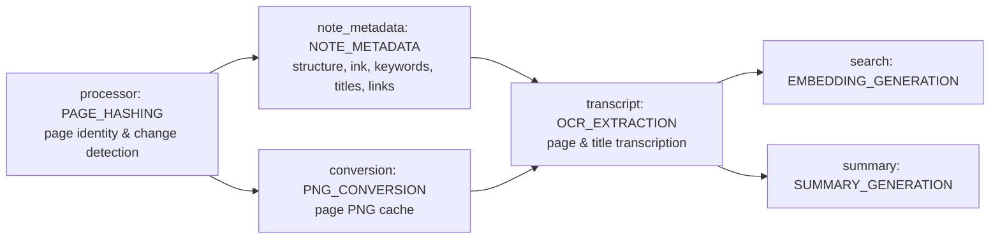

# ADR 0004: Notebook Processing, Metadata, Conversion, and Transcript Component Ownership

- **Status**: Proposed
- **Date**: 2026-11-26
- **Scope**: `supernote.server.components.processor`, `note_metadata` (new), `conversion`, `transcript`, and native notebook title transcription (#501)

---

## 1. Context and Problem

Following [ADR 0001](0001-server-core-component-architecture.md), `ProcessorComponent` ([`supernote/server/components/processor/`](../../../supernote/server/components/processor/__init__.py)) hosts the `"processor"` platform so vertical components (`conversion`, `transcript`, `search`, `summary`) contribute their own `ProcessorModule` stages to a dependency-ordered `TaskGraph`.

However, `processor` still combines the generic pipeline engine with notebook-domain responsibilities that belong in vertical components:

1. **Dual-purpose `PageHashingModule`**: Performs both pipeline change detection (reconciling `NotePageContentDO` page identities, invalidating downstream checkpoints, publishing `NotePagesDeltaEvent`) and structural extraction (persisting `NoteMetadataDO`, `NotePageMetadataDO`, ink/drawable scans, keywords, links, and `NoteTitleDO`).
2. **Domain read & artifact endpoints on `processor`**: Hosts `POST /api/extended/file/note/metadata`, the signed title crop route `GET /api/oss/title/{file_id}/{bitmap_md5}`, and the `get_page_image` MCP tool (which renders and serves page PNGs, overlapping `conversion`'s role).
3. **Unclear home for title transcription (#501)**: Native Supernote titles store cropped handwriting bitmaps (`<TITLEBITMAP>`) rather than plain text. Deciding where title structure lives vs. where handwriting-to-text transcription lives determines whether `note_metadata` stays free of `ai` dependencies and whether title text follows the same separation as page text.

---

## 2. Target Ownership Model

Each component owns one clear domain responsibility with unidirectional dependencies:

| Component | Role | Pipeline Stage Contributed | Data & Artifacts Owned | API / Tool Surface |
| :--- | :--- | :--- | :--- | :--- |
| **`processor`** | **Pipeline engine & change detection**: orchestrates task DAG execution, queues, locks, recovery, and checkpoints. | `PageHashingModule` (`TaskType.PAGE_HASHING`): page list, per-page `content_hash`, `NotePageContentDO` identity reconciliation, checkpoint invalidation, `NotePagesDeltaEvent`. | `f_system_task`; page-identity columns of `f_note_page_content`. | `GET /api/extended/system/tasks`, `POST /api/extended/system/tasks/retry`, `POST /api/extended/file/processing/status`, `/api/admin/{queue,reprocess,tasks}`. |
| **`note_metadata`** *(new)* | **Device-authored notebook structure**: extracts and serves structural metadata written on the Supernote device. | `NoteMetadataModule` (`TaskType.NOTE_METADATA`, file-scoped, depends on `PAGE_HASHING`): parses header/footer/pages, scans ink/drawables, reconciles keywords, links, and titles. | `f_note_metadata`, `f_note_page_metadata`, `f_note_title`; cached title crop PNGs (`{file_id}/titles/{bitmap_md5}.png`). | `POST /api/extended/file/note/metadata`, `GET /api/oss/title/{file_id}/{bitmap_md5}`, `get_title_png_key()`. |
| **`conversion`** | **Rendering & export**: converts `.note` notebooks into images and PDFs and serves cached renders. | `PngConversionModule` (`TaskType.PNG_CONVERSION`, page-scoped, depends on `PAGE_HASHING`). | Cached page PNGs and PDF exports in `CACHE_BUCKET`. | Cover preview, `note/to/png`, `note/to/pdf`, `/api/oss/png/*`, `/api/oss/pdf/*`, **`get_page_image` MCP tool**. |
| **`transcript`** | **Handwriting-to-text transcription**: turns handwritten page images and title crops into readable text. | `OcrModule` (`TaskType.OCR_EXTRACTION`, page-scoped, depends on `PNG_CONVERSION` and `NOTE_METADATA`). | Page transcripts in `f_note_page_content.text_content`; title transcripts in `f_note_title_transcript` keyed by `(user_id, file_id, bitmap_md5)`. | `POST /api/extended/transcript` (page transcripts and title text joined by `bitmapMd5`), transcript MCP tools. |
| **`search`** | **Discovery**: hybrid keyword and semantic search. | `EmbeddingModule` (`TaskType.EMBEDDING_GENERATION`, depends on `OCR_EXTRACTION`). | Embeddings in `f_note_page_content`. | `POST /api/extended/search`, MCP search tools. |
| **`summary`** | **Digests & AI summaries**. | `SummaryModule` (`TaskType.SUMMARY_GENERATION`, depends on `OCR_EXTRACTION`). | Summary tables and `/api/oss/summary/*` renders. | Summary HTTP & MCP endpoints. |

---

## 3. Pipeline DAG and Dependency Direction

Component dependency edges stay strictly acyclic and unidirectional:

- `processor`: `dependencies = ()`
- `note_metadata`: `dependencies = ("processor",)`
- `conversion`: `dependencies = ("ai", "processor")`
- `transcript`: `dependencies = ("ai", "conversion", "note_metadata")`

---

## 4. Key Architectural Decisions

### 4.1 Keep `processor` free of domain knowledge
`PageHashingModule` remains in `processor` solely for page-level change detection so the scheduler knows which pages changed and which checkpoints to invalidate. All structural extraction and read APIs move out so `processor` depends on zero domain components.

### 4.2 Keep artifact download routes next to their owning component
Following the precedent set by `summary` (`/api/oss/summary/*`), `note_metadata` hosts `GET /api/oss/title/{file_id}/{bitmap_md5}` alongside `POST /api/extended/file/note/metadata` and `get_title_png_key()`. This keeps table ownership, crop cache lifecycle, URL signing, and download streaming in one component without reversing the `conversion -> processor` dependency.

### 4.3 Separate title structure (`note_metadata`) from title text (`transcript`)
Mirroring how pages separate structure (`NotePageMetadataDO`) from text (`NotePageContentDO.text_content`):

- `note_metadata` owns what the device wrote: page index, bounding box (`<TITLERECT>`), visual style (`<TITLESTYLE>`), `bitmap_md5`, and the cached crop PNG. It has no `ai` dependency.
- `transcript` owns handwriting transcription for both pages and title crops, reusing the same `ai` OCR model, concurrency limits, and retry behavior.
- Storing title text in `transcript` keyed by `(user_id, file_id, bitmap_md5)` makes transcription follow handwriting automatically across page reorders and edits—eliminating text carry-over logic in `note_metadata` and retiring the unused `f_note_title.text_content` column.
- Clients (including the Web UI Outline) join structure from `note_metadata` with text from `transcript` by `bitmapMd5`, falling back to `imageUrl` when no transcript exists.

### 4.4 Retain the `transcript` component name
The component is named for its domain output (*what the handwriting says*) rather than the current extraction mechanism (*OCR*). Keeping `transcript` preserves stable public API paths (`/api/extended/transcript`), component registry identifiers, and leaves room for non-OCR sources such as native device `RECOGNTEXT` blocks (`supernote.notebook.TextConverter`) in the future.

### 4.5 Explicit Non-Goals
- **Splitting `f_note_page_content`**: `processor`, `transcript`, and `search` continue sharing `f_note_page_content` as today; decomposing that table is out of scope for this ADR.
- **Fixing `TitleMetadata.heading_level`**: Mapping `<TITLESTYLE>` background codes to levels `1..4` is tracked separately from component ownership.

---

## 5. Incremental Migration Plan

Each slice lands as an independent, backward-compatible PR off `main`:

1. **Move `get_page_image` to `conversion`**: Relocate `ProcessorService.get_page_image` and its MCP registration (`processor/mcp.py`) into `conversion`, next to page PNG rendering.
2. **Introduce `note_metadata` (read side)**: Create `supernote/server/components/note_metadata/`, move `get_note_metadata`, `get_title_png_key`, `POST /api/extended/file/note/metadata`, and `GET /api/oss/title/{file_id}/{bitmap_md5}` with no behavior change.
3. **Extract `NoteMetadataModule`**: Split structural parsing and ink/drawable scanning out of `PageHashingModule` into `NoteMetadataModule` (`TaskType.NOTE_METADATA`), add `TaskType.NOTE_METADATA` to `OcrModule.depends_on`, and let `recover_missing_tasks()` backfill existing notes automatically.
4. **Add title transcription in `transcript` (#501)**: Persist title transcripts keyed by `(user_id, file_id, bitmap_md5)`, transcribe uncached title crops via `note_metadata`'s `get_title_png_key()`, drop the unused `f_note_title.text_content` column, and expose title text alongside page transcripts for the Web UI Outline.
