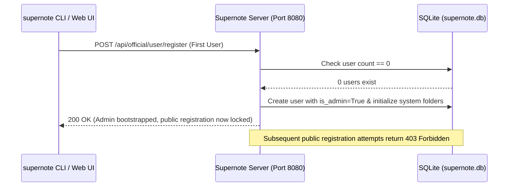

# Self-Hosting & Quickstart Guide

This guide covers deploying **Supernote Private Cloud & Knowledge Hub** (`supernote`), bootstrapping your administrator account, pairing physical Supernote hardware, and configuring reverse proxies and backups.

---

## 1. Deployment Modes & Resource Footprint

The server can run either as a lightweight synchronization target for Supernote hardware or as a full knowledge hub with web previews, vector search, and AI synthesis.

| Deployment Mode | Idle RAM | Peak Active RAM | Capabilities Enabled |
| :--- | :---: | :---: | :--- |
| **Bare Sync Server** | ~133 MB | ~135 MB | Native device synchronization (`Note`, `Document`, `EXPORT`, `INBOX`, `SCREENSHOT`), task/schedule sync, SQLite metadata, content-addressable blob storage. Disables Web UI, background page rasterization, and MCP server. |
| **Full Knowledge Hub** *(Default)* | ~160 MB | ~310 MB | All sync capabilities plus the Web UI dashboard, background `.note` page PNG rasterization, Model Context Protocol (MCP) server (port `8081`), and optional AI pipeline (OCR, summaries, semantic search). |

To run in **Bare Sync Mode** (for low-memory VPS instances or Raspberry Pi deployments):

```yaml
# config/config.yaml
web_enabled: false
mcp_enabled: false
```

Or via environment variables:

```bash
export SUPERNOTE_WEB_ENABLED=false
export SUPERNOTE_MCP_ENABLED=false
```

> [!TIP]
> If you want the Web UI for file and task management without CPU-intensive background notebook rasterization, keep `web_enabled: true` and set `web_notebook_preview: false` (`SUPERNOTE_WEB_NOTEBOOK_PREVIEW=false`). Note that enabling an OCR model (`ai.ocr`) automatically enables PNG page rasterization regardless of `web_notebook_preview`.

---

## 2. Installation & Launch

### Option A: Python CLI (`pip` / `uv`)

Requires **Python 3.13+**.

```bash
# Install server + CLI client/admin tools
pip install "supernote[all]"

# Or install only the server runtime
pip install "supernote[server]"
```

Start the server:

```bash
# Uses ./config/config.yaml and ./storage by default
supernote serve

# Or specify a custom configuration directory
supernote serve --config-dir /etc/supernote
```

For quick local evaluation with a temporary directory and pre-seeded `debug@example.com` (`password`) account:

```bash
supernote serve --ephemeral
```

### Option B: Docker & Docker Compose

The official [`Dockerfile`](https://github.com/allenporter/supernote/blob/main/Dockerfile) runs as a non-root user (`uid=1000`, `gid=1000`), mounts `/data` as a persistent volume, and sets:
- `SUPERNOTE_STORAGE_DIR=/data`
- `SUPERNOTE_CONFIG_DIR=/data/config`
- `SUPERNOTE_HOST=0.0.0.0`
- `SUPERNOTE_PORT=8080`

#### `docker run`

```bash
docker build -t supernote:latest .

docker run -d \
  --name supernote \
  --restart unless-stopped \
  -p 8080:8080 \
  -p 8081:8081 \
  -v "$(pwd)/data:/data" \
  -e SUPERNOTE_GEMINI_API_KEY="your-gemini-api-key" \
  supernote:latest
```

#### `docker-compose.yml`

```yaml
services:
  supernote:
    build: .
    image: supernote:latest
    container_name: supernote
    restart: unless-stopped
    ports:
      - "8080:8080" # Main HTTP API, Web UI, Socket.IO, OAuth 2.1 AS
      - "8081:8081" # MCP Streamable HTTP Resource Server (/mcp)
    volumes:
      - ./data:/data
    environment:
      SUPERNOTE_STORAGE_DIR: /data
      SUPERNOTE_CONFIG_DIR: /data/config
      SUPERNOTE_PROXY_MODE: relaxed
      # Optional: Cloud AI key (or configure ai.* in /data/config/config.yaml)
      # SUPERNOTE_GEMINI_API_KEY: "AIzaSy..."
```

> [!IMPORTANT]
> Ensure the host directory mounted to `/data` is writable by UID/GID `1000:1000` (`chown -R 1000:1000 ./data`).

---

## 3. The "Admin-First" Bootstrap Model

`supernote` uses a zero-config **Admin-First** security model controlled by `supernote.server.config.AuthConfig`:



1. **Empty Server**: When the database has zero users, public registration is open for a single registration request.
2. **First User Becomes Admin**: The first account registered is automatically granted administrator privileges (`is_admin=True`) and its default VFS folders (`NOTE`, `DOCUMENT`, `EXPORT`, `INBOX`, `SCREENSHOT`) are provisioned.
3. **Automatic Lockdown**: As soon as one user exists, public registration closes automatically (unless `auth.enable_registration: true` / `SUPERNOTE_ENABLE_REGISTRATION=true` is explicitly set).
4. **Adding Subsequent Users**: Additional accounts must be created by an authenticated administrator.

### Step-by-Step Bootstrap via CLI

#### 1. Register the initial administrator

```bash
supernote admin --url http://localhost:8080 user add you@example.com --name "Admin"
```

You will be prompted interactively for a password (or pass `--password`). Because no users exist yet, `supernote admin user add` registers the account via the bootstrap registration endpoint and promotes it to administrator.

#### 2. Authenticate your CLI session

```bash
supernote cloud login you@example.com --url http://localhost:8080
```

This authenticates against the server and caches your session token in `~/.cache/supernote.pkl` so subsequent `supernote admin` and `supernote cloud` commands do not require `--url` or re-entering credentials.

#### 3. Manage users & inspect server state

```bash
# Add another user (uses Admin API now that public registration is closed)
supernote admin user add teammate@example.com --name "Teammate"

# List all registered accounts and storage quotas
supernote admin user list

# Reset a user's password
supernote admin user reset-password teammate@example.com

# Check background processing queue status
supernote admin queue status
```

---

## 4. Connecting a Physical Supernote Device

Compatible with **Supernote Nomad (A6 X2)**, **A5 X2 Manta**, **A5 X**, and **A6 X** running firmware with Private Cloud support.

1. **Connect to Network**: Ensure your Supernote tablet can reach your server over LAN, VPN (e.g., Tailscale/WireGuard), or HTTPS reverse proxy.
2. **Select Private Cloud**:
   - On the device, swipe down from the top menu and tap **Settings** (gear icon).
   - Navigate to **Sync** -> **Supernote Cloud**.
   - Select **Private Cloud**.
3. **Enter Server Address**:
   - Enter your server URL, e.g. `http://192.168.1.50:8080` or `https://supernote.example.com`.
   - Log in with the email and password you created in Step 3.
4. **Select Folders to Sync**:
   - Navigate to **Settings** -> **Sync** (or **Drive** -> **Private Cloud**).
   - Toggle synchronization for the folders you want replicated (`Note`, `Document`, `EXPORT`, `INBOX`, `SCREENSHOT`).
5. **Trigger Sync**:
   - Tap the **Sync** icon in the top pull-down bar on your tablet.

### How Device Synchronization Works

- **System Directory Mapping**: Physical devices organize files under root category containers (`NOTE/Note`, `NOTE/MyStyle`, `DOCUMENT/Document`, `EXPORT`, `INBOX`, `SCREENSHOT`). The server's Virtual File System (VFS) preserves this exact hierarchy for hardware compatibility while presenting a clean view in the Web UI.
- **Real-Time Push Notifications**: Connected tablets maintain a persistent Socket.IO connection (`/socket.io/`, supporting both Engine.IO v3 and v4 via `socketio_compat_middleware`). When files or tasks change on the server, the server broadcasts change events to trigger automatic device sync.
- **Deferred Processing During Sync**: While a multi-file sync session is in progress, the background processor defers heavy `.note` processing until the device signals sync completion, preventing CPU/IO contention during uploads.

---

## 5. Reverse Proxy & TLS Setup

When exposing `supernote` behind Nginx, Caddy, or Traefik, configure the external URLs and proxy header trust in `supernote.server.config.ServerConfig`.

### Key Proxy Settings

| YAML Key | Environment Variable | Purpose |
| :--- | :--- | :--- |
| `base_url` | `SUPERNOTE_BASE_URL` | External URL of the main server (e.g. `https://notes.example.com`). Used for signed OSS download/upload URLs and the MCP OAuth 2.1 Authorization Server issuer. When unset, signed file URLs dynamically derive their scheme/host from the incoming request (including `X-Forwarded-Proto` / `X-Forwarded-Host` when `proxy_mode` is enabled). |
| `mcp_base_url` | `SUPERNOTE_MCP_BASE_URL` | External URL of the MCP server (e.g. `https://mcp.notes.example.com` or `http://localhost:8081`). Used for RFC 9728 OAuth Protected Resource discovery. |
| `proxy_mode` | `SUPERNOTE_PROXY_MODE` | Controls `X-Forwarded-*` header trust: `null`/`disabled` (default, ignores proxy headers), `relaxed` (trusts immediate upstream proxy and relaxes MCP DNS rebinding protection), or `strict` (trusts only IPs in `trusted_proxies`). |
| `trusted_proxies` | `SUPERNOTE_TRUSTED_PROXIES` | Comma-separated list of proxy IPs/CIDRs trusted when `proxy_mode: strict` (default: `["127.0.0.1", "::1", "172.17.0.0/16"]`). |

### Proxy Requirements

1. **Large File Uploads**: The server allows uploads up to **1 GB** (`MAX_UPLOAD_SIZE = 1024 * 1024 * 1024`). Increase your reverse proxy's body size limit (e.g., `500M` or `1G`) so large `.note` files and PDFs are not rejected with `413 Payload Too Large`.
2. **WebSockets (`/socket.io/`)**: Enable HTTP/1.1 `Upgrade` and `Connection` headers on `/socket.io/` for real-time device and Web UI notifications.
3. **Streaming HTTP (`/mcp`)**: If proxying port `8081` for remote MCP clients, disable response buffering on `/mcp` so Server-Sent Events (SSE) and Streamable HTTP chunks flush immediately.

### Example: Caddy (`Caddyfile`)

```caddyfile
notes.example.com {
    request_body {
        max_size 1GB
    }
    reverse_proxy supernote:8080
}

mcp.notes.example.com {
    reverse_proxy supernote:8081 {
        flush_interval -1
    }
}
```

### Example: Nginx (`nginx.conf`)

```nginx
server {
    listen 443 ssl http2;
    server_name notes.example.com;

    # Allow large notebook and PDF uploads (server supports up to 1 GB)
    client_max_body_size 1G;

    location / {
        proxy_pass http://127.0.0.1:8080;
        proxy_set_header Host $host;
        proxy_set_header X-Real-IP $remote_addr;
        proxy_set_header X-Forwarded-For $proxy_add_x_forwarded_for;
        proxy_set_header X-Forwarded-Proto $scheme;
        proxy_set_header X-Forwarded-Host $host;
    }

    location /socket.io/ {
        proxy_pass http://127.0.0.1:8080/socket.io/;
        proxy_http_version 1.1;
        proxy_set_header Upgrade $http_upgrade;
        proxy_set_header Connection "upgrade";
        proxy_set_header Host $host;
        proxy_set_header X-Forwarded-For $proxy_add_x_forwarded_for;
        proxy_set_header X-Forwarded-Proto $scheme;
        proxy_read_timeout 86400s;
    }
}
```

---

## 6. Storage Layout & Backups

All persistent state lives inside `storage_dir` (`./storage` locally or `/data` in Docker):

```text
storage/
├── system/
│   ├── supernote.db          # SQLite database (users, VFS tree, tasks, OCR text, embeddings, summaries)
│   └── trace.log             # Structured HTTP request/response trace log (redacted by default)
├── supernote-user-data/      # Content-addressable user blobs sharded by 2-char prefix
│   ├── 0a/
│   │   └── 0a1b2c...         # Immutable raw .note, PDF, EPUB, PNG files
│   └── ...
├── supernote-cache/          # Derived artifacts (rasterized page PNGs)
│   ├── 1f/
│   │   └── 1f9e8d...
│   └── ...
└── temp/                     # Staging directory for atomic uploads (.tmp files, auto-cleaned after 24h)
```

### Safe Backup Procedure

Because the VFS metadata in `system/supernote.db` references content-addressable blobs in `supernote-user-data/`, back up both together:

1. **Online SQLite Backup**: Use `sqlite3` to take a transactionally consistent snapshot of `supernote.db` before copying blobs:
   ```bash
   sqlite3 storage/system/supernote.db ".backup '/backups/supernote.db'"
   rsync -a --delete storage/supernote-user-data/ /backups/supernote-user-data/
   rsync -a --delete config/ /backups/config/
   ```
   *(Note: `supernote-cache/` and `temp/` can be excluded from backups; missing page PNGs in `supernote-cache/` are automatically re-rendered on demand).*

2. **Verify Storage Integrity**: Run the built-in two-way integrity checker at any time to verify that every VFS database node matches its physical blob on disk (and vice versa):
   ```bash
   supernote admin integrity --full-disk
   ```
