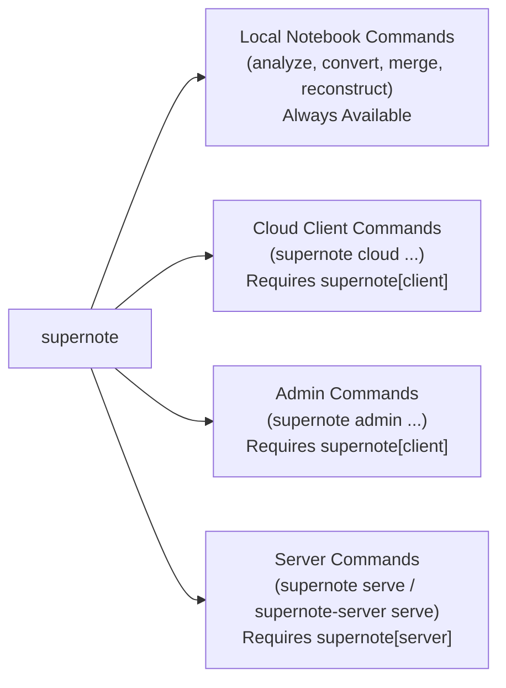

# CLI Reference

The `supernote` package provides two command-line entry points:

- **`supernote`**: Unified toolkit for parsing local `.note` files, running the self-hosted server, interacting with a Supernote Cloud server, and administering users, tasks, and storage.
- **`supernote-server`**: Dedicated entry point for starting the self-hosted Supernote Private Cloud server (`supernote-server serve`).

---

## Installation & Optional Extras

`supernote.cli.main` loads command groups lazily so you can install only the dependencies you need:

| Installation Command | Enabled CLI Commands | Included Dependencies |
| :--- | :--- | :--- |
| `pip install supernote` | `analyze`, `convert`, `merge`, `reconstruct` | Core notebook parser & converters (`Pillow`, `reportlab`, `svgwrite`, `potracer`, `numpy`, `colour`) |
| `pip install "supernote[client]"` | Above + `cloud`, `admin` | `aiohttp`, `mashumaro`, `python-socketio`, `requests`, `tqdm` |
| `pip install "supernote[server]"` | Above + `serve` (and `supernote-server`) | `aiohttp`, `SQLAlchemy[asyncio]`, `aiosqlite`, `alembic`, `PyJWT`, `google-genai`, `mcp`, `prometheus-client`, `ical` |
| `pip install "supernote[all]"` | All commands (`analyze`, `convert`, `merge`, `reconstruct`, `cloud`, `admin`, `serve`) | Both `client` and `server` extras |

If you invoke a subcommand whose optional extra is not installed, the CLI prints the exact `pip install 'supernote[...]'` command needed to enable it.



---

## Local Notebook Commands

Implemented in `supernote.cli.notebook` using the `supernote.notebook` parser and converter APIs. These commands operate directly on local `.note` files and require no network access or optional extras.

### `supernote analyze`

Inspect the internal metadata structure (header, footer, page blocks, layer offsets, titles, keywords, and links) of a `.note` file and print it as formatted JSON.

```bash
supernote analyze <input> [--policy {strict,loose}]
```

| Argument / Option | Default | Description |
| :--- | :--- | :--- |
| `input` | *(required)* | Path to the input `.note` file. |
| `--policy {strict,loose}` | `strict` | Signature validation policy passed to `supernote.notebook.parse_metadata`. Use `loose` to inspect files produced by newer firmware versions whose `SN_FILE_VER_...` signature is not yet in the strict allowlist. |

**Examples:**

```bash
# Dump full metadata structure as pretty-printed JSON
supernote analyze Meeting_Notes.note

# Inspect a notebook from beta firmware using loose signature validation
supernote analyze --policy loose New_Firmware.note | jq '.__header__'
```

---

### `supernote convert`

Convert a single page or all pages of a `.note` file into PNG, SVG, PDF, or plain text (`txt`).

```bash
supernote convert <input> <output> \
  [-t {png,svg,pdf,txt}] \
  [-n NUMBER] [-a] \
  [-c COLOR] \
  [--exclude-background] \
  [--pdf-type {original}] \
  [--no-link] \
  [--add-keyword] \
  [--text-page-separator SEPARATOR] \
  [--policy {strict,loose}]
```

| Argument / Option | Default | Description |
| :--- | :--- | :--- |
| `input` | *(required)* | Path to the input `.note` file. |
| `output` | *(required)* | Output file path. When converting multiple pages (`-a`) to `png` or `svg`, a zero-padded page index is inserted before the extension (e.g., `out.png` becomes `out_0.png`, `out_1.png`, ...). |
| `-t`, `--type {png,svg,pdf,txt}` | `png` | Target conversion format (`supernote.notebook.ImageConverter`, `supernote.notebook.SvgConverter`, `supernote.notebook.PdfConverter`, or `supernote.notebook.TextConverter`). |
| `-n`, `--number NUMBER` | `0` | 0-based page index to convert when `-a` is not set. |
| `-a`, `--all` | `False` | Convert all pages in the notebook. |
| `-c`, `--color COLOR` | None | Remap the 4 Supernote grayscale shades using 4 comma-separated CSS/hex color strings in the order: `black,darkgray,gray,white` (parsed via `supernote.notebook.ColorPalette`). |
| `--exclude-background` | `False` | Hide the background template layer (`BGLAYER`) using `supernote.notebook.VisibilityOverlay` and make the background transparent (supported for `png` and `svg`). |
| `--pdf-type {original}` | `original` | PDF rendering pipeline mode (raster image pages on A4 canvas). |
| `--no-link` | `False` | Disable interactive internal page links and external web links when exporting to `pdf`. |
| `--add-keyword` | `False` | Annotate recognized Supernote keywords as PDF text annotations on their bounding boxes when exporting to `pdf`. |
| `--text-page-separator SEPARATOR` | `""` | Separator string inserted between pages when exporting all pages (`-a -t txt`) from a real-time recognition notebook. |
| `--policy {strict,loose}` | `strict` | Parser signature policy (`strict` or `loose`). |

**Examples:**

```bash
# Convert page 0 (default) to a PNG image
supernote convert lecture.note page0.png

# Convert all pages to numbered PNGs (lecture_0.png, lecture_1.png, ...) with a transparent background
supernote convert lecture.note lecture.png -a -t png --exclude-background

# Convert page 2 to vector SVG with a custom solarized palette (black, darkgray, gray, white)
supernote convert sketch.note sketch.svg -n 2 -t svg -c "#073642,#586e75,#93a1a1,#fdf6e3"

# Export an entire notebook to PDF with clickable links and keyword annotations enabled
supernote convert project.note project.pdf -a -t pdf --add-keyword

# Extract embedded real-time recognition text from all pages with a Markdown page divider
supernote convert journal.note journal.txt -a -t txt --text-page-separator "---"
```

---

### `supernote merge`

*(Experimental)* Merge multiple `.note` files sequentially into a single `.note` file using `supernote.notebook.merge`. Both notebooks must share the latest supported X-series file signature (`SN_FILE_VER_20260016`) and matching device header attributes (`APPLY_EQUIPMENT`, `DEVICE_DPI`, `FILE_PARSE_TYPE`, etc.).

```bash
supernote merge <input> [<input> ...] <output>
```

**Example:**

```bash
# Combine three weekly notebooks into a single monthly notebook
supernote merge week1.note week2.note week3.note month_combined.note
```

---

### `supernote reconstruct`

*(Experimental)* Disassemble and rebuild a `.note` file in memory using `supernote.notebook.reconstruct` to validate binary block offsets and parser/builder symmetry.

```bash
supernote reconstruct <input> <output>
```

**Example:**

```bash
supernote reconstruct original.note rebuilt.note
```

---

## Server Commands

Implemented in `supernote.cli.server`. You can start the server via either `supernote serve` or `supernote-server serve`.

```bash
supernote serve [--config-dir CONFIG_DIR] [--ephemeral]
# or equivalently:
supernote-server serve [--config-dir CONFIG_DIR] [--ephemeral]
```

| Option | Default | Description |
| :--- | :--- | :--- |
| `--config-dir CONFIG_DIR` | `config/` | Directory containing `config.yaml` (can also be overridden via environment variables such as `SUPERNOTE_STORAGE_DIR`, `SUPERNOTE_PORT`, `SUPERNOTE_HOST`, and `SUPERNOTE_GEMINI_API_KEY`). |
| `--ephemeral` | `False` | Run in an isolated temporary directory (`supernote-ephemeral-*`) on `127.0.0.1:8080` (or `SUPERNOTE_HOST`:`SUPERNOTE_PORT`) and automatically bootstrap a default admin account (`debug@example.com` / `password`). All data is deleted when the process exits. |

**Examples:**

```bash
# Start production server using ./config/config.yaml
supernote serve --config-dir /etc/supernote

# Start an isolated ephemeral development server with AI processing enabled
export SUPERNOTE_GEMINI_API_KEY="AIzaSy..."
supernote serve --ephemeral
```

---

## Cloud Client Commands

Implemented in `supernote.cli.client` on top of `supernote.client.Supernote`, `supernote.client.device.DeviceClient`, `supernote.client.extended.ExtendedClient`, and `supernote.client.socket.SupernoteSocketClient`.

### Credential Caching (`~/.cache/supernote.pkl`)

When you authenticate with `supernote cloud login`, the CLI persists your access token and server URL to `~/.cache/supernote.pkl` via `supernote.client.auth.FileCacheAuth`. Subsequent `supernote cloud ...` and `supernote admin ...` commands automatically load the cached token and server URL from `~/.cache/supernote.pkl`, so you do not need to pass `--url` or re-enter your password on every command.

---

### `supernote cloud login`

Authenticate with a Supernote Cloud or self-hosted server using the challenge-response SHA-256/MD5 handshake, save credentials to `~/.cache/supernote.pkl`, and run sanity checks (`query_user` and `list_folder("/")`). If the server requires SMS verification, the CLI interactively prompts for the verification code.

```bash
supernote cloud login <email> --url <URL> [--password PASSWORD] [-v]
```

| Argument / Option | Default | Description |
| :--- | :--- | :--- |
| `email` | *(required)* | Account email address. |
| `--url URL` | *(required)* | Base URL of the Supernote server (e.g., `http://127.0.0.1:8080`). |
| `--password PASSWORD` | Interactive prompt | Account password. Omit to enter securely via hidden terminal prompt. |
| `-v`, `--verbose` | `False` | Enable debug logging for `supernote` and `aiohttp`. |

**Example:**

```bash
supernote cloud login alice@example.com --url http://127.0.0.1:8080
```

---

### `supernote cloud ls`

List files and folders at a remote VFS path via `supernote.client.device.DeviceClient.list_folder`.

```bash
supernote cloud ls [path] [-v]
```

**Examples:**

```bash
# List root directory
supernote cloud ls

# List contents of /NOTE/Note
supernote cloud ls /NOTE/Note
```

---

### `supernote cloud upload`

Upload a local file to the Supernote server using the 3-step `apply -> OSS upload -> finish` protocol (`supernote.client.device.DeviceClient.upload_content`).

```bash
supernote cloud upload <local_path> [remote_path] [-v]
```

- If `remote_path` is omitted, the file is uploaded to `/<basename>`.
- If `remote_path` ends with `/`, the local filename is appended to that folder path.

**Examples:**

```bash
# Upload to root (/Meeting.note)
supernote cloud upload ./Meeting.note

# Upload into a specific remote directory
supernote cloud upload ./Meeting.note /NOTE/Note/
```

---

### `supernote cloud download`

Download a file from the Supernote server to the local filesystem via `supernote.client.device.DeviceClient.download_content`.

```bash
supernote cloud download <remote_path> [local_path] [-v]
```

- If `local_path` is omitted, saves to `./<basename>` in the current working directory.
- If `local_path` is an existing local directory, saves the file inside that directory.

**Examples:**

```bash
# Download to ./Meeting_Notes.note
supernote cloud download /NOTE/Note/Meeting_Notes.note

# Download to a specific local file path
supernote cloud download /NOTE/Note/Meeting_Notes.note ./backups/2026-10-26-meeting.note
```

---

### `supernote cloud mkdir` & `supernote cloud rm`

Create a remote VFS folder (`supernote.client.device.DeviceClient.create_folder`) or delete a remote file/folder by path (`supernote.client.device.DeviceClient.delete_by_path`).

```bash
supernote cloud mkdir <path> [-v]
supernote cloud rm <path> [-v]
```

**Examples:**

```bash
supernote cloud mkdir /NOTE/Projects
supernote cloud rm /NOTE/Projects/Old_Draft.note
```

---

### `supernote cloud insights`

Fetch and display OCR transcripts and AI-generated synthesis summaries for a `.note` file on the server via `supernote.client.extended.ExtendedClient.list_summaries`.

```bash
supernote cloud insights <path> [-v]
```

**Example:**

```bash
supernote cloud insights /NOTE/Note/Weekly_Journal.note
```

---

### `supernote cloud search`

Run a semantic vector search across all indexed notebook pages using `supernote.client.extended.ExtendedClient.search`. Returns ranked page matches with relevance percentages, inferred page dates, and text previews.

```bash
supernote cloud search <query> \
  [--top-n TOP_N] \
  [--name-filter NAME_FILTER] \
  [--after YYYY-MM-DD] \
  [--before YYYY-MM-DD] \
  [-v]
```

| Argument / Option | Default | Description |
| :--- | :--- | :--- |
| `query` | *(required)* | Natural-language search query. |
| `--top-n TOP_N` | `5` | Maximum number of page chunks to return. |
| `--name-filter NAME_FILTER` | None | Case-insensitive substring filter on the `.note` filename. |
| `--after YYYY-MM-DD` | None | Only include pages whose inferred date is on or after `YYYY-MM-DD`. |
| `--before YYYY-MM-DD` | None | Only include pages whose inferred date is on or before `YYYY-MM-DD`. |
| `-v`, `--verbose` | `False` | Enable debug logging. |

**Examples:**

```bash
# Search across all notebooks
supernote cloud search "Q3 architecture milestones and database migration"

# Narrow search by notebook name and date window
supernote cloud search "action items" \
  --top-n 10 \
  --name-filter "Meeting" \
  --after 2026-01-01 \
  --before 2026-06-30
```

---

### `supernote cloud socket`

Connect to the server's real-time Socket.IO endpoint using `supernote.client.socket.SupernoteSocketClient`, verify `ratta_ping` and `ClientMessage` (`status`) heartbeats, and stream live push notifications (`FILE-SYN`, `TASK-SYN`, `DIGEST-SYN`).

```bash
supernote cloud socket [--duration DURATION] [--type TYPE] [-v]
```

| Option | Default | Description |
| :--- | :--- | :--- |
| `--duration DURATION` | `10.0` | Seconds to listen for events before disconnecting (`0` to listen indefinitely until `Ctrl+C`). |
| `--type TYPE` | `ANDROID` | Handshake connection `type` parameter used in HMAC signature calculation (`supernote.server.socket_auth.compute_handshake_signature`). |
| `-v`, `--verbose` | `False` | Enable debug logging. |

**Example:**

```bash
# Listen indefinitely for real-time file, schedule, and digest sync events
supernote cloud socket --duration 0
```

---

### `supernote cloud seed`

Populate a local development server with standard Supernote directories (`/NOTE`, `/DOCUMENT`, `/EXPORT`, `/SCREENSHOT`, `/INBOX`), sample `.note` files from `tests/testdata/`, and sample schedule task groups and tasks via `supernote.client.schedule.ScheduleClient`.

```bash
supernote cloud seed \
  [--url URL] \
  [--email EMAIL] \
  [--password PASSWORD] \
  [-v]
```

| Option | Default | Description |
| :--- | :--- | :--- |
| `--url URL` | `http://127.0.0.1:8080` | Target development server URL. |
| `--email EMAIL` | `debug@example.com` | Account email (auto-registered if not yet present). |
| `--password PASSWORD` | `password` | Account password. |
| `-v`, `--verbose` | `False` | Enable debug logging. |

---

## Admin Commands

Implemented in `supernote.cli.admin` using `supernote.client.admin.AdminClient`. Admin commands use the cached credentials in `~/.cache/supernote.pkl` (or `--url <URL>` if specified on `supernote admin --url <URL> ...`). Note that the first user registered on a fresh server is automatically granted admin privileges.

```bash
supernote admin [--url URL] <subcommand> ...
```

### User Management (`supernote admin user`)

Manage accounts on the server (`list`, `add`, `reset-password`).

```bash
# List all registered users and their storage capacity
supernote admin user list

# Create a new user (attempts public registration first, then falls back to Admin API)
supernote admin user add <email> [--password PASSWORD] [--name DISPLAY_NAME]

# Reset a user's password as an administrator (prompts interactively if --password is omitted)
supernote admin user reset-password <email> [--password PASSWORD]
```

**Examples:**

```bash
supernote admin --url http://127.0.0.1:8080 user list
supernote admin user add bob@example.com --name "Bob Smith"
supernote admin user reset-password bob@example.com
```

---

### Queue Management (`supernote admin queue`)

Inspect, pause, or resume the background `ProcessorService` worker queue on the server. Pausing state is persisted in `CoordinationService` across restarts.

```bash
# Show whether the queue is RUNNING or PAUSED, queue depth, and currently processing file IDs
supernote admin queue status

# Pause background note processing
supernote admin queue stop

# Resume background note processing and immediately trigger task recovery
supernote admin queue start
```

---

### Task Inspection (`supernote admin tasks`)

Inspect background processing records in `f_system_task` (`SystemTaskDO`) with optional filtering by status, task type, or file ID.

```bash
supernote admin tasks \
  [--status {pending,processing,completed,failed}] \
  [--type {hashing,png,ocr,embedding,summary,png_conversion,ocr_extraction,embedding_generation,summary_generation}] \
  [--file-id FILE_ID] \
  [--limit LIMIT] \
  [--json]
```

| Option | Default | Description |
| :--- | :--- | :--- |
| `--status` | None (all) | Filter by `ProcessingStatus` (`pending`, `processing`, `completed`, `failed`). |
| `--type` | None (all) | Filter by `TaskType` friendly name (`hashing`, `png`, `ocr`, `embedding`, `summary`) or raw enum value. |
| `--file-id FILE_ID` | None (all) | Filter tasks belonging to a specific VFS file ID. |
| `--limit LIMIT` | `100` | Maximum number of tasks to return (ordered by most recently updated). |
| `--json` | `False` | Emit the raw `SystemTaskListVO` payload as JSON. |

---

### Note Reprocessing (`supernote admin reprocess`)

Force the server's `ProcessorService` to re-run specific processing stages (or the entire pipeline) for a single `.note` file or across all `.note` files by clearing their `SystemTaskDO` completion checkpoints.

```bash
supernote admin reprocess \
  [--type {all,hashing,png,ocr,embedding,summary}] \
  [--file-id FILE_ID]
```

| Option | Default | Description |
| :--- | :--- | :--- |
| `--type` | `summary` | Stage to clear and reprocess: `all`, `hashing`, `png`, `ocr`, `embedding`, or `summary`. |
| `--file-id FILE_ID` | None (all files) | Target a single `.note` file ID; omit to reprocess all active `.note` files. |

---

### Storage Integrity Verification (`supernote admin integrity`)

Run a comprehensive consistency check across the Virtual File System (`f_user_file`), recycle bin (`f_recycle_file`), summaries (`f_summary`), note processing tables (`f_note_page_content`, `f_system_task`), and physical content-addressable blob storage (`USER_DATA_BUCKET` and `CACHE_BUCKET`). Exits with status code `1` if any integrity issues are detected.

```bash
supernote admin integrity (--email EMAIL | --full-disk) [--file-id FILE_ID] [--json]
```

| Option | Default | Description |
| :--- | :--- | :--- |
| `--email EMAIL` | *(mutually exclusive with `--full-disk`)* | Check VFS nodes, blobs, and pipeline state for a single user. |
| `--full-disk` | *(mutually exclusive with `--email`)* | Perform a global two-way check across all users, database tables, and on-disk storage buckets (including unreferenced blob detection). |
| `--file-id FILE_ID` | None | Restrict `--email` verification to a single VFS file ID. |
| `--json` | `False` | Output the `IntegrityReportVO` as formatted JSON. |

---

### Admin Workflow: Diagnosing & Recovering Failed AI Tasks

Below is a typical administrative workflow for inspecting storage health, diagnosing failed OCR/summary tasks, and triggering recovery:

```bash
# 1. Check background processor queue status
supernote admin queue status

# 2. Inspect any failed background tasks across the server
supernote admin tasks --status failed

# 3. Inspect all pipeline stages for a specific notebook (e.g., file_id=1042)
supernote admin tasks --file-id 1042

# 4. Re-trigger OCR and downstream embedding/summary generation for that file
supernote admin reprocess --type ocr --file-id 1042
supernote admin reprocess --type embedding --file-id 1042
supernote admin reprocess --type summary --file-id 1042

# Or reset the entire pipeline for file 1042 in one command:
supernote admin reprocess --type all --file-id 1042

# 5. Verify two-way VFS, pipeline, and disk blob integrity
supernote admin integrity --full-disk
```
