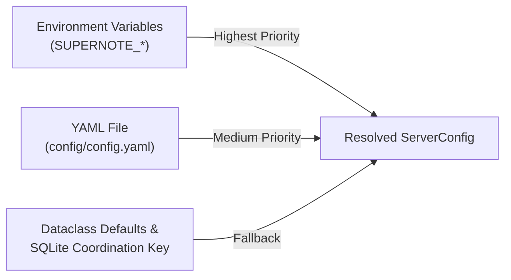

# Configuration Reference

The Supernote Private Cloud server is configured via a YAML configuration file (`config/config.yaml` by default) and `SUPERNOTE_*` environment variables, parsed and validated by `supernote.server.config.ServerConfig`.

---

## 1. Configuration Resolution & Priority

When `supernote.server.config.ServerConfig.load` runs at server startup:

1. **Config File Discovery**:
   - Checks `--config-dir` CLI flag, or `SUPERNOTE_CONFIG_DIR` environment variable (defaults to `config` locally, `/data/config` in Docker).
   - Reads `<config_dir>/config.yaml` if it exists. If `<config_dir>/config.yaml` does not exist, the server writes the resolved configuration to `<config_dir>/config.yaml` on first startup.
2. **Environment Variable Overrides**:
   - Any `SUPERNOTE_*` environment variable overrides the corresponding value from `config.yaml`.
3. **Database Fallbacks**:
   - If `auth.secret_key` (`SUPERNOTE_JWT_SECRET`) is not provided via environment variable or `config.yaml`, `supernote.server.services.user.UserService` automatically generates and persists a random secret key inside the SQLite coordination store (`storage/system/supernote.db`) so tokens survive restarts without manual secret management.



> [!NOTE]
> Boolean environment variables accept `"true"`, `"1"`, `"yes"`, or `"on"` (case-insensitive) as `True`, and any other value as `False`.

---

## 2. Complete `config.yaml` Examples

### Example 1: Zero-Config / Bare Sync Server

Minimal memory footprint (~135 MB RAM). Synchronizes notebooks, documents, and tasks with physical Supernote hardware while disabling the Web UI, background page rasterization, and MCP server.

```yaml
host: 0.0.0.0
port: 8080
storage_dir: storage

web_enabled: false
web_notebook_preview: false
mcp_enabled: false
metrics_enabled: false

auth:
  enable_registration: false
  enable_remote_password_reset: false
```

### Example 2: Full Knowledge Hub with Cloud AI — Google Gemini (Recommended)

Enables the Web UI, MCP server on port `8081`, and background AI pipeline using Google Gemini for handwriting OCR, structured notebook summaries, and vector embeddings. We generally recommend Gemini for its strong multimodal handwriting capabilities and low cost (quality for summaries and OCR extraction may be lower when using other OpenAI-compatible or local models).

```yaml
host: 0.0.0.0
port: 8080
mcp_enabled: true
mcp_port: 8081
storage_dir: storage
web_enabled: true
web_notebook_preview: true

ai:
  providers:
    gemini:
      api_key: "AIzaSyYourGeminiApiKey"
  ocr:
    provider: gemini
    model: gemini-3.6-flash
    max_concurrency: 5
  summary:
    provider: gemini
    model: gemini-3.6-flash
    max_concurrency: 5
  embedding:
    provider: gemini
    model: gemini-embedding-001
    max_concurrency: 5
```

### Example 3: Local AI (Ollama / vLLM / LM Studio via `openai` Provider)

Runs 100% locally with zero external API calls using any OpenAI-compatible inference server (`openai` provider). You can also mix providers per capability (e.g., local embeddings with cloud OCR, or omitting `summary` while keeping `ocr` and `embedding`).

```yaml
host: 0.0.0.0
port: 8080
mcp_enabled: true
mcp_port: 8081
storage_dir: storage

ai:
  providers:
    openai:
      # When running Ollama on the host machine:
      # - Native Python: http://localhost:11434/v1
      # - Inside Docker: http://host.docker.internal:11434/v1
      base_url: "http://localhost:11434/v1"
      # api_key: "sk-..." # Optional for local servers; required for hosted OpenAI
  ocr:
    provider: openai
    model: gemma3:27b
    max_concurrency: 1
  summary:
    provider: openai
    model: gemma3:27b
    max_concurrency: 1
  embedding:
    provider: openai
    model: embeddinggemma
    max_concurrency: 1
```

> [!TIP]
> **Docker to Host Ollama**: When running `supernote` inside Docker and Ollama on the Docker host, set `base_url: "http://host.docker.internal:11434/v1"` and add `extra_hosts: ["host.docker.internal:host-gateway"]` to your `docker-compose.yml`.

### Example 4: Reverse-Proxied Production Setup with Webhooks

Configured for deployment behind an HTTPS reverse proxy (Caddy/Nginx/Traefik) with custom prompts and signed outbound webhooks.

```yaml
host: 0.0.0.0
port: 8080
mcp_enabled: true
mcp_port: 8081
base_url: "https://notes.example.com"
mcp_base_url: "https://mcp.notes.example.com"
proxy_mode: strict
trusted_proxies:
  - "127.0.0.1"
  - "::1"
  - "172.18.0.0/16"

storage_dir: /data
prompts_dir: /data/config/prompts
metrics_enabled: true
metrics_path: /metrics

auth:
  expiration_hours: 24
  device_expiration_hours: 87600
  enable_registration: false
  enable_remote_password_reset: false

ai:
  providers:
    gemini:
      api_key: "AIzaSyYourGeminiApiKey"
  ocr:
    provider: gemini
    model: gemini-3.6-flash
    max_concurrency: 5
  summary:
    provider: gemini
    model: gemini-3.6-flash
    max_concurrency: 5
  embedding:
    provider: gemini
    model: gemini-embedding-001
    max_concurrency: 5

webhooks:
  enabled: true
  endpoints:
    - url: "https://homeassistant.example.com/api/webhook/supernote"
      user: "you@example.com"
      secret: "replace-with-32-byte-random-hex-secret"
      events:
        - "note.sync_completed"
        - "note.processing_completed"
```

---

## 3. Top-Level Server Settings (`supernote.server.config.ServerConfig`)

| YAML Key | Environment Variable | Type | Default | Description |
| :--- | :--- | :--- | :--- | :--- |
| `host` | `SUPERNOTE_HOST` | `str` | `"0.0.0.0"` | Network interface address to bind both the main HTTP server and MCP server. |
| `port` | `SUPERNOTE_PORT` | `int` | `8080` | TCP port for the main HTTP server (Device API, Web UI, Socket.IO, OAuth 2.1 Authorization Server). |
| `mcp_enabled` | `SUPERNOTE_MCP_ENABLED` | `bool` | `true` | Enables the Model Context Protocol (MCP) server on `mcp_port` and mounts OAuth 2.1 endpoints on `port`. |
| `mcp_port` | `SUPERNOTE_MCP_PORT` | `int` | `8081` | TCP port for the Streamable HTTP MCP Resource Server (`/mcp`). |
| `base_url` | `SUPERNOTE_BASE_URL` *(or legacy `SUPERNOTE_AUTH_URL_BASE`)* | `str \| None` | `None` *(falls back to `http://<host>:<port>`)* | Publicly reachable base URL of the main server (port `8080`). Used as the OAuth 2.1 issuer URL and for signed OSS URLs when set. |
| `mcp_base_url` | `SUPERNOTE_MCP_BASE_URL` | `str \| None` | `None` *(falls back to `http://<host>:<mcp_port>`)* | Publicly reachable base URL of the MCP server (port `8081`). Used in RFC 9728 Protected Resource metadata (`/.well-known/oauth-protected-resource`). |
| `storage_dir` | `SUPERNOTE_STORAGE_DIR` | `str` | `"storage"` *(`"/data"` in Docker)* | Root directory for SQLite (`system/supernote.db`), trace logs, user file blobs (`supernote-user-data/`), and PNG cache (`supernote-cache/`). |
| `proxy_mode` | `SUPERNOTE_PROXY_MODE` | `str \| None` | `None` | Reverse proxy header handling: `None`/`"disabled"` (ignore `X-Forwarded-*`), `"relaxed"` (trust immediate upstream proxy and disable MCP DNS rebinding check), or `"strict"` (only trust `trusted_proxies`). |
| `trusted_proxies` | `SUPERNOTE_TRUSTED_PROXIES` | `list[str]` *(comma-separated in env)* | `["127.0.0.1", "::1", "172.17.0.0/16"]` | IP addresses or CIDR ranges trusted when `proxy_mode` is `"strict"`. |
| `web_enabled` | `SUPERNOTE_WEB_ENABLED` | `bool` | `true` | Serves the single-page Web UI dashboard at `/` and static assets at `/static/`. |
| `web_notebook_preview` | `SUPERNOTE_WEB_NOTEBOOK_PREVIEW` | `bool` | `true` | Enables background PNG rasterization of `.note` pages for Web UI viewing. Automatically enabled if `ai.ocr` is configured. |
| `prompts_dir` | `SUPERNOTE_PROMPTS_DIR` | `str \| None` | `None` | Path to a directory containing custom Markdown prompt overrides for `ocr/` and `summary/`. |
| `metrics_enabled` | `SUPERNOTE_METRICS_ENABLED` | `bool` | `true` | Enables Prometheus request/processing metrics collection and exposes the metrics endpoint. |
| `metrics_path` | `SUPERNOTE_METRICS_PATH` | `str` | `"/metrics"` | URL path on the main server (`port`) where Prometheus metrics are exposed. |
| `trace_log_file` | `SUPERNOTE_TRACE_LOG_FILE` | `str \| None` | `<storage_dir>/system/trace.log` | File path for structured JSONL HTTP request/response trace logging. |
| `trace_log_unsafe` | `SUPERNOTE_TRACE_LOG_UNSAFE` | `bool` | `false` | Disables credential/token redaction in `trace.log`. Use only for local protocol debugging. |
| *(runtime property)* | `SUPERNOTE_EPHEMERAL` | `bool` | `false` | Internal flag set by `supernote serve --ephemeral` to bootstrap `debug@example.com` on startup. |

---

## 4. Authentication Settings (`supernote.server.config.AuthConfig`)

Configured under the `auth:` block in `config.yaml`.

| YAML Key | Environment Variable | Type | Default | Description |
| :--- | :--- | :--- | :--- | :--- |
| `auth.secret_key` | `SUPERNOTE_JWT_SECRET` | `str` | `""` *(auto-generated in DB)* | Secret key used to sign JWT session tokens and HMAC-signed OSS file URLs. If empty, a persistent secret is generated and stored in SQLite on first boot. |
| `auth.expiration_hours` | — | `int` | `24` | Lifetime (in hours) of Web UI and CLI JWT access tokens. |
| `auth.device_expiration_hours` | — | `int` | `87600` *(10 years)* | Lifetime (in hours) of JWT tokens issued to physical Supernote hardware devices (`equipment_no` present). |
| `auth.enable_registration` | `SUPERNOTE_ENABLE_REGISTRATION` | `bool` | `false` | When `false`, public registration is only permitted when 0 users exist in the database (Admin-First bootstrap). Set to `true` to allow open public signup at any time. |
| `auth.enable_remote_password_reset` | `SUPERNOTE_ENABLE_REMOTE_PASSWORD_RESET` | `bool` | `false` | When `false`, unauthenticated public password reset endpoints return `403 Forbidden` (administrators can always reset passwords via `supernote admin user reset-password`). |

---

## 5. AI Pipeline Settings (`supernote.server.config.AiConfig`)

Configured under the `ai:` block in `config.yaml`. Each capability (`ocr`, `summary`, `embedding`) is optional; omitting a capability disables that stage of the pipeline.

### Provider Configuration (`supernote.server.config.ProviderConfig`)

Defined as entries under `ai.providers.<provider_name>`:

| YAML Key | Type | Default | Description |
| :--- | :--- | :--- | :--- |
| `ai.providers.<name>.api_key` | `str \| None` | `None` | API key for authenticating with the provider (required for `gemini` and hosted `openai`; optional for local Ollama/vLLM). |
| `ai.providers.<name>.base_url` | `str \| None` | `None` | Custom base URL for OpenAI-compatible servers (e.g. `"http://localhost:11434/v1"` for Ollama). |

### Capability Model Configuration (`supernote.server.config.ModelConfig`)

Defined at `ai.ocr`, `ai.summary`, and `ai.embedding`:

| YAML Key | Type | Default | Validation & Behavior |
| :--- | :--- | :--- | :--- |
| `ai.<capability>.provider` | `str` | `"gemini"` | Must match a provider key in `ai.providers` (`"gemini"` or `"openai"`). Non-empty string required. |
| `ai.<capability>.model` | `str` | `""` | Provider-specific model identifier (e.g., `"gemini-3.6-flash"`, `"gemini-embedding-001"`, `"gemma3:27b"`, `"embeddinggemma"`). Non-empty string required. |
| `ai.<capability>.max_concurrency` | `int` | `5` | Maximum concurrent in-flight API requests for this capability (`>= 1`). Lower to `1` or `2` when using local GPU/CPU inference servers. |

### Legacy Top-Level Gemini Environment Variables

For single-variable Docker deployments, `supernote.server.config.ServerConfig` also supports top-level Gemini environment variables that automatically populate `ai.providers.gemini` and `ai.{ocr,summary,embedding}` when those blocks are not explicitly configured:

| Legacy YAML Key | Environment Variable | Default | Mapped Target |
| :--- | :--- | :--- | :--- |
| `gemini_api_key` | `SUPERNOTE_GEMINI_API_KEY` | `None` | `ai.providers.gemini.api_key` (and enables `ocr`, `summary`, `embedding` if unset) |
| `gemini_ocr_model` | `SUPERNOTE_GEMINI_OCR_MODEL` | `"gemini-3.6-flash"` | `ai.ocr.model` and `ai.summary.model` |
| `gemini_embedding_model` | `SUPERNOTE_GEMINI_EMBEDDING_MODEL` | `"gemini-embedding-001"` | `ai.embedding.model` |
| `gemini_max_concurrency` | `SUPERNOTE_GEMINI_MAX_CONCURRENCY` | `5` | `ai.{ocr,summary,embedding}.max_concurrency` |

---

## 6. Outbound Webhook Settings (`supernote.server.config.WebhookConfig`)

Configured under the `webhooks:` block in `config.yaml`, consumed by `supernote.server.services.webhook.WebhookService`.

| YAML Key | Environment Variable | Type | Default | Description |
| :--- | :--- | :--- | :--- | :--- |
| `webhooks.enabled` | `SUPERNOTE_WEBHOOKS_ENABLED` | `bool` | `false` | Master switch for outbound webhook delivery. |
| `webhooks.endpoints` | — | `list[WebhookEndpointConfig]` | `[]` | List of subscriber endpoint definitions (`supernote.server.config.WebhookEndpointConfig`). |
| `webhooks.endpoints[].url` | — | `str` | *(required)* | Target `http://` or `https://` URL to receive `POST` requests. Validated at startup. |
| `webhooks.endpoints[].user` | — | `str` | *(required)* | Email address of the Supernote user whose events trigger this endpoint. |
| `webhooks.endpoints[].secret` | — | `str` | `""` | Shared secret used to compute the `X-Supernote-Signature: sha256=<hex>` HMAC-SHA256 header. Never logged. |
| `webhooks.endpoints[].events` | — | `list[str]` | `[]` *(all events)* | Event filter list (`"note.sync_completed"`, `"note.processing_completed"`). When empty, the endpoint receives all events for `user`. |
