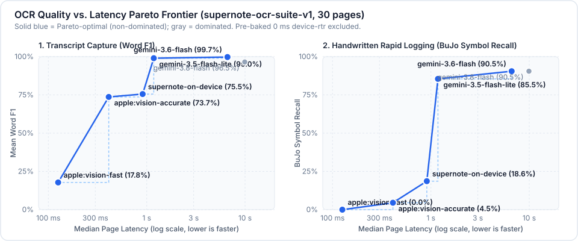

# Choosing an AI Provider

Every AI feature in Open Private Cloud is optional. You can run the server with zero AI (just fast Private Cloud sync, the Web UI, tasks, and native keyword search), connect Google Gemini for the highest accuracy and speed, or point it at a local model server on your own hardware so your notes never leave your network.

## Three ways to run

| Setup | Best for | What you need |
| :--- | :--- | :--- |
| **Google Gemini (recommended default)** | Highest handwriting accuracy, Bullet Journal symbols, diagrams, and best hybrid search embedding quality | `SUPERNOTE_GEMINI_API_KEY` (Paid tier does not train on API data; Free tier does—see below) |
| **100% Local (Ollama, vLLM, llama.cpp, LM Studio)** | Keeping every note and image strictly inside your home network | A local OpenAI-compatible vision model for OCR/summaries and `embeddinggemma` for search |
| **No AI (sync only)** | Minimal ~135–160 MB Private Cloud sync on a Raspberry Pi or NAS | Nothing; run `supernote serve` |

You can also mix providers per capability (for example, Gemini for OCR and a local Ollama server for summaries and embeddings).

## Benchmark summary

We maintain reproducible benchmarks on real Supernote `.note` pages rather than relying on marketing claims.

<p align="center">
  
</p>

### Handwriting & Bullet Journal OCR

Across 30 `.note` pages (Bullet Journal Rapid Logging, two-column diagrams and guitar tablature, French/Spanish/Turkish notes, overlapping strokes, and synthetic fixtures):

| Model | Word Accuracy (F1) | Char Error (CER, lower is better) | Bullet Journal Symbols | Speed / page |
| :--- | ---: | ---: | ---: | ---: |
| `Gemini 3.5 Flash-Lite` *(default)* | 99.0% | 2.3% | 95.8% | 1.18 s |
| `Gemini 3.6 Flash` | 99.7% | 4.2% | 97.3% | 6.63 s |
| `Gemini 3.8 Flash` | 96.5% | 5.6% | 97.3% | 9.93 s |
| `Supernote On-Device` (`MyScript iink 4.1.0`, 25 pages) | 75.5% | 17.2% | 18.6% | 0.91 s |
| `Apple Vision Accurate` | 73.7% | 21.7% | 49.7% | 0.41 s |
| `Apple Vision Fast` | 17.8% | 72.8% | 8.7% | 0.13 s |

Word F1 measures how many whole words match the page (higher is better), while CER counts character-level typos and formatting mistakes (lower is better). See [evals/ocr/RESULTS.md](../../evals/ocr/RESULTS.md) for `Content CER` and per-category breakdowns.

`gemini-3.5-flash-lite` is the easiest option that works well out of the box: it reads nearly every word accurately (99.0% Word F1, 0.0% median CER) in ~1.2 s per page for under `$0.001` per page while preserving Bullet Journal symbols, nested indentation, and strikethroughs.

If you want to stay fully local, you have two main paths with clear tradeoffs. On macOS, Apple Vision (`vision-accurate`) handles basic English prose fine (93.0% Word F1 on plain prose) with no model server, though it cannot take prompts so it drops Bullet Journal symbols and struggles with multi-column layouts. Local vision or dedicated OCR models (such as DeepSeek-OCR or GLM-OCR) keep everything on your own hardware, though they often need extra tuning—like setting `prompt_override` to their expected native instruction (see the [Dedicated local OCR example](#dedicated-local-ocr-models-deepseek-ocr-glm-ocr) below).

### Hybrid search & embeddings

Across 100 pages in 26 notebooks and 60 blind ground-truth queries (`#tag` lookups, exact IDs, typos, Chinese/Japanese/Korean, paraphrases, and unanswerable negatives; full breakdown in [evals/search/RESULTS.md](../../evals/search/RESULTS.md)):

| Model | Top-5 Ranking Quality (nDCG@5) | Found in Top 5 (Recall@5) | Median Latency |
| :--- | ---: | ---: | ---: |
| `gemini:gemini-embedding-2` *(recommended cloud)* | **97.1%** | **93.7%** | 68.8 ms |
| `gemini:gemini-embedding-001` | 95.5% | 93.2% | 69.4 ms |
| `openai:text-embedding-3-small` | 94.0% | 89.5% | 50.9 ms |
| `ollama:embeddinggemma` *(recommended local)* | **93.7%** | **90.2%** | **23.5 ms** |
| `ollama:qwen3-embedding:4b` | 92.2% | 89.7% | 58.9 ms |
| `ollama:qwen3-embedding:0.6b` | 91.3% | 89.8% | 28.9 ms |
| Keyword only (`none`) | 54.8% | 49.3% | 4.0 ms |

Higher is better: Recall@5 is how often the right page lands in the top 5 results; nDCG@5 also rewards putting it at #1.

### Why Gemini is the built-in cloud default

`gemini-3.5-flash-lite` delivers near-frontier vision and document accuracy at a fraction of the cost and latency of larger cloud models, which makes it practical to index entire notebooks automatically. Because Open Private Cloud focuses on a small set of well-tested server backends, Anthropic Claude is not a built-in OCR or summary provider. If you already use Claude Desktop or Claude Code, you can still connect them directly to your notes and search index over [MCP](./mcp.md).

## API data use, training, and retention

Google Gemini offers both a **Free tier** that trains on API data and a **Paid tier** (enabled by linking a [Cloud Billing account](https://aistudio.google.com/docs/terms#paid-services) to your Google AI Studio project) that does not. Commercial API traffic on OpenAI and Anthropic is excluded from training by default:

| Provider & Tier | Used to Train Models? | Default API Log Retention | Policy Citations |
| :--- | :--- | :--- | :--- |
| **Gemini API (Paid tier)** | **No** (Google acts as Data Processor) | Abuse monitoring; optional AI Studio project logs default to 55 days (configurable to 7 days or off; [Zero Data Retention (ZDR)](https://docs.cloud.google.com/gemini-enterprise-agent-platform/resources/zero-data-retention) on Enterprise/Vertex AI) | [Paid Services Terms](https://aistudio.google.com/docs/terms#data-use-paid), [Logs Policy](https://aistudio.google.com/docs/logs-policy), [Google DPA](https://business.safety.google/processorterms/) |
| **Gemini API (Free tier)** | **Yes** (outside EEA, UK, and Switzerland; includes human review) | Retained for product improvement (avoid for private or sensitive notes) | [Unpaid Services Terms](https://aistudio.google.com/docs/terms#data-use-unpaid) |
| **OpenAI API** (`api.openai.com`) | **No** (unless opted in) | Up to 30 days for abuse monitoring; ZDR available for eligible orgs | [OpenAI Data Controls](https://developers.openai.com/api/docs/guides/your-data) |
| **Anthropic Claude API** (`api.anthropic.com`) | **No** under Commercial Terms | Not retained by default on standard endpoints, or up to 30 days on covered models; ZDR available | [Commercial Terms](https://www.anthropic.com/legal/commercial-terms), [Training Policy](https://privacy.claude.com/en/articles/7996868-is-my-data-used-for-model-training), [Data Retention](https://platform.claude.com/docs/en/manage-claude/api-and-data-retention) |
| **Local models** (`Ollama`, `llama.cpp`, `vLLM`, `apple`) | **No** | Local only; notes never leave your server | — |

## Configuration examples

### Google Gemini (default)

Set `SUPERNOTE_GEMINI_API_KEY` and start the server. That enables `gemini-3.5-flash-lite` for OCR/summaries and `gemini-embedding-2` for hybrid search automatically.

### 100% local with Ollama

Run OCR, summaries, and hybrid search embeddings entirely on your own machine. First pull both models in Ollama:

```bash
ollama pull gemma3:27b && ollama pull embeddinggemma
```

Then configure `config/config.yaml`:

```yaml
ai:
  providers:
    ollama:
      type: openai
      base_url: "http://localhost:11434/v1"

  ocr:
    provider: ollama
    model: gemma3:27b
    max_concurrency: 1

  summary:
    provider: ollama
    model: gemma3:27b
    max_concurrency: 1

  embedding:
    provider: ollama
    model: embeddinggemma
    max_concurrency: 2
```

When running Open Private Cloud in Docker and Ollama on your host, set `base_url: "http://host.docker.internal:11434/v1"` (on Linux, also pass `--add-host=host.docker.internal:host-gateway`). `gemma3:27b` needs ~18–20 GB of VRAM or unified memory; on smaller machines, swap in a lighter vision model like `gemma3:12b` or `qwen2.5vl:7b` (expect lower handwriting accuracy on dense notes than Gemini).

### Mixing cloud and local models

You can configure `ocr`, `summary`, and `embedding` independently in `config/config.yaml`:

```yaml
ai:
  providers:
    gemini:
      api_key: "AIzaSyYourGeminiKey"
    ollama:
      type: openai
      base_url: "http://localhost:11434/v1"

  ocr:
    provider: gemini
    model: gemini-3.5-flash-lite
    max_concurrency: 5

  summary:
    provider: ollama
    model: gemma3:27b
    max_concurrency: 1

  embedding:
    provider: ollama
    model: embeddinggemma
    max_concurrency: 2
```

### Multiple local servers

Give each server its own name under `ai.providers` with `type: openai`:

```yaml
ai:
  providers:
    ollama:
      type: openai
      base_url: "http://localhost:11434/v1"
    llamacpp:
      type: openai
      base_url: "http://localhost:8082/v1"
  summary:
    provider: ollama
    model: gemma3:27b
  embedding:
    provider: llamacpp
    model: embeddinggemma
```

### Dedicated local OCR models (DeepSeek-OCR, GLM-OCR)

Dedicated OCR models are often trained on a single short instruction rather than a multi-part Bullet Journal prompt. Use `prompt_override` to send their native prompt instead:

```yaml
ai:
  providers:
    local:
      type: openai
      base_url: "http://localhost:8000/v1"
  ocr:
    provider: local
    model: DeepSeek-OCR-8bit
    max_concurrency: 1
    prompt_override: "Convert the document to markdown."
```

### macOS Apple Vision (offline fallback)

On macOS (`pip install "supernote[server,apple]"`), Apple's built-in `Vision` framework (`vision-accurate`) works offline for plain English prose without a GPU or API key. Avoid `vision-fast`, which only detects printed text, and note that Vision cannot follow prompts for diagrams or Bullet Journal symbols:

```yaml
ai:
  ocr:
    provider: apple
    model: vision-accurate
    max_concurrency: 2
```

See the [Configuration Reference](../reference/configuration.md) for all `ai` settings and environment variables.

## Next steps

- Learn how handwriting transcription, diagrams, and Bullet Journal symbols work in [OCR & Multimodal](./ocr_and_multimodal.md).
- Set up keyword and semantic retrieval across your notebooks in [Search](./search.md).
- Turn your synced notes into a structured knowledge base with [LLM Wiki](./llm_wiki.md).
