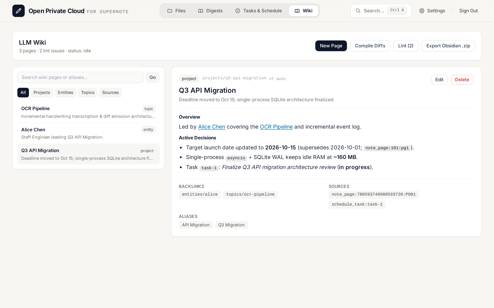

# LLM Wiki

The LLM Wiki is an opt-in feature (`wiki.enabled: false` by default) that turns your synced handwritten notebooks, standalone images, and Supernote tasks into a personal Markdown wiki.

As you sync new pages, a background compiler updates pages for your projects, people, and topics, links them together with `[[wikilinks]]`, and cites the exact notebook pages or tasks each note came from. You can browse and edit the wiki in the Web UI, query it from Claude or Cursor over MCP, or export the whole thing as an Obsidian `.zip` archive whenever you want.

<p align="center">
  
</p>

## How it works

Pages are organized into `projects/`, `entities/`, `topics/`, and `sources/`. Every page keeps track of its backlinks and links back to the original notebook pages or tasks it drew from, so you can always check the original handwriting.

If you edit a wiki page yourself in the Web UI, the background compiler leaves your text alone. Future syncs only add new source citations or suggest updates in the Lint panel. You can also lock a page if you don't want the compiler touching it at all.

After each compile, a lightweight health check scans for broken links, orphan pages, deleted sources, and possible OCR spelling variants (like `Al1ce` vs. `Alice`). Ambiguous names are never merged automatically; instead they show up in the Lint panel for you to approve or dismiss.

## Turning it on

The wiki needs a configured AI text model (Gemini or a local OpenAI-compatible server like Ollama or vLLM; see the [Configuration Reference](../reference/configuration.md)). Because it is off by default, sync-only servers use zero extra memory or tokens.

Enable it with an environment variable or in `config/config.yaml`:

```bash
export SUPERNOTE_WIKI_ENABLED=true
```

```yaml
# config/config.yaml
wiki:
  enabled: true
  auto_compile: true  # Compile automatically as notes and tasks sync
```

By default, each user has a `daily_token_budget` of `200,000` tokens per day. That is plenty for everyday note-taking while keeping a large first-time backfill from burning through tokens in one go. You can raise or lower `daily_token_budget` and other limits (`debounce_seconds`, `max_pages_per_batch`, `lint_event_threshold`, `lint_interval_days`) in the [Configuration Reference](../reference/configuration.md).

## Everyday use

### Backfill existing notebooks

When you first turn the wiki on, open the **Wiki** tab (`#/wiki`) and run a **Backfill** if you want to compile older notebooks. Backfill works newest-first in small batches and pauses automatically if it hits your daily token cap.

### Browse, edit, and triage lint issues

In the **Wiki** tab you can filter pages by folder, search across titles and body text, follow `[[wikilinks]]`, and check backlinks and source pages in the side panel.

Open the **Lint** drawer to review broken links, stale sources, contradictions, and OCR alias merge proposals, then resolve or dismiss them with one click.

<p align="center">
  
</p>

### Export to Obsidian

Click **Export `.zip`** in the Wiki header to download all active pages as a standard Obsidian vault with YAML frontmatter and `[[wikilinks]]`.

## Using the wiki with AI assistants

When both MCP and `wiki.enabled: true` are active, assistants like Claude Desktop or Cursor get eight wiki tools (`get_wiki_index`, `list_wiki_pages`, `read_wiki_page`, `search_wiki`, `upsert_wiki_page`, `list_wiki_lint_issues`, `resolve_wiki_lint_issue`, and `get_wiki_status`). Agent edits respect your manual edits and locked pages automatically.

See the [MCP Guide](./mcp.md) for client setup, or [ADR 0002](../architecture/adr/0002-llm-wiki-architecture.md) if you want the internal compiler and schema design.
