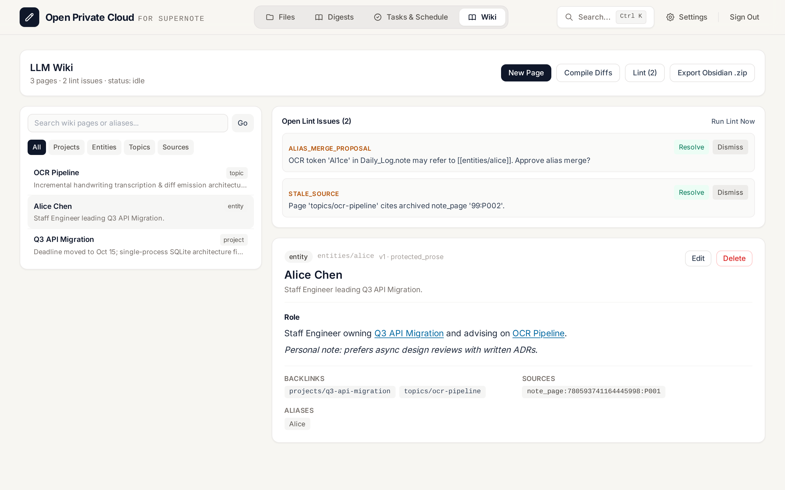

# LLM Wiki & Knowledge Graph

The **LLM Wiki** is an **opt-in** feature (`wiki.enabled: false` by default) that incrementally compiles your synced handwritten notebooks, standalone images, and Supernote tasks into a persistent, interlinked Markdown knowledge base.

Instead of re-reading dozens of notebooks every time you need context on a project or person, the wiki maintains living summary pages—complete with `[[wikilinks]]`, backlinks, source citations back to the original notebook pages, and one-click **Obsidian `.zip` export**.

<p align="center">
  
</p>

---

## What It Unlocks

- **Living Knowledge Base from Handwriting**: Automatically synthesizes project logs, meeting notes, and tasks into structured Markdown pages organized into `projects/`, `entities/`, `topics/`, and `sources/`.
- **Human-First Editing (`protected_prose`)**: Edit any wiki page directly in the Web UI. The moment you save a manual edit, that page is marked `protected_prose` so background compiler runs never overwrite your writing—they only append citations or suggest updates via the Lint queue.
- **Provenance & Backlinks**: Every compiled page tracks which notebook pages and tasks it came from, with clickable links back to the source and automatic reverse backlinks across pages.
- **Health Lint & OCR Alias Hygiene**: After each compile, structural checks flag broken links, orphan pages, stale sources, and potential OCR name variants (e.g., `Al1ce` vs. `Alice`) as one-click merge proposals—never silently merging ambiguous entities.
- **Portable Obsidian Vault Export**: Download your entire wiki at any time as a standard `.zip` archive with YAML frontmatter and `[[wikilinks]]` ready to open in Obsidian.

---

## How to Enable

The LLM Wiki requires an AI text model (Gemini or a local OpenAI-compatible model such as Ollama/vLLM; see the [Configuration Reference](../reference/configuration.md)). It is **disabled by default** so sync-only servers pay zero memory or token cost.

Enable it via environment variable or `config/config.yaml`:

```bash
export SUPERNOTE_WIKI_ENABLED=true
```

```yaml
# config/config.yaml
wiki:
  enabled: true
  auto_compile: true          # Optional: compile automatically when notes/tasks sync
  daily_token_budget: 200000  # Per-user daily LLM token cap (default: 200,000)
```

For all tuning options (`debounce_seconds`, `max_pages_per_batch`, `lint_event_threshold`, `lint_interval_days`), see the **[Configuration Reference](../reference/configuration.md)**.

---

## Everyday Workflow

### 1. Backfill Existing Notebooks (Optional)
When you turn the wiki on for the first time, you can run an on-demand **Backfill** from the **Wiki** tab in the Web UI. Backfill processes your existing notebooks newest-first in small batches and automatically pauses if it reaches your `daily_token_budget`.

### 2. Browse, Search & Edit in the Web UI
Open the **Wiki** tab (`#/wiki`) to:
- Navigate pages by category (`projects/`, `entities/`, `topics/`, `sources/`) or search across titles, aliases, and body text.
- Follow `[[wikilinks]]` and inspect **Backlinks** and **Sources** in the right-hand panel.
- Edit any page inline—saving your changes promotes the page to `protected_prose` (or you can lock a page completely so the compiler never touches it).

### 3. Review the Lint Triage Queue
Open the **Lint** panel to review health findings—broken links, stale sources, contradictions, and OCR alias merge proposals—and resolve or dismiss them with one click.

<p align="center">
  
</p>

### 4. Export to Obsidian
Click **Export `.zip`** in the Wiki header to download a portable Obsidian vault containing all active Markdown pages, YAML frontmatter, and `[[wikilinks]]`.

---

## Using the Wiki with AI Assistants (MCP)

When both MCP and `wiki.enabled: true` are active, connected assistants (Claude Desktop, Cursor, or custom scripts) gain eight wiki tools—including `get_wiki_index`, `read_wiki_page`, `search_wiki`, `upsert_wiki_page`, and `list_wiki_lint_issues`. Agent writes respect your `protected_prose` and `locked` policies automatically.

See the **[MCP Guide](./mcp.md)** for client setup and the full tool list, or **[ADR 0002](../architecture/adr/0002-llm-wiki-architecture.md)** for the internal compilation and schema design.
