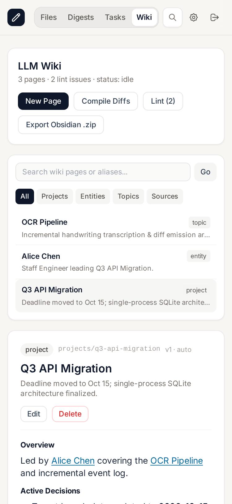

# LLM Wiki

The LLM Wiki is an opt-in feature (`wiki.enabled: false` by default) that turns your synced handwritten notebooks, standalone images, and Supernote tasks into a personal Markdown wiki.

As you sync new pages, a background compiler updates pages for your projects, people, and topics, links them together with `[[wikilinks]]`, and cites the exact notebook pages or tasks each note came from. You can browse and edit the wiki in the Web UI, query it from Claude or Cursor over MCP, or export the whole thing as an Obsidian `.zip` archive whenever you want.

<p align="center">
  
</p>

## How it works

Pages are organized into `projects/`, `entities/`, `topics/`, and `sources/`. Every page keeps track of its backlinks and links back to the original notebook pages or tasks it drew from, so you can always check the original handwriting.

If you edit a wiki page yourself in the Web UI, the background compiler leaves your text alone. Future syncs only add new source citations or suggest updates in the Lint panel. You can also lock a page if you don't want the compiler touching it at all.

After each compile, a lightweight health check scans for broken links, unlinked (orphan) pages, deleted sources, and possible OCR spelling variants (like `Al1ce` vs. `Alice`). Ambiguous names are never merged automatically; instead they show up in the Lint panel for you to approve or dismiss.

## Turning it on

The wiki reuses your configured `ai.summary` model (or `SUPERNOTE_GEMINI_API_KEY`) automatically. You can also configure a separate `ai.text` model for wiki compilation; see [Choosing an AI Provider](./ai_providers.md) for model recommendations and the [Configuration Reference](../reference/configuration.md) for all settings. Because it is off by default, sync-only servers use zero extra memory or tokens.

Enable it with an environment variable or in `config/config.yaml`:

```bash
export SUPERNOTE_WIKI_ENABLED=true
```

```yaml
# config/config.yaml
wiki:
  enabled: true
```

Setting `SUPERNOTE_WIKI_ENABLED=true` (or `wiki.enabled: true`) turns on the **Wiki** tab and automatically compiles new notes and tasks in the background as they sync. Set `wiki.auto_compile: false` in `config/config.yaml` if you prefer manual or MCP-only updates. You can also tune the daily token budget and batching/lint schedules in the [Configuration Reference](../reference/configuration.md).

## Everyday use

### Backfill existing notebooks

When you first turn the wiki on, open the **Wiki** tab (`#/wiki`) and start a backfill to compile your older OCR'd notebooks. Backfill runs on the server in chronological order by page date, working through small windows of pages (8 pages per turn by default) so multi-month journals and evolving projects build up in the order you wrote them. You can leave the tab or reload while it runs, pause it at any time, or use **Reset & Rebuild** to replay your notebooks from the beginning after changing models or prompts.

### Inspect coverage and debug compile quality

If a notebook did not produce the wiki pages you expected, open the **Diagnostics** panel in the Wiki header. It lists your transcribed notebooks with the lowest citation coverage first, alongside each notebook's average OCR character count so you can tell right away whether handwriting recognition was sparse or whether the compiler skipped the notebook.

Click **Dry-Run** on any notebook (or pick a start date and page offset) to run the exact production compile pipeline read-only without saving anything. The inspector summarizes what happened in plain English and lets you expand the full OCR text sent to the AI as well as the Markdown draft the AI would write, plus any updates or citations the server would skip. You can run the same checks from the terminal with `supernote cloud wiki diagnostics` and `supernote cloud wiki dry-run`; see the [CLI Reference](../reference/cli_reference.md#supernote-cloud-wiki-diagnostics-dry-run) for flags.

### Browse, edit, and triage lint issues

In the **Wiki** tab you can filter pages by folder, search across titles and body text, follow `[[wikilinks]]`, and check backlinks and source pages in the side panel.

Open the **Lint** drawer to review broken links, stale sources, contradictions, and OCR alias merge proposals, then resolve or dismiss them with one click.

<p align="center">
  
</p>

### Export to Obsidian

Click **Export `.zip`** in the Wiki header to download all active pages as a standard Obsidian vault with YAML frontmatter and `[[wikilinks]]`.

### Browse on mobile

The wiki reader adapts to phone screens so you can read compiled pages, follow `[[wikilinks]]`, and check lint items on the go.

<p align="center">
  
</p>

## Using the wiki with AI assistants

When both MCP and `wiki.enabled: true` are active, assistants like Claude Desktop or Cursor can browse, search, read, and update wiki pages, as well as review and resolve lint issues. Agent edits respect your manual edits and locked pages automatically.

See the [MCP Guide](./mcp.md) for the full list of wiki tools and client setup, or [ADR 0002](../architecture/adr/0002-llm-wiki-architecture.md) if you want the internal compiler and schema design.
