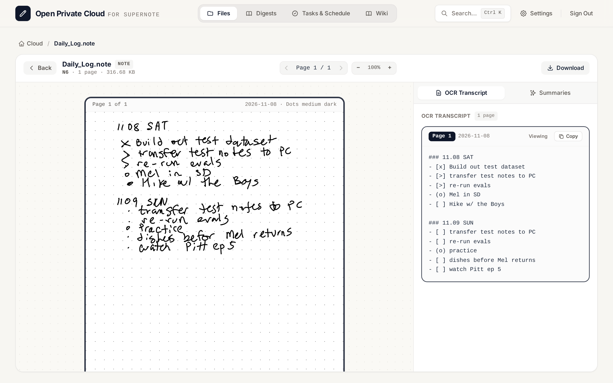
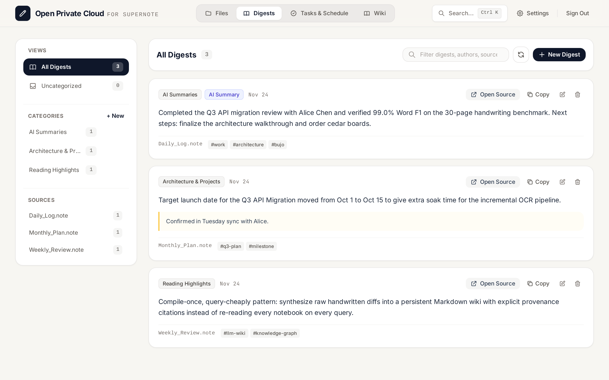

# Handwriting OCR & Multimodal Workflows

Handwriting recognition on e-ink hardware drains battery and struggles with dense cursive, Bullet Journal signifiers, tables, and hand-drawn diagrams. When you enable an optional Vision AI provider in Open Private Cloud, a background pipeline turns both **`.note` notebooks** and **standalone images** into structured Markdown, rendered Mermaid diagrams, summaries, and visual context for AI assistants.

Everything in this pipeline is **optional and incremental**: unchanged and blank pages are hashed and skipped automatically, and if you do not configure an AI provider, your server still syncs files and renders notebook pages with zero AI overhead.

<p align="center">
  
</p>

---

## What It Unlocks

### 1. Handwriting, Bullet Journal & Diagram OCR
When a `.note` file syncs, modified pages are transcribed into clean Markdown:
- **Bullet Journal Rapid Logging**: Preserves task bullets (`•`), completed items (`X`), migrated/scheduled tasks (`>`, `<`), events (`o`), notes (`-`), priority stars (`*`), nested indentation, and `~~strikethroughs~~`.
- **Diagrams & Multi-Column Layouts**: Recognizes hand-drawn flowcharts, architecture sketches, and tables—converting structured diagrams into fenced ` ```mermaid ` blocks and tables into GitHub-Flavored Markdown.
- **Rendered Mermaid Diagrams in the Web UI**: Fenced ` ```mermaid ` blocks inside OCR transcripts render directly as interactive diagrams in the side-by-side viewer, with a toggle to inspect the raw Mermaid source.

### 2. Standalone Images (Screenshots, Whiteboards & Photos)
Drop `.png`, `.jpg`, `.jpeg`, `.gif`, `.webp`, or `.bmp` files into your synced cloud folders and the pipeline indexes them alongside your notebooks:
- Transcribes visible text, tables, and whiteboard diagrams (as Mermaid blocks).
- Generates a concise visual scene description for photographs and illustrations so you can find them with natural-language search.
- Displays the OCR transcript and scene description in a dedicated side panel in the Web UI image viewer.

Standalone image indexing is enabled by default when an OCR provider is configured, and skips Supernote system folders (`MyStyle/**` and `EXPORT/**`) automatically. You can customize or disable it in `config/config.yaml`:

```yaml
# config/config.yaml
enable_image_processing: true
image_include_patterns: []                    # Empty = index all non-excluded folders
image_exclude_patterns: ["MyStyle/**", "EXPORT/**"]
```

### 3. Handwritten Digest Rendering (PDF & PNG)
Reading digests and annotations synced from your tablet—including handwritten margin notes—can be browsed in the **Digests** tab and rendered to cached PDF or PNG files via the extended API (`SummaryClient.summary_to_pdf` / `summary_to_png`) for sharing or archiving.

<p align="center">
  
</p>

### 4. Visual Context for AI Assistants (`get_page_image`)
Text transcripts are great for search, but sometimes an AI assistant needs to *see* your actual sketch, floor plan, or whiteboard photo. Through the built-in MCP server, vision-capable assistants (such as Claude Desktop or Cursor) can call `get_page_image(file_id, page_index)` to inspect a normalized PNG of any notebook page or standalone image directly.

---

## Customizing Prompts by Filename or Stationery Style

You can tailor OCR and summary output for specific notebooks without writing code by placing Markdown prompt templates in your `prompts_dir` (`config/prompts` by default):

```text
config/prompts/
├── ocr/
│   ├── daily/prompt.md            # Matches notebooks named Daily.note, daily_log.note, etc.
│   └── style_cornell/prompt.md    # Matches pages using Cornell Notes stationery
├── summary/
│   └── meeting_notes/prompt.md    # Custom executive summary format for meeting notebooks
└── image/
    └── default/prompt.md          # Custom prompt for standalone raster images
```

Native Supernote page keywords (`PAGE_KEYWORDS`) are injected automatically into prompts so your custom instructions can reference device tags and headings.

---

## Choosing a Vision Model

- **Recommended Default — Google Gemini (`gemini-3.5-flash-lite`)**: Highest accuracy and speed in our [30-page Supernote OCR Benchmark](../../evals/ocr/RESULTS.md) (99.0% Word F1 in ~1.2 s/page, under `$0.001`/page), with strong Bullet Journal and diagram fidelity. Set `SUPERNOTE_GEMINI_API_KEY` to enable.
- **100% Local Models (Ollama, vLLM, llama.cpp, LM Studio)**: Point the `openai` provider at any local OpenAI-compatible vision model so notes never leave your network.
- **macOS Offline Fallback (`apple:vision-accurate`)**: Supported on macOS for plain English prose without a GPU, though it does not support prompts, diagrams, or Bullet Journal signifiers.

See the **[Configuration Reference](../reference/configuration.md)** for full provider and prompt settings, the **[MCP Guide](./mcp.md)** for multimodal agent setup, and the **[Async Note Processing Pipeline](../architecture/note_processing_design.md)** for internal queue mechanics.
