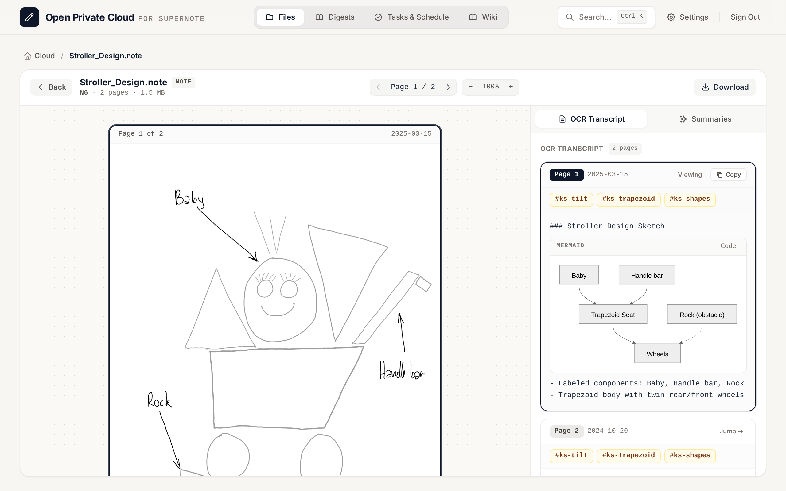
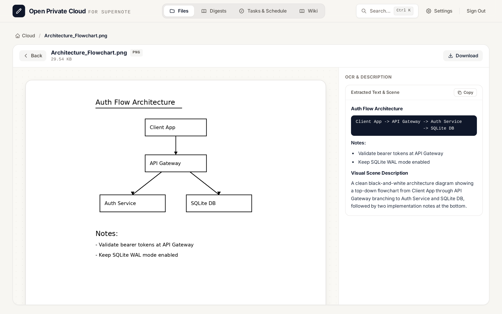

# Handwriting OCR & Multimodal Workflows

On-device handwriting recognition drains battery and often misses dense cursive, Bullet Journal symbols, tables, and hand-drawn diagrams. If you configure an optional Vision AI provider, Open Private Cloud runs a background pipeline that turns your synced `.note` notebooks and standalone images into searchable Markdown, rendered diagrams, summaries, and visual context for AI assistants.

Nothing in this pipeline is required. Unchanged and blank pages are skipped automatically, and if you leave AI unconfigured, your server still syncs files and renders notebook pages with no AI overhead.

<p align="center">
  
</p>

## Handwriting, Bullet Journals, and diagrams

When a `.note` file syncs, modified pages are transcribed into Markdown and shown side-by-side with your handwriting in the Web UI.

The default OCR prompt preserves Bullet Journal Rapid Logging symbols (`•`, `X`, `>`, `<`, `o`, `-`, `*`), nested indentation, and `~~strikethroughs~~`. It also handles tables and hand-drawn diagrams: tabular notes become GitHub-Flavored Markdown tables, and flowcharts or architecture sketches are transcribed as interactive diagrams using Mermaid syntax (` ```mermaid ` blocks).

In the Web UI, those Mermaid blocks render directly as diagrams inside the transcript panel, with a toggle to view the raw source.

<p align="center">
  
</p>

## Notebook outlines (Supernote headings)

When you mark headings on your Supernote, the Web UI viewer adds an **Outline** tab in the side panel listing every heading in reading order (by page and position on the page) with its style swatch and page number. Click any heading to jump straight to that page. Notebooks without headings keep the standard **OCR Transcript** and **Summaries** tabs.

Outlines work whether or not you configure AI:

- When an OCR provider is enabled, each heading crop is transcribed into a single line of text and cached by its handwriting, so unchanged headings are not re-transcribed when you edit or reorder pages.
- When AI is disabled, transcription is still running, or a heading cannot be read, the Outline falls back to showing the cropped handwritten heading image directly from your `.note` file.

## Standalone images (screenshots, whiteboards, and photos)

You can also sync `.png`, `.jpg`, `.jpeg`, `.gif`, `.webp`, and `.bmp` files into your cloud folders. The pipeline transcribes visible text, tables, and whiteboard diagrams (including Mermaid blocks), and writes a short scene description for photos and illustrations so they show up in natural-language search.

Opening a standalone image in the Web UI shows its OCR text and scene description in a side panel.

<p align="center">
  
</p>

Image indexing is on by default whenever an OCR provider is configured, and it automatically skips Supernote system folders (`MyStyle/**` and `EXPORT/**`). You can change the folder filters or turn it off in `config/config.yaml`:

```yaml
enable_image_processing: true
image_include_patterns: []                    # Empty = index all non-excluded folders
image_exclude_patterns: ["MyStyle/**", "EXPORT/**"]
```

## Reading digests and handwritten annotations

Reading digests and handwritten margin notes synced from your tablet appear in the **Digests** tab. If you need a shareable or archival copy of a handwritten digest, the extended API and Python client (`supernote.client`) can also render and cache it as a PDF or PNG.

<p align="center">
  
</p>

## Letting AI assistants see your pages (`get_page_image`)

Transcripts work well for text search, but sometimes an assistant needs to look at the actual drawing, floor plan, or whiteboard photo. When MCP is enabled, vision-capable clients like Claude Desktop and Cursor can call `get_page_image(file_id, page_index)` to fetch a normalized PNG of any notebook page or standalone image.

## Customizing prompts by filename or stationery

You can customize OCR or summary instructions for specific notebooks by dropping Markdown files into `prompts_dir` (`config/prompts` by default):

```text
config/prompts/
├── ocr/
│   ├── common/                    # Always prepended to every OCR prompt
│   ├── default/                   # Fallback when no filename or page-style folder matches
│   ├── daily/prompt.md            # Matches Daily.note, daily_log.note, etc.
│   └── cornell/prompt.md          # Matches pages using Cornell stationery (style_cornell)
├── summary/
│   ├── common/                    # Always prepended to every summary prompt
│   └── meeting_notes/prompt.md    # Custom summary format for meeting notebooks
├── title/
│   └── default/prompt.md          # Custom single-line prompt for notebook headings
└── image/
    └── default/prompt.md          # Custom prompt for standalone images
```

For each page, OCR prompts resolve in order: notebook filename stem (`Daily.note` → `daily/`), then page template name (for example, a Cornell template → `cornell/`), and finally `default/`. Native Supernote page keywords are included automatically so custom prompts can use your tablet's tags and headings. Prompts are loaded into memory once, so restart the server after adding or editing prompt files.

> [!NOTE]
> When customizing `summary/` prompts, keep the structured JSON output format intact so the server can parse date ranges and page references. See the [Async Note Processing Pipeline](../architecture/note_processing_design.md) for the expected schema.

## Picking a vision model

See [Choosing an AI Provider](./ai_providers.md) for the full OCR and search benchmarks, local Ollama/vLLM examples, and API data-retention policies. For full provider settings, see the [Configuration Reference](../reference/configuration.md); for agent setup, see the [MCP Guide](./mcp.md); and for internal queue details, see the [Async Note Processing Pipeline](../architecture/note_processing_design.md).
