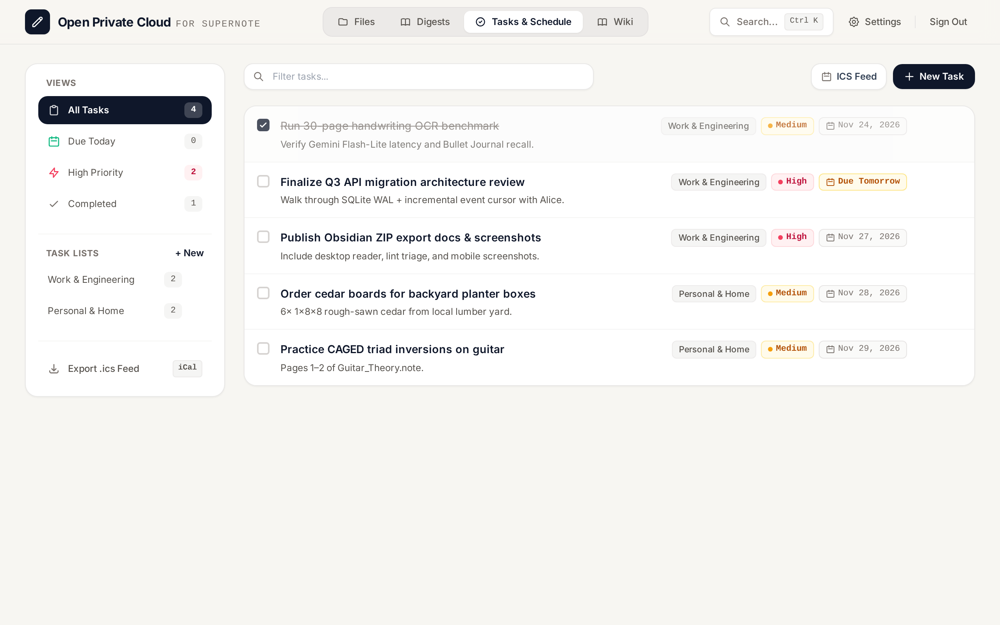

# Webhooks, Calendar (`.ics`) & Home Assistant Integrations

You can connect Open Private Cloud to external task apps and automation tools in two ways:

- Subscribe to your Supernote tasks as an RFC 5545 iCalendar (`.ics`) feed. This works out of the box with zero AI configured.
- Send signed HTTP webhooks to Home Assistant, n8n, or your own scripts whenever files sync, tasks change, or notes finish processing. Webhooks are opt-in and disabled by default.

---

## iCalendar (`.ics`) task feeds

Tasks created on your Supernote tablet (including handwritten To-Do items linked to specific notebook pages) and tasks created in the Web UI are available as a standard `.ics` stream of `VTODO` items.

<p align="center">
  
</p>

### Export or subscribe

From the Web UI, open **Tasks** and click **Export `.ics`** to download all tasks or the currently selected list.

For scripts or scheduled syncs, fetch `/api/schedule/feed.ics` using a revocable static API key created in the Web UI (**Settings → Access & API Keys**) or via the CLI (`supernote cloud keys create "calendar-sync"`):

```bash
curl -fsSL \
  -H "Authorization: Bearer ${SUPERNOTE_API_KEY}" \
  "http://localhost:8080/api/schedule/feed.ics" \
  -o tasks.ics
```

Pass `?taskListId=<list_id>` to export a single task list instead of all lists. You can also fetch the feed from Python with `ScheduleClient.get_ical_feed(group_id=None)`.

### Subscribing from URL-only calendar clients

Calendar apps such as Apple Reminders, Thunderbird, Nextcloud, and Home Assistant often cannot send custom `Authorization` headers on `.ics` subscriptions. Open Private Cloud does not accept tokens in query strings by default so credentials stay out of server logs. If your calendar client only supports a plain URL, map a query parameter (or private path) to an `Authorization` header in your reverse proxy using a dedicated API key:

```nginx
location = /api/schedule/feed.ics {
    set $auth_header $http_authorization;
    if ($arg_token != "") {
        set $auth_header "Bearer $arg_token";
    }
    proxy_set_header Authorization $auth_header;
    proxy_pass http://127.0.0.1:8080/api/schedule/feed.ics;
}
```

### How Supernote tasks map to `VTODO`

| Supernote field | `VTODO` property | Behavior |
| :--- | :--- | :--- |
| Task ID | `UID` | `supernote-task-<id>@supernote` |
| Title | `SUMMARY` | Task title |
| Status / completion time | `STATUS`, `COMPLETED` | `COMPLETED` when done, otherwise `NEEDS-ACTION` |
| Due date | `DUE` | UTC timestamp |
| Created / updated | `CREATED`, `LAST-MODIFIED` | UTC timestamps |
| Priority | `PRIORITY` | High → `1`, Normal/Medium → `5`, Low → `9` |
| Recurrence | `RRULE` | Standard RFC 5545 recurrence rule (for example, `FREQ=WEEKLY;BYDAY=MO`) |
| Task list | `CATEGORIES` | Task list name |
| Details and notebook link | `DESCRIPTION` | Task notes plus the linked `.note` file path and page number when created from a notebook |

---

## Outbound webhooks

Webhooks are opt-in (`webhooks.enabled: false` by default). When enabled, the server sends non-blocking HTTP `POST` requests to your configured endpoints whenever matching events occur, without slowing down device sync.

### Enable webhooks in `config/config.yaml`

```yaml
webhooks:
  enabled: true  # Or set SUPERNOTE_WEBHOOKS_ENABLED=true
  endpoints:
    - url: "https://n8n.example.com/webhook/supernote-sync"
      user: "you@example.com"
      secret: "0f9e8d7c6b5a4938271605f4e3d2c1b0a9f8e7d6c5b4a39281706f5e4d3c2b1a"
      events:
        - "file.created"
        - "note.*"
```

Each endpoint filters events for one `user` email. You can subscribe to exact event names (`file.created`, `file.content_updated`, `note.processing_completed`, `schedule.task_created`, `summary.created`), namespace wildcards (`file.*`, `note.*`, `schedule.*`, `summary.*`), or `*` (or omit `events`) for all events.

> [!NOTE]
> The server resolves each endpoint's `user` email at startup. If you configure an endpoint before creating that user account, restart the server after creating the user so the subscription activates.

### Payload format and delivery

Every webhook `POST` includes these headers:

- `Content-Type: application/json`
- `X-Supernote-Event`: the event name (for example, `note.processing_completed`)
- `X-Supernote-Signature: sha256=<hex_digest>` when `secret` is set on the endpoint

The JSON body uses the same event envelope returned by `/api/extended/events` and the MCP `list_events` tool:

```json
{
  "seq": "42",
  "timestamp": 1754321400000,
  "eventType": "note.processing_completed",
  "actor": "system:processor",
  "entityType": "file",
  "entityId": "42",
  "relatedFileId": "42",
  "payload": {
    "file_id": "42",
    "file_path": "/NOTE/Note/2026-08-04.note"
  }
}
```

Each attempt times out after 10 seconds, redirects are not followed, and up to 5 requests run concurrently. Server (`5xx`) and network errors retry up to 3 attempts with linear backoff (1 s, then 2 s). Client (`4xx`) responses are logged and not retried. Credentials, query strings, and secrets are stripped from server logs.

See the [Configuration Reference](../reference/configuration.md) for all webhook settings.

---

## Verify `X-Supernote-Signature`

When `secret` is configured, the server signs the raw UTF-8 request body with HMAC-SHA256. Always compare the header in constant time before acting on the payload.

### Python

```python
import hashlib
import hmac


def verify_supernote_webhook(secret: str, raw_body: bytes, signature_header: str) -> bool:
    if not secret or not signature_header.startswith("sha256="):
        return False
    expected_digest = hmac.new(
        secret.encode("utf-8"),
        raw_body,
        hashlib.sha256,
    ).hexdigest()
    return hmac.compare_digest(f"sha256={expected_digest}", signature_header)
```

### Node.js / TypeScript

```typescript
import { createHmac, timingSafeEqual } from "node:crypto";

export function verifySupernoteWebhook(
  secret: string,
  rawBody: Buffer,
  signatureHeader: string | undefined,
): boolean {
  if (!secret || !signatureHeader?.startsWith("sha256=")) {
    return false;
  }
  const expected = `sha256=${createHmac("sha256", secret).update(rawBody).digest("hex")}`;
  const expectedBuf = Buffer.from(expected, "utf8");
  const actualBuf = Buffer.from(signatureHeader, "utf8");
  if (expectedBuf.length !== actualBuf.length) {
    return false;
  }
  return timingSafeEqual(expectedBuf, actualBuf);
}
```

---

## Home Assistant example

To trigger a Home Assistant notification whenever a notebook finishes background OCR and summarization, add your Home Assistant webhook URL to `config/config.yaml`:

```yaml
webhooks:
  enabled: true
  endpoints:
    - url: "http://homeassistant.local:8123/api/webhook/supernote_note_ready_secret_id"
      user: "you@example.com"
      events:
        - "note.processing_completed"
```

Then add a matching automation in Home Assistant (`automations.yaml`):

```yaml
alias: "Supernote: Notify when a notebook finishes processing"
description: "Fires when background OCR and summarization complete for a .note file"
triggers:
  - trigger: webhook
    webhook_id: "supernote_note_ready_secret_id"
    allowed_methods:
      - POST
    local_only: true
conditions:
  - condition: template
    value_template: "{{ trigger.json.eventType == 'note.processing_completed' }}"
actions:
  - action: notify.persistent_notification
    data:
      title: "Supernote Note Processed"
      message: >-
        Finished processing {{ trigger.json.payload.file_path }}
        (ID: {{ trigger.json.payload.file_id }}).
mode: queued
```
