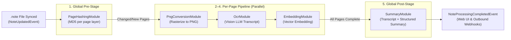

# AI Pipeline, Custom Prompts & MCP Server

Supernote Knowledge Hub transforms binary `.note` files into searchable transcripts, vector embeddings, and structured chronological summaries, and exposes them to AI assistants via a built-in **Model Context Protocol (MCP)** server.

---

## 1. The 5-Stage Background Processing Pipeline

When a `.note` file is uploaded or synchronized, `supernote.server.services.processor.ProcessorService` orchestrates an incremental, idempotent 5-stage pipeline tracked in SQLite (`SystemTaskDO` and `NotePageContentDO`):



### Stage Breakdown

| Stage | Module Class | Scope | Task Type | Behavior & Invalidation Rules |
| :---: | :--- | :---: | :--- | :--- |
| **1** | `supernote.server.services.processor_modules.page_hashing.PageHashingModule` | File | `PAGE_HASHING` | Parses the binary `.note` header/metadata and computes an MD5 hash for each page (`PAGEID`). Only pages whose hash changed (or were newly inserted/deleted) have their downstream checkpoints invalidated; unchanged pages are skipped. |
| **2** | `supernote.server.services.processor_modules.png_conversion.PngConversionModule` | Page | `PNG_CONVERSION` | Rasterizes modified pages into PNG blobs in `supernote-cache/`. Enabled when `web_enabled` + `web_notebook_preview` is `true`, or whenever `ai.ocr` is configured. |
| **3** | `supernote.server.services.processor_modules.ocr.OcrModule` | Page | `OCR_EXTRACTION` | Sends the page PNG and formatted prompt (`supernote.server.ai.prompts.format_ocr_prompt`) to the configured `supernote.server.ai.models.ocr.OcrModel` and stores the Markdown transcript in `NotePageContentDO.text_content`. |
| **4** | `supernote.server.services.processor_modules.embedding.EmbeddingModule` | Page | `EMBEDDING_GENERATION` | Embeds `text_content` via `supernote.server.ai.models.embedding.EmbeddingModel` (`RETRIEVAL_DOCUMENT`). Tracks `model_id` as the task version—switching `ai.embedding.model` automatically re-embeds all existing pages in the background. |
| **5** | `supernote.server.services.processor_modules.summary.SummaryModule` | File | `SUMMARY_GENERATION` | Concatenates all page transcripts with `--- Page N ---` headers, stores the full notebook transcript record (`data_source="OCR"`), and invokes `supernote.server.ai.models.summary.SummaryModel` to produce date-segmented Markdown summaries with page citations (`SummaryResponse`). |

### Managing the Pipeline via CLI

Administrators can inspect, pause, resume, or force-reprocess pipeline stages at any time:

```bash
# View queue status and currently processing file IDs
supernote admin queue status

# Pause or resume background processing
supernote admin queue stop
supernote admin queue start

# Inspect recent tasks or filter by failed status
supernote admin tasks --status failed
supernote admin tasks --type ocr --file-id 42

# Force reprocessing of summaries (or all/ocr/png/embedding) across one or all files
supernote admin reprocess --type summary
supernote admin reprocess --type all --file-id 42
```

---

## 2. Configuring Cloud vs. Local AI Models

AI capabilities (`ocr`, `summary`, `embedding`) are configured independently in `config/config.yaml` via `supernote.server.config.AiConfig`. You can use cloud providers (`gemini`, hosted `openai`), local inference servers (`openai` provider pointed at Ollama, vLLM, llama.cpp, or LM Studio), or mix both.

> [!TIP]
> **Model Recommendation**: We generally recommend **Google Gemini** (`gemini`) because of its strong multimodal handwriting recognition capabilities and cost-effectiveness. Handwriting OCR extraction and summary quality may be lower when using smaller local or other OpenAI-compatible models.

### Mixing Providers per Capability

For example, to use Google Gemini for handwriting OCR (vision) while running summarization and vector embeddings locally via Ollama:

```yaml
ai:
  providers:
    gemini:
      api_key: "AIzaSyYourGeminiKey"
    openai:
      base_url: "http://localhost:11434/v1"

  ocr:
    provider: gemini
    model: gemini-3.6-flash
    max_concurrency: 5

  summary:
    provider: openai
    model: gemma3:27b
    max_concurrency: 1

  embedding:
    provider: openai
    model: embeddinggemma
    max_concurrency: 2
```

> [!NOTE]
> - **Disabling individual stages**: Omit `summary:` if you only want OCR transcripts and semantic search, or omit `ai:` entirely for non-AI operation.
> - **Automatic Re-Embedding**: `EmbeddingModule` records the active `model_id` on every page task. If you change `ai.embedding.model`, the background recovery loop automatically detects the version mismatch and re-embeds all pages using the new model.

---

## 3. Customizing AI Prompts & Filename Routing

Prompts are managed by `supernote.server.utils.prompt_loader.PromptLoader` (`PROMPT_LOADER`). By default, the server loads built-in Bullet Journal / Rapid Logging prompts from `supernote/server/resources/prompts/`.

To override prompts with your own instructions, point `prompts_dir` (`SUPERNOTE_PROMPTS_DIR`) to a custom directory:

```yaml
# config/config.yaml
prompts_dir: /data/config/prompts
```

### Prompt Directory Layout

`PromptLoader` reads two top-level categories: `ocr` (`PromptId.OCR_TRANSCRIPTION`) and `summary` (`PromptId.SUMMARY_GENERATION`). Within each category, all `.md` files inside a subdirectory are sorted alphabetically and concatenated with `\n\n`:

```text
prompts/
├── ocr/
│   ├── common/               # Always prepended to EVERY OCR prompt
│   │   ├── 00_context.md
│   │   └── 01_legend.md
│   ├── default/              # Appended when no notebook-specific folder matches
│   │   └── system.md
│   ├── daily/                # Appended when syncing "Daily.note" (or "daily.note")
│   │   └── prompt.md
│   ├── weekly/               # Appended when syncing "Weekly.note"
│   │   └── prompt.md
│   └── meeting_notes/        # Appended when syncing "Meeting_Notes.note"
│       └── prompt.md
└── summary/
    ├── common/               # Always prepended to EVERY Summary prompt
    │   └── instruction.md
    ├── default/              # Appended when no notebook-specific folder matches
    │   └── prompt.md
    ├── daily/                # Appended when summarizing "Daily.note"
    │   └── prompt.md
    └── meeting_notes/        # Appended when summarizing "Meeting_Notes.note"
        └── prompt.md
```

### How Filename-Based Prompt Routing Works

When `OcrModule` or `SummaryModule` processes a notebook, it extracts the lowercase filename stem (`Path(file_name).stem.lower()`) as `custom_type` and resolves the prompt using:

$$\text{Final Prompt} = \text{common/*.md} + \begin{cases} \text{<notebook\_stem>/*.md} & \text{if directory exists} \\ \text{default/*.md} & \text{otherwise} \end{cases}$$

For example:
1. You sync `/NOTE/Note/Daily.note` from your Supernote tablet.
2. The filename stem is `"daily"`.
3. For OCR, `format_ocr_prompt` prepends the page metadata block (`--- Page 1 ---`, `Notebook: Daily.note`, `Page ID: ...`), followed by `ocr/common/*.md` + `ocr/daily/*.md`.
4. For Summarization, `format_summary_prompt` combines `summary/common/*.md` + `summary/daily/*.md`, followed by `TRANSCRIPT:\n<full_text>`.
5. If you sync `/NOTE/Note/Architecture_Ideas.note` and no `ocr/architecture_ideas/` directory exists, `PromptLoader` automatically falls back to `ocr/common/*.md` + `ocr/default/*.md`.

> [!IMPORTANT]
> When customizing `summary/` prompts, keep instructions compatible with the structured JSON output schema (`supernote.server.ai.prompts.SummaryResponse`), which expects a `segments` array containing `date_range`, `summary` (Markdown string), `extracted_dates` (`YYYY-MM-DD` strings), and `page_refs` (1-indexed page numbers).

---

## 4. Model Context Protocol (MCP) Server Architecture

When `mcp_enabled: true` (default), `supernote` runs a Streamable HTTP **MCP Resource Server** alongside an **OAuth 2.1 / IndieAuth Authorization Server** (`supernote.server.mcp.server` and `supernote.server.mcp.auth`).

### Dual-Port OAuth 2.1 + Streamable HTTP Topology

| Port | Role | Endpoints Exposed | Configuration |
| :---: | :--- | :--- | :--- |
| **`8080`** *(Main Server)* | **OAuth 2.1 Authorization Server (AS)** & Web UI | `/.well-known/oauth-authorization-server`<br>`/authorize`<br>`/login-bridge`<br>`/token`<br>`/revoke` | Public URL configured via `base_url` (`SUPERNOTE_BASE_URL`). |
| **`8081`** *(MCP Server)* | **MCP Resource Server (RS)** (Streamable HTTP) | `/.well-known/oauth-protected-resource`<br>`/mcp` | Port configured via `mcp_port` (`SUPERNOTE_MCP_PORT`). Public URL configured via `mcp_base_url` (`SUPERNOTE_MCP_BASE_URL`). |

```mermaid
sequenceDiagram
    participant Client as MCP Client (Claude / Cursor)
    participant RS as MCP Resource Server (:8081/mcp)
    participant AS as Authorization Server (:8080)
    participant Browser as User Browser (Web UI)

    Client->>RS: POST /mcp (unauthenticated)
    RS-->>Client: 401 Unauthorized (RFC 9728 Protected Resource Metadata)
    Client->>RS: GET /.well-known/oauth-protected-resource
    RS-->>Client: Returns authorization_servers: ["http://localhost:8080"]
    Client->>AS: GET /.well-known/oauth-authorization-server
    AS-->>Client: OAuth 2.1 metadata (/authorize, /token)
    Client->>Browser: Open /authorize?client_id=http://...&code_challenge=...
    Browser->>AS: Redirects through /login-bridge -> /#login
    Browser->>AS: User logs in; POST /login-bridge issues auth code
    AS-->>Client: Redirect to callback with ?code=...
    Client->>AS: POST /token (PKCE code_verifier)
    AS-->>Client: Bearer access_token (1h TTL) + refresh_token (30d TTL)
    Client->>RS: POST /mcp (Authorization: Bearer <access_token>)
    RS-->>Client: Streamable HTTP MCP Tool Execution
```

### Dynamic IndieAuth Client IDs

`supernote.server.mcp.auth.SupernoteOAuthProvider` implements **IndieAuth-style dynamic clients**:
- No manual client registration is required.
- Any valid `http://` or `https://` URL passed as `client_id` is accepted automatically, and any `redirect_uri` sharing the same scheme, host, and path prefix is permitted.
- Access tokens expire after **1 hour** (`3600` seconds) and refresh tokens remain valid for **30 days**.

---

## 5. Connecting MCP Clients

### Claude Desktop (`claude_desktop_config.json`)

```json
{
  "mcpServers": {
    "supernote": {
      "command": "npx",
      "args": [
        "-y",
        "mcp-remote",
        "http://localhost:8081/mcp"
      ]
    }
  }
}
```

*(Alternatively, if using `mcp-proxy` or native Streamable HTTP support in Cursor / Claude Code, point the server URL directly to `http://localhost:8081/mcp` or your reverse-proxied `https://mcp.notes.example.com/mcp`).*

---

## 6. Exposed MCP Tools Reference

Defined in `supernote.server.mcp.server` and validated by DTOs/VOs in `supernote.server.mcp.models`. All tools scope queries strictly to the authenticated user's notebooks.

### 1. `list_notebooks`

Lists active `.note` notebooks ordered by most recently updated (`update_time` descending).

- **Arguments (`supernote.server.mcp.models.ListNotebooksRequestDTO`)**:
  | Parameter | Type | Default | Description |
  | :--- | :--- | :--- | :--- |
  | `limit` | `int` | `20` | Maximum number of notebooks to return. |
  | `name_filter` | `str \| None` | `None` | Optional case-insensitive substring filter on the notebook filename. |

- **Response Payload (`supernote.server.mcp.models.ListNotebooksResponseVO`)**:
  ```json
  {
    "success": true,
    "errorCode": null,
    "errorMsg": null,
    "notebooks": [
      {
        "fileId": "42",
        "fileName": "Daily.note",
        "createTime": 1754265600000,
        "updateTime": 1754352000000
      }
    ]
  }
  ```

### 2. `search_notebook_chunks`

Performs semantic vector similarity search across all embedded notebook pages (`NotePageContentDO`), with optional filename and ISO 8601 date filtering.

- **Arguments (`supernote.server.mcp.models.SearchRequestDTO`)**:
  | Parameter | Type | Default | Description |
  | :--- | :--- | :--- | :--- |
  | `query` | `str` | *(required)* | Natural-language semantic search query (embedded with `RETRIEVAL_QUERY`). |
  | `top_n` | `int` | `5` | Maximum number of top-scoring page chunks to return. |
  | `name_filter` | `str \| None` | `None` | Optional substring filter for notebook filenames (e.g. `"Journal"`). |
  | `date_after` | `str \| None` | `None` | Include only notes/pages on or after this ISO 8601 date (`YYYY-MM-DD`). |
  | `date_before` | `str \| None` | `None` | Include only notes/pages on or before this ISO 8601 date (`YYYY-MM-DD`). |

- **Response Payload (`supernote.server.mcp.models.SearchResponseVO`)**:
  ```json
  {
    "success": true,
    "errorCode": null,
    "errorMsg": null,
    "results": [
      {
        "fileId": "42",
        "fileName": "Daily.note",
        "pageIndex": 3,
        "pageId": "P20260804120000",
        "score": 0.8742,
        "textPreview": "--- Page 4 ---\n• Finalize Q3 architecture proposal\nX Review VFS integrity service",
        "date": "2026-08-04"
      }
    ]
  }
  ```

### 3. `get_notebook_transcript`

Retrieves the full OCR transcript for a notebook or slices a specific 0-based page range (`[start_index, end_index]` inclusive).

- **Arguments (`supernote.server.mcp.models.TranscriptRequestDTO`)**:
  | Parameter | Type | Default | Description |
  | :--- | :--- | :--- | :--- |
  | `file_id` | `str` | *(required)* | Numeric notebook ID string (as returned by `list_notebooks` or `search_notebook_chunks`). |
  | `start_index` | `int \| None` | `None` | 0-based starting page index (inclusive). If omitted, starts at page `0`. |
  | `end_index` | `int \| None` | `None` | 0-based ending page index (inclusive). If omitted, includes through the last page. |

- **Response Payload (`supernote.server.mcp.models.TranscriptResponseVO`)**:
  ```json
  {
    "success": true,
    "errorCode": null,
    "errorMsg": null,
    "transcript": "--- Page 1 ---\nNotebook: Daily.note\nCreated: 2026-08-04\nPage ID: P20260804090000\n\n• Ship MCP documentation\nX Fix webhook signature verification"
  }
  ```
