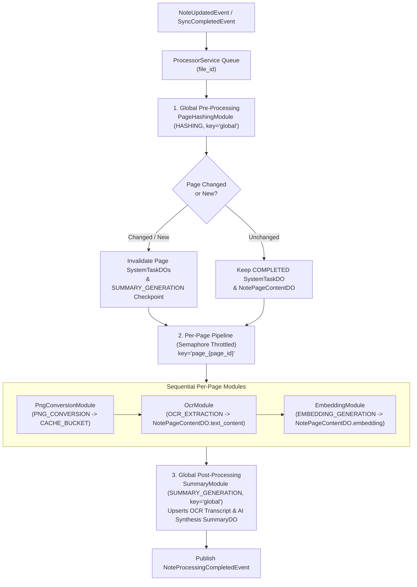

# Asynchronous Note Processing Architecture

This document describes the architecture of the asynchronous, multi-stage `.note` processing pipeline implemented in `supernote.server.services.processor`.

---

## 1. Core Principles

- **Incremental & Page-Atomic**: The **Page** (identified by its stable `.note` `PAGEID`) is the unit of processing. Only modified or newly added pages trigger expensive operations (PNG rendering, LLM OCR, and vector embedding generation).
- **Hierarchical Knowledge**: Intelligence is captured at two levels: **Page Chunks** (`NotePageContentDO`) for granular semantic search, and **Documents** (`SummaryDO`) for full-notebook transcripts and chronological AI syntheses.
- **Asynchronous & Event-Driven**: Processing is triggered by domain events on `LocalEventBus` (`NoteUpdatedEvent`, `SyncCompletedEvent`) and runs in background `asyncio` workers. Device sync is never blocked. During active hardware sync sessions (`defer_processing=True`), processing is deferred until `SyncCompletedEvent` fires.
- **Operation-Level Checkpoints**: Every stage (`HASHING`, `PNG_CONVERSION`, `OCR_EXTRACTION`, `EMBEDDING_GENERATION`, `SUMMARY_GENERATION`) is tracked independently in `SystemTaskDO` (`f_system_task`), including module/model version tags (`SystemTaskDO.data`).
- **Personal-Scale Concurrency**: Uses a bounded `asyncio.Queue` of file IDs with configurable file worker concurrency (`concurrency=2`) and per-page semaphore concurrency (`DEFAULT_PAGE_CONCURRENCY`).
- **Privacy & Isolation**: OCR transcripts, vector embeddings, and summaries are scoped strictly per user (`UserFileDO.user_id`).
- **Lifecycle & Garbage Collection**: When a `.note` file is deleted (`NoteDeletedEvent`), `ProcessorService` purges all associated `NotePageContentDO`, `SystemTaskDO`, and `SummaryDO` rows, as well as cached page PNGs in `CACHE_BUCKET` and unreferenced handwriting blobs in `USER_DATA_BUCKET`.
- **Resilience & Self-Healing Recovery**: On server startup and every 5 minutes in `poll_loop()`, `ProcessorService` runs `recover_tasks()`, `recover_stalled_tasks()`, and `recover_missing_tasks()` to re-enqueue unfinished, stalled, or newly discovered/version-upgraded tasks.

---

## 2. Pipeline Architecture

---

## 3. Data Schema (`supernote.server.db.models`)

### `SystemTaskDO` (`f_system_task` — Pipeline Checkpoint & Error Tracking)

Tracks the execution state of every module per file and page (`supernote/server/db/models/note_processing.py`):

| Column | Type | Description |
| :--- | :--- | :--- |
| `id` | `BigInteger` (PK) | Internal unique task ID. |
| `file_id` | `BigInteger` | Numeric VFS file ID (`UserFileDO.id`). |
| `task_type` | `String` | `TaskType` value: `HASHING`, `PNG_CONVERSION`, `OCR_EXTRACTION`, `EMBEDDING_GENERATION`, or `SUMMARY_GENERATION`. |
| `key` | `String` | `"global"` for file-level modules (`PageHashingModule`, `SummaryModule`) or `"page_{page_id}"` for page-level modules. |
| `status` | `String` | `ProcessingStatus`: `PENDING`, `PROCESSING`, `COMPLETED`, or `FAILED`. |
| `data` | `Text` (nullable) | Module version or AI model identifier (e.g., `"v2"` for `PngConversionModule`, `embedding_model.model_id` for `EmbeddingModule`). |
| `retry_count` | `BigInteger` | Number of execution retries. |
| `last_error` | `Text` (nullable) | Exception type and message from the most recent failure. |
| `create_time` / `update_time` | `BigInteger` | Epoch timestamps in milliseconds. |

A `UniqueConstraint("file_id", "task_type", "key")` ensures each stage has at most one checkpoint record per target.

### `NotePageContentDO` (`f_note_page_content` — Page Text & Vector Cache)

Stores per-page change hashes, extracted OCR text, and vector embeddings:

| Column | Type | Description |
| :--- | :--- | :--- |
| `id` | `BigInteger` (PK) | Internal database ID. |
| `file_id` | `BigInteger` | Numeric VFS file ID (`UserFileDO.id`). |
| `page_index` | `BigInteger` | Current 0-based page order within the notebook. |
| `page_id` | `String` | Stable `PAGEID` from the `.note` binary metadata (`uq_note_page_content` with `file_id`). |
| `content_hash` | `String` (nullable) | MD5 hash of the page's metadata dictionary (layer offsets and protocol info). |
| `text_content` | `Text` (nullable) | Extracted OCR markdown/text for this page. |
| `embedding` | `Text` (nullable) | JSON array of floats representing the page's vector embedding. |
| `embedding_model` | `String` (nullable) | Model ID that generated `embedding` (e.g. Gemini embedding model). |

### `SummaryDO` (`f_summary` — User-Facing Transcripts & AI Synthesis)

`SummaryModule` persists document-level outputs via `SummaryService` into `f_summary` under a parent Summary Group (`is_summary_group=True`, `unique_identifier=get_summary_group_id(file_basis)`):

1. **OCR Transcript Summary**:
   - `unique_identifier`: `get_transcript_id(file_basis)`
   - `data_source`: `"OCR"`
   - `content`: Full concatenated transcript of all pages in the notebook, with page headers and inferred dates.
2. **AI Synthesis Summary**:
   - `unique_identifier`: `get_summary_id(file_basis)`
   - `data_source`: `summary_model.model_id`
   - `content`: Chronological Markdown synthesis with date-range headings and page citations (e.g., `## 2026-06-18 (Pages 1, 2)`).
   - `extra_metadata`: JSON object containing structured `segments` (`date_range`, `summary`, `extracted_dates`, `page_refs`).

---

## 4. Pipeline Stages (`supernote.server.services.processor_modules`)

1. **`PageHashingModule` (`TaskType.PAGE_HASHING`, Global Pre-Module)**:
   - Parses `.note` metadata in a worker thread (`supernote.notebook.parse_metadata`).
   - Compares each page's `PAGEID` and `content_hash` against `NotePageContentDO`:
     - **New page**: Inserts a `NotePageContentDO` row.
     - **Moved page**: Updates `page_index` in place without re-running OCR/Embeddings if `content_hash` is unchanged.
     - **Modified page**: Updates `content_hash`, clears `text_content` and `embedding`, and deletes the page's `SystemTaskDO` rows (`key="page_{page_id}"`) so downstream page modules re-run.
     - **Deleted page**: Deletes the `NotePageContentDO` row, removes the cached PNG from `CACHE_BUCKET`, and deletes associated `SystemTaskDO` rows.
   - If any page was added, moved, modified, or deleted, deletes the `SUMMARY_GENERATION` `SystemTaskDO` checkpoint so `SummaryModule` regenerates the document transcript and synthesis.
2. **`PngConversionModule` (`TaskType.PNG_CONVERSION`, Page Module)**:
   - Uses single-page lazy loading (`load_notebook(path, policy="loose", page_number=page_index)`) and `ImageConverter` to render the page to PNG (`compress_level=1`) and stores it in `CACHE_BUCKET` at `get_page_png_path(file_id, page_id)`.
3. **`OcrModule` (`TaskType.OCR_EXTRACTION`, Page Module)**:
   - Verifies that `ocr_model` is configured and the page PNG exists in `CACHE_BUCKET`.
   - Formats page context (`format_ocr_prompt`) and calls `ocr_model.extract_text(png_data, prompt)`, storing the result in `NotePageContentDO.text_content`.
4. **`EmbeddingModule` (`TaskType.EMBEDDING_GENERATION`, Page Module)**:
   - Verifies that `embedding_model` is configured and `NotePageContentDO.text_content` is populated.
   - Calls `embedding_model.embed(text_content, task_type=EmbeddingTaskType.RETRIEVAL_DOCUMENT)` and stores the vector JSON and `model_id` in `NotePageContentDO`.
5. **`SummaryModule` (`TaskType.SUMMARY_GENERATION`, Global Post-Module)**:
   - Verifies that `summary_model` is configured and every page in `NotePageContentDO` for `file_id` has non-null `text_content`.
   - Upserts the parent Summary Group, the full `"OCR"` transcript `SummaryDO`, and the segmented AI synthesis `SummaryDO`.

---

## 5. Extended Intelligence & Admin API Surface

### Extended Web & SDK Endpoints (`supernote.server.routes.extended` / `ExtendedClient`)

- **Semantic Search**: `POST /api/extended/search` (`ExtendedClient.search`)
  - Embeds the query with `EmbeddingTaskType.RETRIEVAL_QUERY` and performs in-memory NumPy cosine similarity across the user's `NotePageContentDO` vectors (`SearchService.search_chunks`), supporting `top_n`, `name_filter`, `date_after`, and `date_before`.
- **Notebook Transcript**: `POST /api/extended/transcript` (`ExtendedClient.get_transcript`)
  - Returns the formatted OCR transcript for an entire notebook or a specific `[start_index, end_index]` page range.
- **File Summaries**: `POST /api/extended/file/summary/list` (`ExtendedClient.list_summaries`)
  - Lists the `OCR` transcript and AI synthesis `SummaryDO` records for a `file_id`.
- **File Processing Status**: `POST /api/extended/file/processing/status` (`ExtendedClient.get_processing_status`)
  - Aggregates `SystemTaskDO` states for a list of `file_ids`.
- **Recent System Tasks**: `GET /api/extended/system/tasks` (`ExtendedClient.list_system_tasks`)
  - Returns recent `SystemTaskDO` entries for the authenticated user.

### Admin Inspection & Recovery Endpoints (`supernote.server.routes.admin` / `AdminClient`)

- `GET /api/admin/queue/status`, `POST /api/admin/queue/stop`, `POST /api/admin/queue/start` — Inspect, pause, or resume `ProcessorService`.
- `GET /api/admin/tasks` — Filter `SystemTaskDO` records across the server by `status`, `file_id`, `task_type`, and `limit`.
- `POST /api/admin/reprocess` — Delete `SystemTaskDO` checkpoints for `all` or a specific `TaskType` (`hashing`, `png`, `ocr`, `embedding`, `summary`) and re-enqueue affected files.

---

## 6. ProcessorModule API Contract

Each stage inherits from `supernote.server.services.processor_modules.ProcessorModule`:

| Method | Role | Return / Side Effect |
| :--- | :--- | :--- |
| `run_if_needed(file_id, session_manager, page_index, page_id)` | **Gating** | `True`: Execute `process()`. `False`: Skip execution (already `COMPLETED` with matching `version`, module disabled, or prerequisite missing). |
| `process(file_id, session_manager, page_index, page_id)` | **Work** | Performs idempotent CPU/IO work and commits domain data updates. Raises descriptive exceptions on error. |
| `run(file_id, session_manager, page_index, page_id)` | **Lifecycle** | Calls `run_if_needed()`; if needed, runs `process()`, records Prometheus metrics, and updates `SystemTaskDO` to `COMPLETED` (with `data=self.version`) or `FAILED` (with `last_error` and incremented `retry_count`). |

### Failure & Stall Semantics

- **`run_if_needed() -> False`**: `run()` returns `True` immediately without calling `process()`, allowing the orchestrator to continue.
- **`run() -> False` (Exception in `process()`)**:
  - `SystemTaskDO.status` is set to `FAILED` with `last_error = f"{type(e).__name__}: {e}"`.
  - For page modules, `ProcessorService._process_page` **stalls** the sequential chain for that specific page (e.g., if `PngConversionModule` fails on page 2, `OcrModule` and `EmbeddingModule` are skipped for page 2, while other pages continue processing in parallel).
  - Stalled or failed tasks are automatically retried by `recover_stalled_tasks()` (after 5 minutes) or on demand via `supernote admin reprocess`.
