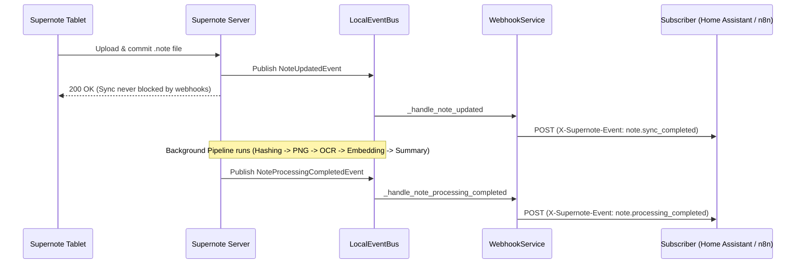

# Webhooks, Calendar (`.ics`) & Home Assistant Integrations

Supernote Knowledge Hub provides two primary integration mechanisms for external automation platforms, task managers, and smart-home systems:
1. **RFC 5545 iCalendar (`.ics`) Task Feeds** (`supernote.server.services.ical_export.ICalExportService`)
2. **Signed Outbound Webhooks** (`supernote.server.services.webhook.WebhookService`)

---

## 1. iCalendar (`.ics`) Task Feeds

Tasks created on your physical Supernote tablet (including handwritten tasks converted via the To-Do app with notebook page deep-links) or via the Web UI / Python SDK can be exported as an RFC 5545 `VCALENDAR` stream of `VTODO` items.

### Endpoint Specification

```http
GET /api/schedule/feed.ics?taskListId=<optional_group_id>
x-access-token: <your-jwt-access-token>
```

- **Route Handler**: `supernote.server.routes.schedule.get_schedule_feed_ics`
- **Service**: `supernote.server.services.ical_export.ICalExportService.export_calendar`
- **Response Content-Type**: `text/calendar; charset=utf-8` (`Content-Disposition: inline; filename="feed.ics"`)
- **Query Parameters**:
  - `taskListId` *(optional)*: Restricts the exported `VTODO` items to a single Task Group (`ScheduleTaskGroupDO.task_list_id`). When omitted, exports all active tasks across all lists (including Inbox tasks where `task_list_id` is `None`).

### Supernote Task to RFC 5545 `VTODO` Field Mapping

`supernote.server.services.ical_export.task_to_vtodo` maps each task (`ScheduleTaskDO` / `supernote.models.schedule.ScheduleTaskInfo`) into an RFC 5545 `VTODO` component:

| Supernote Task Field | RFC 5545 `VTODO` Property | Mapping Behavior |
| :--- | :--- | :--- |
| `task_id` | `UID` | `supernote-task-{task_id}@supernote` |
| `title` | `SUMMARY` | Verbatim task title string. |
| `status` & `completed_time` | `STATUS` & `COMPLETED` | `COMPLETED` if `status == "completed"` or `completed_time` is set; otherwise `NEEDS-ACTION`. |
| `due_time` | `DUE` | Converted from epoch milliseconds to UTC `datetime`. |
| `create_time` / `update_time` | `CREATED` / `LAST-MODIFIED` | Converted from epoch milliseconds to UTC `datetime`. |
| `importance` | `PRIORITY` | `"high"` / `"1"` $\rightarrow$ `1`; `"normal"` / `"medium"` / `"5"` $\rightarrow$ `5`; `"low"` / `"9"` $\rightarrow$ `9`. |
| `recurrence` | `RRULE` | Parsed via `ical.types.Recur.from_rrule` (e.g. `FREQ=WEEKLY;BYDAY=MO`). |
| `task_list_id` *(Group Title)* | `CATEGORIES` | Task Group name (e.g. `["Work & Projects"]`). |
| `detail` + `links` | `DESCRIPTION` | Task notes plus decoded `supernote.models.schedule.ScheduleTaskLinkDTO` metadata (`App`, `Path`, `Page`) if the task was linked to a `.note` page on the tablet. |

#### Example `.ics` Output

```ics
BEGIN:VCALENDAR
PRODID:-//hacksw/handcal//NONSGML v1.0//EN
VERSION:2.0
BEGIN:VTODO
UID:supernote-task-a1b2c3d4e5f6@supernote
SUMMARY:Finalize Q3 Architecture Proposal
DESCRIPTION:Review VFS layer and MCP server integration.\n--- Supernote Document Link ---\nApp: Note\nPath: /NOTE/Note/Architecture.note\nPage: 4
STATUS:NEEDS-ACTION
PRIORITY:1
CATEGORIES:Work & Projects
DUE:20260815T170000Z
CREATED:20260804T093000Z
LAST-MODIFIED:20260804T142000Z
END:VTODO
END:VCALENDAR
```

### Exporting & Subscribing to Task Feeds

1. **Web UI Direct Export**:
   Open the **Tasks** view in the Web UI and click **Export `.ics`** to download `tasks.ics` for all tasks or the currently selected task list.
2. **CLI / `curl` / Scripts**:
   Authenticate with `x-access-token`:
   ```bash
   # Retrieve your cached token from ~/.cache/supernote.pkl or login API
   curl -fsSL \
     -H "x-access-token: ${SUPERNOTE_TOKEN}" \
     "http://localhost:8080/api/schedule/feed.ics?taskListId=dcf35927c2c7279e3d204f592af6e9ed" \
     -o work_tasks.ics
   ```
3. **Python SDK (`ScheduleClient`)**:
   ```python
   from supernote.client import Supernote
   from supernote.client.schedule import ScheduleClient

   async with await Supernote.login("you@example.com", "password", host="http://localhost:8080") as sn:
       schedule = ScheduleClient(sn.client)
       ics_text = await schedule.get_ical_feed(group_id=None)
   ```
4. **Calendar Clients Requiring URL-Only Subscriptions (Apple Reminders, Thunderbird, Nextcloud, Home Assistant)**:
   The server's `jwt_auth_middleware` reads tokens from the `x-access-token` request header (`supernote.server.utils.auth_utils.get_token_from_request`) so bearer tokens are not leaked in server access logs. If a calendar client cannot send custom HTTP headers, map a `?token=` query parameter (or dedicated secret path) to `x-access-token` in your reverse proxy:
   ```nginx
   # Nginx: Allow ?token=<jwt> on /api/schedule/feed.ics for calendar apps
   location = /api/schedule/feed.ics {
       set $auth_token $http_x_access_token;
       if ($arg_token != "") {
           set $auth_token $arg_token;
       }
       proxy_set_header x-access-token $auth_token;
       proxy_pass http://127.0.0.1:8080/api/schedule/feed.ics;
   }
   ```

---

## 2. Outbound Webhooks

`supernote.server.services.webhook.WebhookService` listens on the internal `LocalEventBus` and dispatches signed, non-blocking HTTP `POST` notifications whenever notes finish syncing or finish background AI processing.



### Supported Events & Payload Schema (`supernote.models.webhook`)

Every webhook `POST` request sends two headers:
- `Content-Type: application/json`
- `X-Supernote-Event: <event_name>`
- `X-Supernote-Signature: sha256=<hex_digest>` *(included whenever `secret` is configured on the endpoint)*

| Event Name | Constant | Trigger Condition | Payload Model |
| :--- | :--- | :--- | :--- |
| `note.sync_completed` | `supernote.models.webhook.EVENT_NOTE_SYNC_COMPLETED` | Dispatched immediately when a `.note` file upload/sync commits to the VFS (`NoteUpdatedEvent`). | `supernote.models.webhook.NoteSyncCompletedPayload` |
| `note.processing_completed` | `supernote.models.webhook.EVENT_NOTE_PROCESSING_COMPLETED` | Dispatched after all enabled background pipeline stages (Hashing, PNG, OCR, Embedding, Summary) finish for a `.note` file (`NoteProcessingCompletedEvent`). | `supernote.models.webhook.NoteProcessingCompletedPayload` |

#### JSON Payload Structure

Both events serialize a `supernote.models.webhook.WebhookPayload` with a nested `supernote.models.webhook.WebhookFileVO` (`file`). Internal database `user_id` values are intentionally excluded from outbound payloads:

```json
{
  "event": "note.processing_completed",
  "timestamp": 1754321400,
  "file": {
    "id": 42,
    "name": "2026-08-04.note",
    "path": "/NOTE/Note/2026-08-04.note"
  }
}
```

### Delivery & Retry Semantics

Defined in `supernote.server.services.webhook`:

| Parameter | Constant | Value | Behavior |
| :--- | :--- | :---: | :--- |
| **Request Timeout** | `REQUEST_TIMEOUT_SECONDS` | `10.0s` | Total timeout per HTTP `POST` attempt. |
| **Max Attempts** | `MAX_ATTEMPTS` | `3` | Maximum delivery attempts for transient failures. |
| **Retry Backoff** | `RETRY_BACKOFF_SECONDS` | `1.0s` *(linear)* | Waits `1.0s` after attempt 1, `2.0s` after attempt 2 (`RETRY_BACKOFF_SECONDS * attempt`). |
| **Max Concurrency** | `MAX_CONCURRENT_REQUESTS` | `5` | Bounded via `asyncio.Semaphore(5)` across all in-flight webhook requests. |
| **Redirects (`3xx`)** | `allow_redirects=False` | Not followed | `3xx` responses are treated as non-2xx and not followed. |
| **Client Errors (`4xx`)** | — | No retry | Logged as a warning and dropped immediately without retrying. |
| **Server/Network Errors (`5xx`, Timeout)** | — | Retried | Retried up to `3` attempts before logging an error and giving up. |
| **Log Redaction** | `_redact_url` | Enabled | URL credentials, query parameters, fragments, and `secret` values are stripped before logging. |

### Configuring Webhooks in `config/config.yaml`

```yaml
webhooks:
  enabled: true  # Or set SUPERNOTE_WEBHOOKS_ENABLED=true
  endpoints:
    - url: "https://n8n.example.com/webhook/supernote-sync"
      user: "you@example.com"
      secret: "0f9e8d7c6b5a4938271605f4e3d2c1b0a9f8e7d6c5b4a39281706f5e4d3c2b1a"
      events:
        - "note.sync_completed"
        - "note.processing_completed"
```

> [!NOTE]
> If `events` is omitted or empty (`[]`), the endpoint receives **all** events for `user`. At startup, `WebhookService.start` resolves each endpoint's `user` email to their account; if a configured user email does not exist yet in the database, that endpoint is logged and skipped until the user is created and the server restarts.

---

## 3. Verifying `X-Supernote-Signature` (HMAC-SHA256)

When `secret` is set on an endpoint, `supernote.server.services.webhook.sign_payload` signs the raw UTF-8 JSON request body using HMAC-SHA256 and sends `X-Supernote-Signature: sha256=<hex>`. Always verify this header using a constant-time digest comparison before trusting the payload.

### Python Verification Snippet

You can use `supernote.server.services.webhook.verify_signature` directly, or verify with Python's standard library `hmac`:

```python
import hashlib
import hmac


def verify_supernote_webhook(secret: str, raw_body: bytes, signature_header: str) -> bool:
    if not secret or not signature_header.startswith("sha256="):
        return False
    expected_digest = hmac.new(
        secret.encode("utf-8"),
        raw_body,
        hashlib.sha256,
    ).hexdigest()
    expected_header = f"sha256={expected_digest}"
    return hmac.compare_digest(expected_header, signature_header)
```

### Node.js / TypeScript Verification Snippet

```typescript
import { createHmac, timingSafeEqual } from "node:crypto";

export function verifySupernoteWebhook(
  secret: string,
  rawBody: Buffer,
  signatureHeader: string | undefined,
): boolean {
  if (!secret || !signatureHeader?.startsWith("sha256=")) {
    return false;
  }
  const expected = `sha256=${createHmac("sha256", secret).update(rawBody).digest("hex")}`;
  const expectedBuf = Buffer.from(expected, "utf8");
  const actualBuf = Buffer.from(signatureHeader, "utf8");
  if (expectedBuf.length !== actualBuf.length) {
    return false;
  }
  return timingSafeEqual(expectedBuf, actualBuf);
}
```

---

## 4. Home Assistant Integration

### Triggering Automations on Note Processing Completion

Configure a Home Assistant webhook automation to react whenever a handwritten note finishes OCR and summarization:

#### 1. Add the Home Assistant webhook URL to `config/config.yaml`

```yaml
webhooks:
  enabled: true
  endpoints:
    - url: "http://homeassistant.local:8123/api/webhook/supernote_note_ready_secret_id"
      user: "you@example.com"
      events:
        - "note.processing_completed"
```

#### 2. Create the Home Assistant Automation (`automations.yaml`)

```yaml
alias: "Supernote: Notify when Daily Note is summarized"
description: "Fires when background OCR and AI summarization complete for a .note file"
triggers:
  - trigger: webhook
    webhook_id: "supernote_note_ready_secret_id"
    allowed_methods:
      - POST
    local_only: true
conditions:
  - condition: template
    value_template: "{{ trigger.json.event == 'note.processing_completed' }}"
actions:
  - action: notify.persistent_notification
    data:
      title: "Supernote Note Processed"
      message: >-
        Finished processing {{ trigger.json.file.name }}
        (Path: {{ trigger.json.file.path }}, ID: {{ trigger.json.file.id }}).
mode: queued
```
