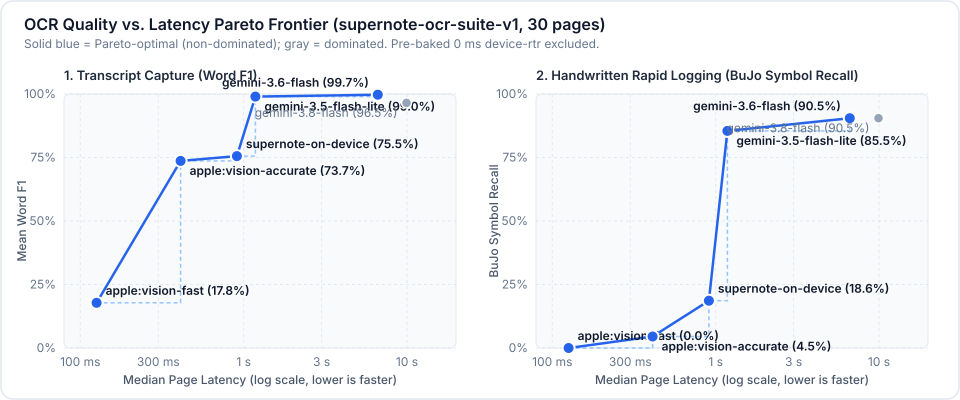

# OCR Evaluation Suite

Provider-agnostic benchmark suite for comparing page OCR backends (`apple`, `gemini`, `openai`/Ollama/llama.cpp/vLLM, `fake`, and Supernote on-device RTR) across Bullet Journal Rapid Logging notebooks and real-world `.note` fixtures.

See [**RESULTS.md**](RESULTS.md) for the current checked-in provider comparison table (and [`results/`](results/) for per-provider JSON transcripts and metrics).



## Quick Start

```bash
# Run on macOS with local Apple Vision (`vision-accurate` vs `vision-fast`)
./script/eval_ocr.py \
  --target apple:vision-accurate \
  --target apple:vision-fast

# Compare Apple Vision against a local Ollama vision model and Gemini
./script/eval_ocr.py \
  --target apple:vision-accurate \
  --target openai:gemma3:27b \
  --openai-base-url http://localhost:11434/v1 \
  --target gemini:gemini-3.5-flash-lite \
  --markdown-out storage/eval_ocr_report.md \
  --json-out storage/eval_ocr_results.json

# Run only Bullet Journal Rapid Logging categories
./script/eval_ocr.py \
  --category bujo_daily \
  --category bujo_monthly \
  --category bujo_synthetic
```

You can also pass `--config config/config.yaml` to reference named provider entries from `ai.providers` (e.g. `--target ollama:gemma3:27b --target llamacpp:qwen2.5-vl`).

## Recording & Merging Provider Results

Checked-in benchmark runs are stored as standalone JSON files in [`results/`](results/) so new providers can be evaluated incrementally on different machines (macOS Apple Silicon, Linux GPU, cloud APIs) without re-running existing providers:

```bash
# 1. Run a new provider and save its standalone per-page JSON results
./script/eval_ocr.py \
  --target openai:gemma3:27b \
  --openai-base-url http://localhost:11434/v1 \
  --json-out evals/ocr/results/ollama_gemma3_27b.json

# 2. Merge all saved JSON runs into RESULTS.md and pareto_frontier.svg (no live inference required)
./script/eval_ocr.py \
  --from-json evals/ocr/results/*.json \
  --markdown-out evals/ocr/RESULTS.md \
  --svg-out evals/ocr/pareto_frontier.svg

# Optional: Recompute per-page metrics/categories in saved JSON after dataset/metric updates
./script/eval_ocr.py \
  --from-json evals/ocr/results/apple.json \
  --rescore \
  --json-out evals/ocr/results/apple.json
```

### Provider Notes

- **`apple:vision-accurate` vs `apple:vision-fast`** ([`results/apple.json`](results/apple.json)): Evaluated across all `30` pages (`410.8 ms` median / `665.8 ms` P95 latency for `vision-accurate`, `0` errors). `vision-accurate` uses Apple's neural recognizer (`73.7%` Word F1, `21.7%` Mean CER, `9.8%` Median CER, `20.7%` Content CER), landing within `1.8` Word F1 points of `supernote-on-device` (`75.5%`) at `2.2×` lower latency. It performs strongly on English prose (`93.0%` Word F1, `3.0%` CER), synthetic Bullet Journal pages (`94.4%` Word F1, `2.9%` CER), and bilingual Spanish/English lessons (`5.2%–7.5%` CER via automatic language detection, preserving `ó` accents and `→` arrows), whereas `vision-fast` (`17.8%` Word F1, `72.8%` Mean CER) uses Vision's legacy contour detector intended for machine-printed text. On 2D spatial layouts (`bujo_monthly_november_calendar`, `guitar_caged_shapes`), sequence CER is elevated because Vision orders multi-column blocks column-first rather than row-by-row (`64.1%` Word F1 vs `30.2%` CER on `diagram_and_layout`). On real handwritten Rapid Logging pages (`bujo_daily`, `bujo_monthly`), Vision captures most words (`74.4%` daily Word F1) but drops hand-drawn signifiers (`0.0%` daily / `9.1%` monthly BuJo Symbol Recall, `0.0%` Indent, `0.0%` Strike), demonstrating that prompt-guided VLMs are required for structured Rapid Logging extraction.
- **`supernote-on-device`** ([`results/supernote_on_device.json`](results/supernote_on_device.json)): Supernote Chauvet `3.30.45` on-device handwriting recognition (`MyScript iink 4.1.0`) across all `25` vector-stroke `.note` pages in `dataset.yaml` (`75.5%` Word F1, `17.2%` Mean CER, `3.3%` Median CER; the `5` `bujo_synthetic` fixtures are raster-only bitmaps without a vector stroke layer). Running with matching `fr_FR`, `es_ES`, and `tr_TR` dictionaries achieves `4.4%` multilingual CER (`93.9%` Word F1). On real handwritten Bullet Journal pages, word capture remains solid (`92.5%` daily Word F1, `71.4%` monthly Word F1), but Rapid Logging signifiers (`10.0%` daily / `27.3%` monthly BuJo Symbol Recall, `18.6%` overall) and horizontal strikethroughs (`0.0%` recall) are not preserved semantically. Supernote's recognizer also intentionally excludes Marker/Highlighter strokes (`1to10.note` giant digits and `inverted_banner_scribble_overlap` overlays).
- **`gemini:gemini-3.5-flash-lite` / `gemini:gemini-3.6-flash` / `gemini:gemini-3.8-flash`** ([`results/gemini.json`](results/gemini.json)): Evaluated across all `30` pages. `gemini-3.5-flash-lite` achieves the lowest overall Mean CER (`2.3%`, `0.0%` Median CER, `1.4%` Content CER, `99.0%` Word F1, `95.8%` BuJo Symbol Recall, `0` errors) at `1.18 s` median / `1.42 s` P95 latency. `gemini-3.6-flash` posts the highest overall Word F1 (`99.7%`) and BuJo Symbol Recall (`97.3%` overall, `90.0%–90.9%` on real handwritten BuJo, `100.0%` Indent & Strike) plus `2.3%` multilingual CER; its `14.5%` diagram CER reflects optional ASCII pipe (`|`) alignment on guitar fretboard diagrams despite `99.3%` Word F1 (`6.63 s` median latency). `gemini-3.8-flash` achieves the lowest multilingual CER (`2.1%`, `99.1%` Word F1) and matches `97.3%` BuJo Symbol Recall, but spends >90 s of reasoning tokens aligning the 12-fret `guitar_tuning_grid` tablature (`1` timeout error under the default `90 s` `--page-timeout`).

## Metrics Reported

- **Mean / Median CER**: Normalized Character Error Rate (`Levenshtein(ref, hyp) / len(ref)`), strict case-, order-, and symbol-sensitive.
- **Content CER**: Case-insensitive Character Error Rate after stripping leading Rapid Logging signifiers (`*`, `•`, `X`, `>`, `<`, `o`, `-`) and `~~strikethrough~~` markers—isolating raw word sequence accuracy from capitalization and bullet formatting.
- **Word F1 / Word Recall**: Order- and case-insensitive multiset (`Counter`) word F1 and recall (`0%–100%`, with internal apostrophes normalized so `L's` matches `Ls`), measuring transcript word capture for search and embeddings without penalizing 2D column-vs-row reading order while penalizing hallucinated extra tokens in F1.
- **BuJo Symbol Recall**: Evaluated strictly on Bullet Journal cases (`bujo_*` categories or `daily`/`weekly`/`monthly` prompt types); measures the fraction of Rapid Logging items in `ground_truth` whose matching transcribed line preserves the canonical bullet (`•`, `X`, `>`, `<`, `o`, `-`) and critical star (`* `) defined in [legend.md](../../supernote/server/resources/prompts/ocr/common/legend.md).
- **BuJo Indent / BuJo Strike**: Preservation of 2-space nested hierarchy and `~~crossed out~~` strikethrough spans on Bullet Journal pages.
- **Median / P95 Latency**: Per-page inference wall-clock time (after a single unmeasured warmup call).

## Adding Real `.note` or `.png` Pages

Drop a `.note` notebook or `.png` page into `evals/ocr/notebooks/` (or anywhere relative to [dataset.yaml](dataset.yaml)) and add an entry to [dataset.yaml](dataset.yaml):

```yaml
  - id: my_daily_log_p0
    path: notebooks/my_daily.note
    page_index: 0
    category: bujo_daily
    prompt_type: daily
    description: Real handwritten daily log page.
    ground_truth: |-
      2026-11-09 Sunday
      * • Buy groceries for week
      X Morning run 5km
```

## Notebooks in `notebooks/`

Real handwritten Supernote `.note` fixtures (`TOTALPATH` vector strokes + `MAINLAYER` bitmaps):

| Notebook | Pages Evaluated | Category | Notes |
| :--- | ---: | :--- | :--- |
| [bujo_daily_weekend.note](notebooks/bujo_daily_weekend.note) | `1` (`p0`) | `bujo_daily` | Handwritten weekend Rapid Logging (`X`, `>`, `o`, `•`) on Nomad dot-grid. |
| [bujo_monthly_november.note](notebooks/bujo_monthly_november.note) | `2` (`p0–p1`) | `bujo_monthly` | Handwritten November backlog (`-`, `X`, `<`, `•`, strikethrough) + `1–30` calendar timeline. |
| [guitar_theory.note](notebooks/guitar_theory.note) | `2` (`p0–p1`) | `diagram_and_layout` | Two-column CAGED fretboard diagrams + 12-fret C tuning & song tab grid. |
| [french_phrases.note](notebooks/french_phrases.note) | `3` (`p0–p2`) | `multilingual` (`fr_FR`) | Bilingual French/English café, travel, and verb notes (includes embedded RTR). |
| [spanish_lessons.note](notebooks/spanish_lessons.note) | `2` (`p0, p6`) | `multilingual` (`es_ES`) | Bilingual Spanish/English cognate & sentence drills (includes embedded RTR). |

Synthetic Bullet Journal fixtures (`notebooks/{daily,weekly,monthly}.note`) and their rendered `.png` previews are generated deterministically with [generate_bujo_eval_notes.py](../../script/generate_bujo_eval_notes.py):

| Case ID | Notebook | Page | Rendered Preview |
| :--- | :--- | ---: | :--- |
| `bujo_daily_friday` | [daily.note](notebooks/daily.note) | `0` | [daily_page_0.png](notebooks/daily_page_0.png) |
| `bujo_daily_saturday` | [daily.note](notebooks/daily.note) | `1` | [daily_page_1.png](notebooks/daily_page_1.png) |
| `bujo_weekly_w45` | [weekly.note](notebooks/weekly.note) | `0` | [weekly_page_0.png](notebooks/weekly_page_0.png) |
| `bujo_monthly_calendar` | [monthly.note](notebooks/monthly.note) | `0` | [monthly_page_0.png](notebooks/monthly_page_0.png) |
| `bujo_monthly_goals` | [monthly.note](notebooks/monthly.note) | `1` | [monthly_page_1.png](notebooks/monthly_page_1.png) |
