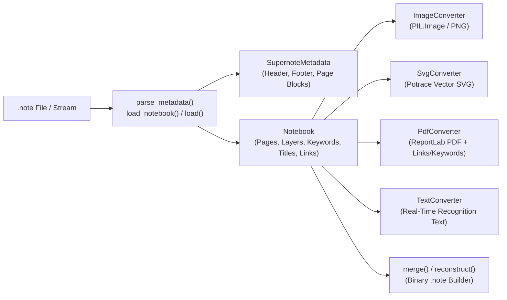

# Supernote Notebook Parser & Converter Guide

The `supernote.notebook` package parses, inspects, converts, and manipulates binary Supernote `.note` files (both original `SN_FILE_ASA_*` and X/X2-series `SN_FILE_VER_*` formats, including high-resolution `A5X2` / Manta `1920x2560` and standard `1404x1872` canvases).

It requires only the base `supernote` installation (`pip install supernote`) with zero network or server dependencies.



---

## Loading Notebooks & Metadata

### Loading a Full Notebook (`load_notebook` / `parse_notebook`)

Use `supernote.notebook.load_notebook` (or its alias `supernote.notebook.parse_notebook`) to load a `.note` file from a filesystem path, or `supernote.notebook.load` to read from any binary file-like stream (`io.BytesIO`, `BufferedReader`):

```python
import io
from pathlib import Path
from supernote.notebook import load, load_notebook

# Load from a file path
notebook = load_notebook("Meeting_Notes.note")

# Load from an in-memory binary stream
raw_bytes = Path("Meeting_Notes.note").read_bytes()
notebook_from_stream = load(io.BytesIO(raw_bytes))
```

### Single-Page Lazy Loading (`page_number`)

When rendering a single page of a large notebook (such as in background workers), pass `page_number` (0-based index) to `supernote.notebook.load_notebook` or `supernote.notebook.load`. Only that page's layer bitmaps are read from the stream, skipping cover, title, keyword, link, and other page blocks:

```python
from supernote.notebook import ImageConverter, load_notebook

# Load only page index 3 into memory
single_page_nb = load_notebook("Large_Journal.note", page_number=3)
img = ImageConverter(single_page_nb).convert(3)
img.save("page_3.png")
```

### Metadata-Only Inspection (`parse_metadata`)

To inspect a `.note` file's structure without loading bitmap blocks into memory, call `supernote.notebook.parse_metadata`. It performs a fast footer-first seek and returns a `supernote.notebook.SupernoteMetadata` object:

```python
from supernote.notebook import parse_metadata

with open("Meeting_Notes.note", "rb") as f:
    metadata = parse_metadata(f, policy="strict")

print("Signature:", metadata.signature)         # e.g. SN_FILE_VER_20260016
print("Total pages:", metadata.get_total_pages())
print("Header dict:", metadata.header)          # FILE_ID, APPLY_EQUIPMENT, FILE_RECOGN_TYPE, ...
print(metadata.to_json(indent=2))               # Full JSON dump (same as `supernote analyze`)
```

### Parser Policies: `strict` vs `loose`

Both `supernote.notebook.load_notebook`, `supernote.notebook.load`, and `supernote.notebook.parse_metadata` accept a `policy` parameter:

| Policy | Behavior | When to Use |
| :--- | :--- | :--- |
| `"strict"` *(default)* | Raises `supernote.notebook.exceptions.UnsupportedFileFormat` if the file signature does not match a known firmware signature in `SupernoteXParser.SN_SIGNATURES` (up to `SN_FILE_VER_20260016`). | Validating known file formats or before running `reconstruct` / `merge`. |
| `"loose"` | Accepts any file whose signature matches the pattern `SN_FILE_VER_\d{8}` or `SN_FILE_ASA_\d{8}`, treating newer unknown versions as the latest supported signature. | Rendering or indexing notebooks created on newly released or beta Chauvet firmware. |

---

## Converting Notebooks (PNG, SVG, PDF, Text)

### Raster Image Conversion (`ImageConverter` / `PngConverter`)

`supernote.notebook.ImageConverter` (aliased as `supernote.notebook.PngConverter`) decodes compressed `RATTA_RLE`, `RATTA_RLE_X2` (high-resolution grayscale for signatures `>= 20230015`), `SN_ASA_COMPRESS` (zlib), and custom PNG template layers into a `PIL.Image.Image`:

```python
from supernote.notebook import ImageConverter, load_notebook

notebook = load_notebook("Design_Sketches.note", policy="loose")
converter = ImageConverter(notebook)

# Convert page 0 to a Pillow Image and save as PNG
img = converter.convert(0)
img.save("sketch_page_0.png", format="PNG")
```

### Vector SVG Conversion (`SvgConverter`)

`supernote.notebook.SvgConverter` traces handwriting strokes per grayscale shade using Potrace (`potracer`) and emits an SVG string (`svgwrite`). Unless the background is excluded, the background layer (`BGLAYER`) is embedded as a base64 PNG `<image>` element beneath the traced vector `<path>` elements:

```python
from pathlib import Path
from supernote.notebook import SvgConverter, load_notebook

notebook = load_notebook("Diagram.note")
svg_converter = SvgConverter(notebook)

svg_markup = svg_converter.convert(0)
Path("diagram_page_0.svg").write_text(svg_markup, encoding="utf-8")
```

### PDF Export (`PdfConverter`)

`supernote.notebook.PdfConverter` renders one, several, or all pages onto an A4 PDF canvas (automatically switching between portrait and landscape per page based on `Page.is_horizontal()`), with optional interactive internal/web links and PDF text annotations for Supernote keywords:

```python
from pathlib import Path
from supernote.notebook import PdfConverter, load_notebook

notebook = load_notebook("Project_Plan.note")
pdf_converter = PdfConverter(notebook)

# Convert all pages (page_indices=-1) with links and keyword annotations enabled
pdf_bytes = pdf_converter.convert(
    page_indices=-1,
    enable_link=True,
    enable_keyword=True,
)
Path("Project_Plan.pdf").write_bytes(pdf_bytes)

# Or convert a specific subset of pages (e.g., pages 0 and 2)
subset_pdf = pdf_converter.convert([0, 2], enable_link=True)
Path("Project_Plan_Excerpt.pdf").write_bytes(subset_pdf)
```

### Real-Time Recognition Text Extraction (`TextConverter`)

If a notebook was created on the device with **Real-Time Recognition** enabled (`notebook.is_realtime_recognition() == True`) and a page has completed on-device recognition (`page.get_recogn_status() == Page.RECOGNSTATUS_DONE`), `supernote.notebook.TextConverter` decodes the embedded `RECOGNTEXT` block, sorts recognized text elements top-to-bottom, and reconstructs line breaks and punctuation spacing:

```python
from supernote.notebook import TextConverter, load_notebook

notebook = load_notebook("Realtime_Notes.note")
txt_converter = TextConverter(notebook)

for idx in range(notebook.get_total_pages()):
    page_text = txt_converter.convert(idx)
    if page_text is not None:
        print(f"--- Page {idx + 1} ---\n{page_text}")
```

---

## Custom Color Palettes & Layer Visibility

### Remapping Colors (`ColorPalette`)

Supernote `.note` files encode strokes using 4 shades: `black`, `darkgray`, `gray`, and `white`. You can pass a custom `supernote.notebook.ColorPalette` in `MODE_RGB` or `MODE_GRAYSCALE` to `ImageConverter`, `SvgConverter`, or `PdfConverter`:

```python
from supernote.notebook import (
    MODE_RGB,
    ColorPalette,
    ImageConverter,
    PdfConverter,
    SvgConverter,
    load_notebook,
)

notebook = load_notebook("Notes.note")

# Define 4 RGB hex integers: (black, darkgray, gray, white)
blueprint_palette = ColorPalette(
    mode=MODE_RGB,
    colors=(0xFFFFFF, 0x93C5FD, 0x3B82F6, 0x1E3A8A),
)

# Render PNG, SVG, or PDF with the custom palette
img = ImageConverter(notebook, palette=blueprint_palette).convert(0)
svg = SvgConverter(notebook, palette=blueprint_palette).convert(0)
pdf = PdfConverter(notebook, palette=blueprint_palette).convert(-1)
```

### Controlling Layer Visibility (`VisibilityOverlay`)

Each layered page has up to 5 layers: `"BGLAYER"`, `"MAINLAYER"`, `"LAYER1"`, `"LAYER2"`, and `"LAYER3"`. Use `supernote.notebook.VisibilityOverlay` and `supernote.notebook.converter.build_visibility_overlay` with `ImageConverter.convert` or `SvgConverter.convert` to force specific layers visible/invisible or export transparent PNGs/SVGs without the background template:

```python
from supernote.notebook import ImageConverter, SvgConverter, VisibilityOverlay, load_notebook
from supernote.notebook.converter import build_visibility_overlay

notebook = load_notebook("Layered_Drawing.note")

# Hide BGLAYER to produce a transparent RGBA PNG or vector-only SVG
no_bg_overlay = build_visibility_overlay(
    background=VisibilityOverlay.INVISIBLE,
    main=VisibilityOverlay.DEFAULT,
    layer1=VisibilityOverlay.VISIBLE,
    layer2=VisibilityOverlay.INVISIBLE,
)

rgba_image = ImageConverter(notebook).convert(0, visibility_overlay=no_bg_overlay)
rgba_image.save("transparent_strokes.png", format="PNG")

vector_only_svg = SvgConverter(notebook).convert(0, visibility_overlay=no_bg_overlay)
```

---

## Inspecting Internal Structure

A loaded `supernote.notebook.Notebook` exposes rich domain objects defined in `supernote.notebook.fileformat`:

| Class | Key Methods & Properties | Description |
| :--- | :--- | :--- |
| `supernote.notebook.Notebook` | `get_total_pages()`, `get_page(i)`, `get_width()`, `get_height()`, `get_fileid()`, `get_signature()`, `get_keywords()`, `get_titles()`, `get_links()`, `get_cover()`, `is_realtime_recognition()`, `supports_highres_grayscale()` | High-level representation of a parsed `.note` file. |
| `supernote.notebook.Page` | `get_pageid()`, `get_style()`, `get_style_hash()`, `get_orientation()`, `is_horizontal()`, `is_layer_supported()`, `get_layers()`, `get_layer(i)`, `get_layer_order()`, `get_layer_info()`, `get_recogn_status()`, `get_recogn_text()`, `get_totalpath()` | Single notebook page with layer metadata, orientation (`1000`, `1090`, `1180`, `1270`), and recognition data. |
| `supernote.notebook.Layer` | `get_name()`, `get_protocol()`, `get_type()`, `get_content()` | Individual layer (`MAINLAYER`, `LAYER1`..`LAYER3`, `BGLAYER`) holding compressed bitmap bytes. |
| `supernote.notebook.Keyword` | `get_keyword()`, `get_page_number()`, `get_rect()`, `get_content()` | Indexed keyword tag attached to a page and bounding rectangle `(left, top, right, bottom)`. |
| `supernote.notebook.Title` | `get_page_number()`, `get_position_string()`, `get_content()` | Handwritten table-of-contents heading marker on a page. |
| `supernote.notebook.Link` | `get_type()`, `get_inout()`, `get_page_number()`, `get_rect()`, `get_filepath()`, `get_fileid()`, `get_pageid()` | Hyperlink (`TYPE_PAGE_LINK = 0`, `TYPE_FILE_LINK = 1`, `TYPE_WEB_LINK = 4`; `DIRECTION_OUT = 0`, `DIRECTION_IN = 1`). |
| `supernote.notebook.Cover` | `get_content()`, `set_content(bytes)` | Custom notebook cover bitmap block (`COVER_2` / `COVER_1`). |
| `supernote.notebook.SupernoteMetadata` | `type`, `signature`, `header`, `footer`, `pages`, `get_total_pages()`, `is_layer_supported(i)`, `to_json(indent)` | Raw parsed dictionary tree of `<KEY:VALUE>` parameter blocks. |

```python
import base64
from supernote.notebook import Link, load_notebook

nb = load_notebook("Research.note")
print(f"File ID: {nb.get_fileid()} ({nb.get_width()}x{nb.get_height()})")

for idx in range(nb.get_total_pages()):
    page = nb.get_page(idx)
    layers = [layer.get_name() for layer in page.get_layers() if layer.get_content()]
    print(f"Page {idx} (ID={page.get_pageid()}, style={page.get_style()}): layers={layers}")

for kw in nb.get_keywords():
    print(f"Keyword '{kw.get_keyword()}' on page {kw.get_page_number()} at {kw.get_rect()}")

for link in nb.get_links():
    if link.get_inout() == Link.DIRECTION_OUT and link.get_type() == Link.TYPE_WEB_LINK:
        url = base64.b64decode(link.get_filepath()).decode("utf-8")
        print(f"Web link on page {link.get_page_number()} -> {url}")
```

---

## Merging & Reconstructing `.note` Files

`supernote.notebook.manipulator` provides `supernote.notebook.merge` and `supernote.notebook.reconstruct` for reassembling valid `.note` binaries via `NotebookBuilder` and verifying the generated stream against `SupernoteXParser`:

```python
from pathlib import Path
from supernote.notebook import load_notebook, merge, reconstruct

# 1. Reconstruct a single notebook (validates binary layout & footer offsets)
nb1 = load_notebook("Part1.note")
rebuilt_bytes = reconstruct(nb1)
Path("Part1_rebuilt.note").write_bytes(rebuilt_bytes)

# 2. Merge two compatible notebooks (offsets page numbers for keywords, titles, and links)
nb2 = load_notebook("Part2.note")
merged_bytes = merge(nb1, nb2)
Path("Combined.note").write_bytes(merged_bytes)
```

> [!NOTE]
> `merge` and `reconstruct` require the input notebooks to use the latest supported X-series signature (`SN_FILE_VER_20260016`) and matching device header properties (`FILE_TYPE`, `APPLY_EQUIPMENT`, `DEVICE_DPI`, `SOFT_DPI`, `FILE_PARSE_TYPE`, `RATTA_ETMD`, `APP_VERSION`).

---

## Binary Format Specification

For a deep dive into the `.note` binary layout—including the footer-first offset architecture, `<KEY:VALUE>` parameter blocks, `RATTA_RLE` / `SN_ASA_COMPRESS` encoding algorithms, and guidelines for incremental page-level indexing—see `supernote.guides.notebook_spec` ([`docs/notebook_spec.md`](../../docs/notebook_spec.md)).
