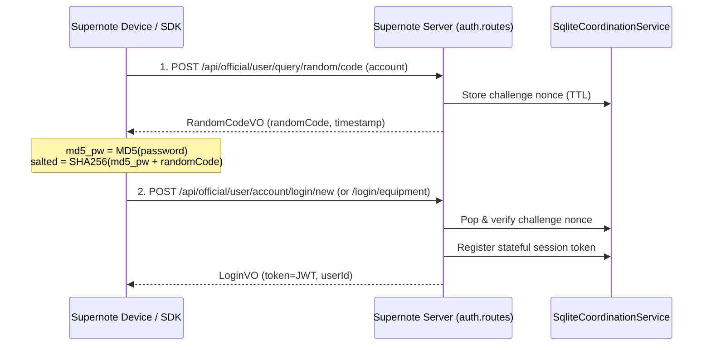
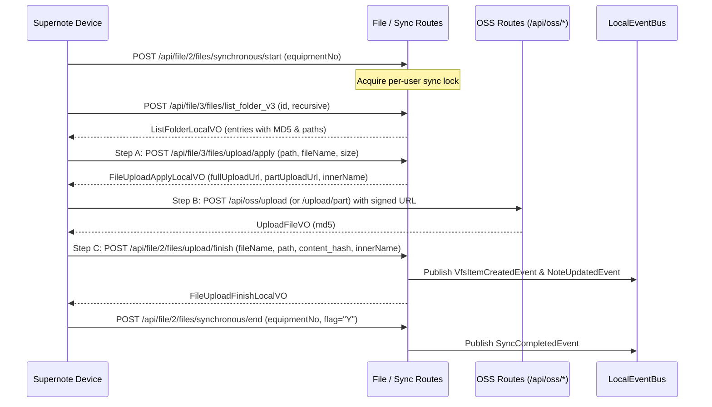
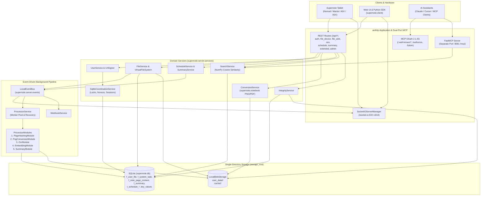

# Supernote Server Architecture & Wire Protocol Guide

This document describes both:

1. **The Supernote Private Cloud Wire Protocol** — the HTTP, OSS transfer, and Socket.IO contract required by physical Supernote hardware tablets (Nomad, Manta, A5X, A6X) and companion apps.
2. **This Project's Python/Asyncio Server Architecture** — how `supernote.server` implements that wire protocol alongside a local Virtual File System (VFS), content-addressable blob storage, an event-driven AI note processing pipeline, and a Model Context Protocol (MCP) server in a single lightweight Python process.

---

## Part 1: The Supernote Private Cloud Wire Protocol

Ratta's original Supernote Private Cloud server was designed around a Java/Spring Boot + MySQL + Redis + external TCP `QTServer` stack. To remain 100% wire-compatible with unmodified Supernote hardware firmware, `supernote.server` implements the exact REST endpoints, JSON payload conventions (`mashumaro` DTOs/VOs in `supernote.models`), cryptographic handshakes, and real-time Socket.IO events expected by the devices.

### 1.1. Challenge-Response Authentication Protocol

Hardware devices and web clients authenticate via a two-step challenge-response flow to prevent credential replay without requiring plaintext password storage on the wire.

1. **Request Challenge (`POST /api/official/user/query/random/code`)**:
   - Request (`supernote.models.auth.RandomCodeDTO`): `{"account": "user@example.com", "countryCode": "+1"}`
   - Response (`supernote.models.auth.RandomCodeVO`): `{"randomCode": "12345678", "timestamp": 1678888888000}`
2. **Submit Salted Hash (`POST /api/official/user/account/login/new` or `/api/official/user/account/login/equipment`)**:
   - The client hashes the password with MD5 (`md5_pass = MD5(plain_password)`) and salts it with the challenge (`final_pass = SHA256(md5_pass + randomCode)`).
   - Request (`supernote.models.auth.LoginDTO`): includes `account`, `password`, `timestamp`, `equipmentNo`, and `equipment` (`1`: Web, `2`: App, `3`: Terminal/Device).
   - Response (`supernote.models.auth.LoginVO`): returns an HS256 JWT `token`.
3. **Authenticated Requests**:
   - Subsequent HTTP requests pass `x-access-token: <JWT>` and a CSRF token obtained from `GET /api/csrf` in `X-XSRF-TOKEN`.

---

### 1.2. 3-Step File Synchronization Protocol

Device synchronization (`/api/file/2/*` and `/api/file/3/*`) follows a stateful session lifecycle (`sync_start -> list/upload/download -> sync_end`) with a 3-step upload flow (`apply -> OSS transfer -> finish`):

- **Sync Session Locking**: `synchronous/start` acquires a per-user sync lock in `CoordinationService` (`ErrorCode.ANOTHER_DEVICE_SYNCING` / `E0078` if another device is actively syncing).
- **State Comparison**: The device compares local file MD5 hashes against the server's `ListFolderLocalVO.entries` (`content_hash`).
- **3-Step Upload (`apply -> OSS upload -> finish`)**:
  1. **Apply** (`/api/file/3/files/upload/apply` or web `/api/file/upload/apply`): Allocates a `storage_key` (`innerName`) and returns signed URLs (`fullUploadUrl` for single-shot uploads, `partUploadUrl` for multipart chunked uploads).
  2. **Transfer** (`/api/oss/upload` or `/api/oss/upload/part`): Streams binary data into `LocalBlobStorage`, verifying the URL signature via `UrlSigner` and returning the computed MD5.
  3. **Finish** (`/api/file/2/files/upload/finish` or web `/api/file/upload/finish`): Commits the VFS metadata node (`UserFileDO`) in SQLite, updates user storage quota (`CapacityDO`), and publishes domain events (`VfsItemCreatedEvent`, `NoteUpdatedEvent`).
- **Signed Downloads (`/api/file/3/files/download_v3` & `/api/file/download/url`)**:
  - Returns a time-limited URL signed by `supernote.server.utils.url_signer.UrlSigner` pointing to `/api/oss/download`, supporting HTTP `Range` requests.

---

### 1.3. Real-Time Socket.IO Push Protocol (Engine.IO v3 & v4)

Physical Supernote tablets maintain a persistent Socket.IO connection to receive instant push notifications when files, tasks, or digests change on the cloud.

- **Engine.IO v3/v4 Compatibility**: Older Supernote firmware connects with Engine.IO v3 (`?EIO=3`), while modern clients use Engine.IO v4 (`?EIO=4`). `socketio_compat_middleware` and `_CompatAsyncServer` in `supernote.server.socket` transparently bridge Engine.IO v3 handshakes and ping/pong frames onto `python-socketio`.
- **Handshake Signature Verification**: Clients connect with `?token=<JWT>&type=<conn_type>&random=<ms>&sign=<hmac>`. `supernote.server.socket_auth.verify_handshake_signature` verifies `HMAC-SHA256(SOCKET_IO_KEY, f"{token}_{type}_{random}")` (alphanumeric base64) and validates the active session token in `UserService`.
- **Heartbeats & Push Channels**:
  - `ratta_ping` -> replies `"received"`.
  - `ClientMessage` with payload `"status"` -> replies `"true"` on `ServerMessage`.
  - Domain events on `LocalEventBus` are automatically broadcast to the user's Socket.IO room (`user_{user_id}`):
    - `ServerMessage` (`FILE-SYN`): `STARTSYNC`, `ADDFILE`, `ADDFOLDER`, `MODIFYFILE`, `MOVEFILE`, `COPYFILE`, `DELETEFILE`, etc.
    - `to-do` (`TASK-SYN`): `QUERY` notification when schedule tasks or task groups change.
    - `digest` (`DIGEST-SYN`): `ADD_DIGEST`, `UPDATE_DIGEST`, `DELETE_DIGEST` when summaries or tags change.

---

## Part 2: This Project's Python/Asyncio Server Architecture

Rather than requiring a heavy multi-container deployment (Java + MySQL + Redis + S3 + QTServer), `supernote.server` consolidates the entire stack into a single self-contained Python `asyncio` application built on `aiohttp`, `SQLAlchemy[asyncio]`, and `aiosqlite`.

### 2.1. Replacing External Infrastructure with Embedded Components

| Legacy Java Component | `supernote.server` Component | Architectural Design |
| :--- | :--- | :--- |
| **Spring Boot + MyBatis + MySQL** | `aiohttp.web` + `SQLAlchemy[asyncio]` + `aiosqlite` + `Alembic` | Asynchronous relational persistence in `<storage_root>/system/supernote.db` with automatic schema migrations on startup (`run_migrations`). |
| **Redis** (locks, tokens, nonces) | `supernote.server.services.coordination.SqliteCoordinationService` | Implements `CoordinationService` (`set_value`, `get_value`, `pop_value`, `increment`, `delete_by_prefix`) backed by the `key_values` (`KeyValueDO`) SQLite table with TTL expiration. Used for sync locks, stateful JWT sessions, single-use URL nonces, rate limiting, and queue pause state. |
| **Physical Folder Tree / S3** | `VirtualFileSystem` (`UserFileDO`) + `LocalBlobStorage` | Decouples logical paths from physical storage. `f_user_file` stores the hierarchical directory adjacency list (`directory_id`), while `LocalBlobStorage` stores immutable blobs sharded by prefix (`<storage_root>/<bucket>/<key[:2]>/<key>`) in `user_data` (`USER_DATA_BUCKET`) and `cache` (`CACHE_BUCKET`). |
| **External TCP `QTServer`** | `supernote.server.services.conversion.ConversionService` | Replaces the proprietary TCP socket conversion server by calling `supernote.notebook.ImageConverter` and `supernote.notebook.PdfConverter` directly in worker threads and caching outputs in `CACHE_BUCKET`. |
| **Message Broker** | `supernote.server.events.LocalEventBus` | In-process `asyncio` pub/sub bus that decouples HTTP request handlers from background AI processing (`ProcessorService`), real-time device notifications (`SocketIOServerManager`), blob garbage collection (`BlobCleanupEvent`), and outbound webhooks (`WebhookService`). |

---

### 2.2. Core Database Schema (`supernote.server.db.models`)

All timestamps follow the Supernote protocol convention of 64-bit Unix epoch milliseconds (`int(time.time() * 1000)`).

- **Virtual File System (`supernote/server/db/models/file.py`)**:
  - `UserFileDO` (`f_user_file`): Adjacency-list tree where `directory_id = 0` is the user's root directory. Folders (`is_folder = "Y"`) are purely logical rows; files (`is_folder = "N"`) reference physical blobs via `storage_key` and `md5`. Soft-deleted items set `is_active = "N"`.
  - `RecycleFileDO` (`f_recycle_file`) & `CapacityDO` (`f_capacity`): Track recycle bin entries and per-user storage usage.
- **Note Processing & Intelligence (`supernote/server/db/models/note_processing.py`)**:
  - `NotePageContentDO` (`f_note_page_content`): Keyed by `(file_id, page_id)`. Stores the page's 0-based `page_index`, layer metadata `content_hash`, extracted `text_content` (OCR), JSON `embedding` vector, and `embedding_model` identifier.
  - `SystemTaskDO` (`f_system_task`): Keyed by `(file_id, task_type, key)` where `key` is `"global"` or `"page_{page_id}"`. Tracks `ProcessingStatus` (`PENDING`, `PROCESSING`, `COMPLETED`, `FAILED`), module `data` (version/model tag), `retry_count`, and `last_error`.
- **Summaries & Schedule (`supernote/server/db/models/summary.py`, `schedule.py`)**:
  - `SummaryDO` (`f_summary`) & `SummaryTagDO` (`f_summary_tag`): Store both user-created digests/annotations and server-generated `OCR` transcripts and AI synthesis summaries.
  - `ScheduleTaskGroupDO` (`t_schedule_task_group`), `ScheduleTaskDO` (`t_schedule_task`), `ScheduleRecurTaskDO` (`t_schedule_recur_task`), and `ScheduleSortDO` (`t_schedule_sort`): Store synced device tasks and task lists.

---

### 2.3. Asynchronous Note Processing Pipeline (`ProcessorService`)

When a `.note` file is uploaded or updated (`NoteUpdatedEvent`) or when a device sync session finishes (`SyncCompletedEvent`), `supernote.server.services.processor.ProcessorService` enqueues the `file_id` for background processing without blocking the HTTP response.

1. **Global Pre-Processing (`PageHashingModule`)**:
   - Parses `.note` metadata via `supernote.notebook.parse_metadata`, computes an MD5 hash for each page's metadata (`PAGEID`), updates `NotePageContentDO`, and deletes downstream `SystemTaskDO` checkpoints only for modified or deleted pages.
2. **Per-Page Parallel Processing (bounded by `page_concurrency`)**:
   - `PngConversionModule` (`TaskType.PNG_CONVERSION`): Renders only the target page (`load_notebook(..., page_number=page_index)`) to PNG and stores it in `CACHE_BUCKET`.
   - `OcrModule` (`TaskType.OCR_EXTRACTION`): Sends the cached page PNG to the configured `OcrModel` (e.g., Gemini Flash) and writes `text_content` to `NotePageContentDO`.
   - `EmbeddingModule` (`TaskType.EMBEDDING_GENERATION`): Generates a vector embedding from `text_content` via `EmbeddingModel` and stores it on `NotePageContentDO`.
3. **Global Post-Processing (`SummaryModule`)**:
   - Once all pages have OCR text, assembles the full notebook transcript (`OCR` `SummaryDO`) and invokes `SummaryModel` to generate a chronological synthesis (`SummaryDO`) inside a parent Summary Group.
   - Emits `NoteProcessingCompletedEvent` upon completion.

For full pipeline semantics, state machine rules, and failure recovery details, see `supernote.guides.note_processing_design` ([`docs/note_processing_design.md`](../../docs/note_processing_design.md)).

---

### 2.4. Dual-Port Model Context Protocol (MCP) Server

When `mcp_enabled` is configured, `create_app` in `supernote.server.app` exposes the user's notebook knowledge base to AI assistants using a dual-port OAuth 2.1 + FastMCP architecture:

- **OAuth 2.1 Authorization Server (Main HTTP Port, e.g. `:8080`)**: Mounts `supernote.server.mcp.auth.create_auth_app` via `aiohttp_asgi.ASGIResource` to serve `/.well-known/oauth-authorization-server`, `/authorize`, `/login-bridge`, and `/token`, authenticating against `UserService` and storing OAuth codes/tokens in `SqliteCoordinationService`.
- **MCP Resource Server (Dedicated MCP Port, e.g. `:8081/mcp`)**: Runs `supernote.server.mcp.server.create_mcp_server` in a background `asyncio.Task`, exposing semantic search (`search_chunks`), notebook listing (`list_notebooks`), and transcript retrieval (`get_transcript`) backed by `SearchService`.
