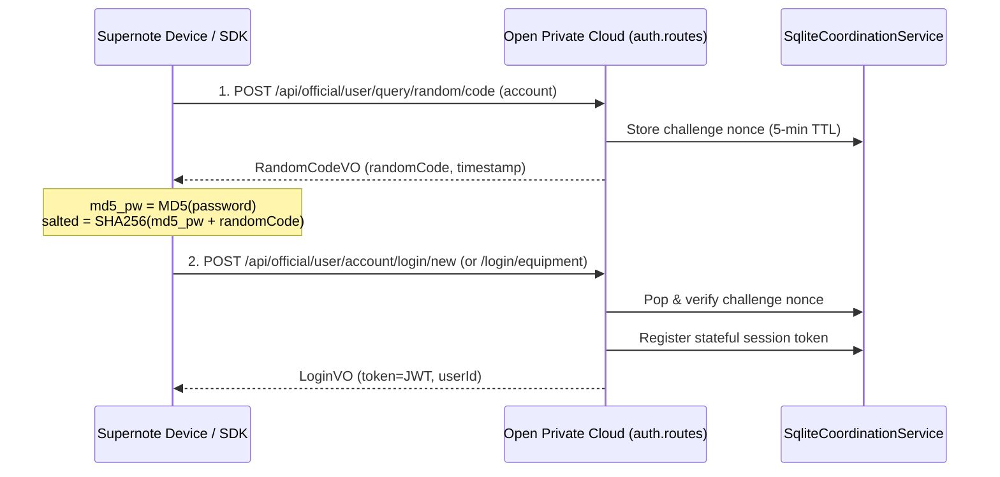
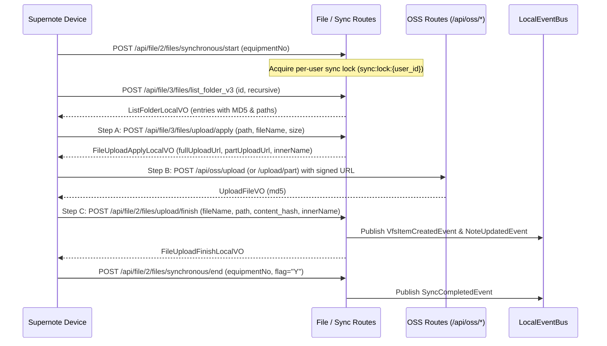
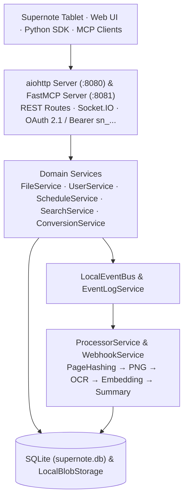

# Open Private Cloud Server Architecture & Wire Protocol

This document describes the architecture of the **Open Private Cloud for Supernote** Python server (`supernote.server`) and the Supernote Private Cloud wire protocol it implements:

1. **The Supernote Private Cloud Wire Protocol** — the HTTP, OSS transfer, and Socket.IO contract required by physical Supernote hardware tablets (Nomad, Manta, A5X, A6X) and companion apps.
2. **This Project's Python/Asyncio Server Architecture** — how `supernote.server` implements that wire protocol alongside a local Virtual File System (VFS), content-addressable blob storage, an event-driven AI note processing pipeline, an append-only domain event log, and a Model Context Protocol (MCP) server in a single lightweight Python process.

Open Private Cloud is an asynchronous Python server built to run as a lightweight, self-hosted service using a single SQLite database and local file storage:

- **HTTP / Web Framework**: `aiohttp` (`supernote.server.app`) serving device sync endpoints, Web UI routes, signed object storage endpoints, and the static Vue 3 Web UI (`supernote/server/static/`).
- **Database**: SQLAlchemy 2.0 (async) with `aiosqlite` and Alembic migrations (`supernote/alembic/`) backed by a single SQLite file (`storage/system/supernote.db`).
- **Coordination & Session State**: `CoordinationService` (`supernote.server.services.coordination.SqliteCoordinationService`, backed by `KeyValueDO`) manages login challenges, stateful JWT sessions, sync session locks, event log pruning watermarks, and single-use URL signing nonces.
- **Virtual Filesystem, Quotas & Storage**: `VirtualFileSystem` (`supernote.server.services.vfs`) and `FileService` (`supernote.server.services.file`) track the logical folder tree in `UserFileDO` (`f_user_file`), soft-deleted items in `RecycleFileDO` (`f_recycle_file`), and enforce two-tier storage quotas (`UserDO.total_capacity` -> `default_user_quota` -> volume free space), while `LocalBlobStorage` (`supernote.server.services.blob`) stores binary file content on disk by bucket (`supernote-user-data`, `supernote-cache`).
- **Authentication**: Challenge-response login issuing `HS256` JWTs (`x-access-token` header) backed by session state in `CoordinationService`, plus revocable static Bearer API keys (`sn_...` in `ApiKeyDO` / `f_api_key`) for CLI automation and MCP agents.
- **Notebook Rendering & AI Processing**: `ConversionService` (`supernote.server.services.conversion`) and `ProcessorService` (`supernote.server.services.processor`) use the local `supernote.notebook` library to parse `.note` metadata (`NoteMetadataDO`, `NotePageMetadataDO`), render pages to PNG/PDF, and optionally run OCR, summarization, and vector embeddings (automatically skipping blank pages where `has_drawables == False`).
- **Domain Event Log & Real-Time Messaging**: `EventLogService` (`supernote.server.components.events`) persists per-user domain events (`UserEventDO` in `f_user_event`) for cursor-based incremental sync, while `SocketIOServerManager` (`supernote.server.components.socketio`, powered by `python-socketio` with Engine.IO v3 compatibility middleware) subscribes to `LocalEventBus` and pushes sync notifications to connected Supernote devices.

---

## Supernote Private Cloud Wire Protocol

Ratta's original Supernote Private Cloud server was designed around a Java/Spring Boot + MySQL + Redis + external TCP `QTServer` stack. To remain 100% wire-compatible with unmodified Supernote hardware firmware, `supernote.server` implements the exact REST endpoints, JSON payload conventions (`mashumaro` DTOs/VOs in `supernote.models`), cryptographic handshakes, and real-time Socket.IO events expected by the devices.

### Challenge-Response Authentication & API Keys

Hardware devices and web clients authenticate via a two-step challenge-response flow to prevent credential replay without requiring plaintext password transmission on the wire.



#### Get Random Code (Challenge)

**Endpoint**: `POST /api/official/user/query/random/code`

**Request (`supernote.models.auth.RandomCodeDTO`)**:
```json
{
  "account": "user@example.com",
  "countryCode": "+1"
}
```

**Response (`supernote.models.auth.RandomCodeVO`)**:
```json
{
  "success": true,
  "randomCode": "12345678",
  "timestamp": "1678888888000"
}
```

`UserService` stores the challenge in `CoordinationService` under `challenge:{account}:{timestamp}` with a 5-minute TTL.

#### Submit Salted Login Hash

**Endpoint**: `POST /api/official/user/account/login/new` (or `POST /api/official/user/account/login/equipment` for hardware device logins)

**Request (`supernote.models.auth.LoginDTO`)**:
```json
{
  "account": "user@example.com",
  "password": "SHA256_HASH_OF_PASSWORD",
  "timestamp": "1678888888000",
  "equipmentNo": "SN100B...",
  "equipment": 3,
  "loginMethod": "2"
}
```

`equipment` indicates the client type (`1`: Web, `2`: App, `3`: Terminal/Device, `4`: Platform).

**Password Hashing Logic**:
1. **MD5 Hash**: `md5_pass = MD5(plain_text_password)` (stored on `UserDO.password_md5`).
2. **Salted SHA256 Hash**: `client_hash = SHA256(md5_pass + randomCode)`.
3. On verification, the server consumes (`pop_value`) the challenge from `CoordinationService` and compares `SHA256(user.password_md5 + random_code)` using constant-time `hmac.compare_digest`.

**Response (`supernote.models.auth.LoginVO`)**:
```json
{
  "success": true,
  "token": "eyJ0eXAiOiJKV1Qi...",
  "counts": "0",
  "isBind": "Y",
  "isBindEquipment": "Y",
  "userName": "user@example.com",
  "soldOutCount": 0
}
```

#### Token Usage, Revocation & Static Bearer API Keys (`sn_...`)

- **Session JWT Header**: `x-access-token: <token>` (also accepted via `Authorization: Bearer <token>`, cookie, or query parameter where applicable, plus CSRF validation via `GET /api/csrf` and `X-XSRF-TOKEN` on cookie-backed web routes).
- **Signing Key**: Configured via `SUPERNOTE_JWT_SECRET` / `auth.secret_key`, or auto-generated as a random 256-bit secret and persisted in `CoordinationService` (`system:jwt_secret_key`).
- **Stateful Session Validation**: Every authenticated JWT request verifies both the signature/expiration (`auth.expiration_hours` for web/CLI, `auth.device_expiration_hours` for hardware) and active session state in `CoordinationService`, allowing individual device unlinks, password resets, or global key rotation to revoke tokens immediately.
- **Static Bearer API Keys (`sn_...`)**: Headless scripts, CLI automation, and MCP clients can authenticate with `Authorization: Bearer sn_...` keys created via `POST /api/extended/keys` (`supernote cloud keys create`). Raw keys are hashed with SHA-256 into `ApiKeyDO` (`f_api_key`). Sensitive account/key-mutation routes use `@interactive_session_only` (`supernote.server.routes.decorators.interactive_session_only`) to reject static API keys (`request["auth_method"] == "api_key"`).
- **OAuth Client Grants**: Each OAuth authorization approved through `/login-bridge` is recorded as an `OAuthGrantDO` (`oauth_grants`) row when its code is exchanged. The row holds SHA-256 digests of the grant's current access token and its refresh token, so `UserService.load_oauth_access_token` verifies a Bearer token in one query for REST and `/mcp` alike. `GET /api/extended/oauth/grants` lists a user's authorized clients and `DELETE /api/extended/oauth/grants/{grantId}` (both `@interactive_session_only`) deletes the row. Revoking a refresh token through `/revoke`, or changing or resetting the password, ends the grant too.

---

### 3-Step File Synchronization Protocol

Device synchronization (`/api/file/2/*` and `/api/file/3/*`) runs inside a locked session lifecycle (`Start -> List / Upload / Download / Delete -> End`) with a 3-step upload flow (`Apply -> Transfer -> Finish`):



#### Start Sync Session (`POST /api/file/2/files/synchronous/start`)

**Request (`SynchronousStartLocalDTO`)**:
```json
{
  "equipmentNo": "SN100B..."
}
```

Checks `CoordinationService` (`sync:lock:{user_id}`, 300 s TTL) to ensure no other device is concurrently syncing the same account. If another device holds the lock, the server returns HTTP `409` with error code `E0078` (`ErrorCode.ANOTHER_DEVICE_SYNCING`). Also returns `synType` indicating whether initial sync has already completed (`sync:initialized:{user_id}`).

#### List Files (`POST /api/file/3/files/list_folder_v3`)

**Request (`ListFolderLocalDTO`)**:
```json
{
  "id": 0,
  "recursive": true,
  "equipmentNo": "SN100B..."
}
```

**Response (`ListFolderLocalVO`)**:
```json
{
  "success": true,
  "equipmentNo": "SN100B...",
  "entries": [
    {
      "id": "1001",
      "name": "MyNote.note",
      "tag": "file",
      "size": 1024,
      "content_hash": "MD5_HASH",
      "path_display": "/MyNote.note",
      "parent_path": "/",
      "is_downloadable": true,
      "lastUpdateTime": 1678888888000
    }
  ]
}
```

Synchronization is **state-based**: the client compares server MD5 hashes (`content_hash`) and paths against local state to decide uploads, downloads, or deletions (`POST /api/file/3/files/delete_folder_v3`).

#### Upload File (`Apply -> Transfer -> Finish`)

- **Step A: Apply (`POST /api/file/3/files/upload/apply` or web `/api/file/upload/apply`)**:
  Validates prospective upload `size` against the user's effective quota (`UserDO.total_capacity` or `default_user_quota`) and physical disk headroom (`LocalBlobStorage.get_available_bytes()`), raising `QuotaExceeded` (`E0012`) if exceeded. Allocates a `storage_key` (`innerName`) and returns signed URLs (`fullUploadUrl` and `partUploadUrl`).
  ```json
  {
    "path": "/Note/MyNote.note",
    "fileName": "MyNote.note",
    "size": "1024",
    "equipmentNo": "SN100B..."
  }
  ```
- **Step B: Transfer (`POST /api/oss/upload` or `POST|PUT /api/oss/upload/part`)**:
  Streams binary data into `LocalBlobStorage`, verifying the URL signature via `UrlSigner`. For chunked uploads, parts are staged under chunk keys and merged into `USER_DATA_BUCKET` when `partNumber == totalChunks`.
- **Step C: Finish (`POST /api/file/2/files/upload/finish` or web `/api/file/upload/finish`)**:
  Verifies the stored blob's MD5 against `content_hash`, re-verifies quota constraints inside the VFS transaction, commits the `UserFileDO` row in SQLite, and publishes domain events (`VfsItemCreatedEvent` / `VfsItemUpdatedEvent`, `NoteUpdatedEvent`) onto `LocalEventBus`.

#### Download File (`POST /api/file/3/files/download_v3` -> `GET /api/oss/download`)

1. **Apply**: Looks up the `UserFileDO` entry by `id`, verifies ownership, and returns `FileDownloadLocalVO` containing a signed `url` (`/api/oss/download?path={id}&signature=...`).
2. **Transfer**: Verifies the URL signature via `UrlSigner` (`single_use=False`) and streams bytes with HTTP `Range` support from `LocalBlobStorage`.

#### End Sync Session (`POST /api/file/2/files/synchronous/end`)

**Request (`SynchronousEndLocalDTO`)**:
```json
{
  "equipmentNo": "SN100B...",
  "flag": "Y"
}
```

Releases `sync:lock:{user_id}` if held by `equipmentNo`. When `flag != "N"`, marks `sync:initialized:{user_id}`, runs opportunistic expired recycle-bin pruning, and publishes `SyncCompletedEvent` onto `LocalEventBus`.

---

### Signed Object Storage URLs (`/api/oss/`)

`UrlSigner` (`supernote.server.utils.url_signer.UrlSigner`) secures `/api/oss/*` upload and download URLs without requiring `x-access-token` headers on direct blob transfers:

- **Mechanism**: Appends a `signature` query parameter containing an `HS256` JWT signed with the server secret key.
- **Signed Claims**: Embeds the target `path`, `user` email, expiration (`exp`, default 15 minutes), and a unique `nonce` (`jti`).
- **Single-Use vs. Reusable Tokens**: Upload URLs enforce single-use nonce consumption in `CoordinationService` (or consume on the final chunk for multipart uploads), while download URLs allow range requests within the expiry window (`single_use=False`).

---

### Real-Time Socket.IO Push Protocol (Engine.IO v3 & v4)

Physical Supernote tablets maintain a persistent Socket.IO connection to receive instant push notifications when files, tasks, or digests change on the cloud.

- **Engine.IO v3/v4 Compatibility**: Older Supernote firmware connects with Engine.IO v3 (`?EIO=3`), while modern clients use Engine.IO v4 (`?EIO=4`). `socketio_compat_middleware` and `_CompatAsyncServer` in `supernote.server.components.socketio` transparently bridge Engine.IO v3 handshakes and ping/pong frames onto `python-socketio`.
- **Handshake Signature Verification**: Clients connect with `?token=<JWT>&type=<conn_type>&random=<ms>&sign=<hmac>`. `supernote.server.socket_auth.verify_handshake_signature` verifies `HMAC-SHA256(SOCKET_IO_KEY, f"{token}_{type}_{random}")` (alphanumeric base64) and validates the active session token in `UserService`.
- **Heartbeats & Push Channels**:
  - `ratta_ping` -> replies `"received"`.
  - `ClientMessage` with payload `"status"` -> replies `"true"` on `ServerMessage`.
  - Domain events on `LocalEventBus` are automatically broadcast to the user's Socket.IO room (`user_{user_id}`):
    - `ServerMessage` (`FILE-SYN`): `STARTSYNC`, `ADDFILE`, `ADDFOLDER`, `MODIFYFILE`, `MOVEFILE`, `COPYFILE`, `DELETEFILE`, etc.
    - `to-do` (`TASK-SYN`): `QUERY` notification when schedule tasks or task groups change.
    - `digest` (`DIGEST-SYN`): `ADD_DIGEST`, `UPDATE_DIGEST`, `DELETE_DIGEST` when summaries or tags change.

---

## Python/Asyncio Server Architecture

Rather than requiring a heavy multi-container deployment (Java + MySQL + Redis + S3 + QTServer), `supernote.server` consolidates the entire stack into a single self-contained Python `asyncio` application built on `aiohttp`, `SQLAlchemy[asyncio]`, and `aiosqlite`.



### Replacing External Infrastructure with Embedded Components

| Legacy Java Component | `supernote.server` Component | Architectural Design |
| :--- | :--- | :--- |
| **Spring Boot + MyBatis + MySQL** | `aiohttp.web` + `SQLAlchemy[asyncio]` + `aiosqlite` + `Alembic` | Asynchronous relational persistence in `<storage_root>/system/supernote.db` with automatic schema migrations on startup (`run_migrations`). |
| **Redis** (locks, tokens, nonces) | `supernote.server.services.coordination.SqliteCoordinationService` | Implements `CoordinationService` (`set_value`, `get_value`, `pop_value`, `increment`, `delete_by_prefix`) backed by the `key_values` (`KeyValueDO`) SQLite table with TTL expiration. Used for sync locks, stateful JWT sessions, single-use URL nonces, rate limiting, and queue pause state. |
| **Physical Folder Tree / S3** | `VirtualFileSystem` (`UserFileDO`) + `LocalBlobStorage` | Decouples logical paths from physical storage. `f_user_file` stores the hierarchical directory adjacency list (`directory_id`), while `LocalBlobStorage` stores immutable blobs sharded by prefix (`<storage_root>/<bucket>/<key[:2]>/<key>`) in `supernote-user-data` (`USER_DATA_BUCKET`) and `supernote-cache` (`CACHE_BUCKET`). |
| **External TCP `QTServer`** | `supernote.server.services.conversion.ConversionService` | Replaces the proprietary TCP socket conversion server by calling `supernote.notebook.ImageConverter` and `supernote.notebook.PdfConverter` directly in worker threads and caching outputs in `CACHE_BUCKET`. |
| **Message Broker** | `supernote.server.events.LocalEventBus` + `EventLogService` | In-process `asyncio` pub/sub bus (`LocalEventBus`) paired with a persistent, cursor-paginated SQLite domain event log (`EventLogService` / `UserEventDO` in `f_user_event`), decoupling HTTP handlers from background AI processing (`ProcessorService`), real-time Socket.IO notifications, blob garbage collection, and outbound webhooks (`WebhookService`). |

---

### Core Database Schema (`supernote.server.db.models`)

All timestamps follow the Supernote protocol convention of 64-bit Unix epoch milliseconds (`int(time.time() * 1000)`), and user-owned tables enforce multi-tenant scoping by `user_id`.

- **Users, Devices & Static API Keys (`supernote/server/db/models/user.py`, `api_key.py`)**:
  - `UserDO` (`users`): Stores user accounts, `password_md5`, `is_admin`, and per-user storage quota override (`total_capacity`, where `0` defers to `default_user_quota` or volume free space).
  - `DeviceDO` (`f_device`) & `EquipmentUserDO` (`f_equipment_user`): Track bound Supernote hardware tablets.
  - `ApiKeyDO` (`f_api_key`): Stores revocable static Bearer API keys (`sn_...`) keyed by `(user_id, id)` with unique SHA-256 `key_hash`, `key_prefix`, `name`, `created_time`, and `last_used_time`.
- **Virtual File System (`supernote/server/db/models/file.py`)**:
  - `UserFileDO` (`f_user_file`): Adjacency-list tree where `directory_id = 0` is the user's root directory. Folders (`is_folder = "Y"`) are logical rows; files (`is_folder = "N"`) reference physical blobs via `storage_key` and `md5`. Soft-deleted items set `is_active = "N"`.
  - `RecycleFileDO` (`f_recycle_file`) & `CapacityDO` (`f_capacity`): Track recycle bin entries and per-user storage usage.
- **Note Metadata, Processing & Intelligence (`supernote/server/db/models/note_processing.py`)**:
  - `NoteMetadataDO` (`f_note_metadata`): Keyed by `(user_id, file_id)`. Stores cached notebook-level `.note` binary metadata (`native_file_id`, `file_type`, `signature`, `total_pages`, `header_json`, `footer_json`).
  - `NotePageMetadataDO` (`f_note_page_metadata`): Keyed by `(user_id, file_id, page_index)` across `0..total_pages - 1`. Stores `page_id`, `content_hash`, `page_style` (`PAGESTYLE`), `has_ink` (MAINLAYER/BGLAYER vector/bitmap ink), `has_drawables` (foreground ink, textboxes, or geometric shapes), `page_json`, `keywords_json` (`PAGE_KEYWORDS`), `titles_json` (`PAGE_TITLES`), and `links_json` (`PAGE_LINKS`).
  - `NotePageContentDO` (`f_note_page_content`): Keyed by `(user_id, file_id, page_id)`. Stores the page's 0-based `page_index`, layer metadata `content_hash`, extracted `text_content` (OCR), JSON `embedding` vector, and `embedding_model` identifier.
  - `SystemTaskDO` (`f_system_task`): Keyed by `(user_id, file_id, task_type, key)` where `key` is `"global"` or `"page_{page_id}"`. Tracks `ProcessingStatus` (`PENDING`, `PROCESSING`, `COMPLETED`, `FAILED`), module `data` (version/model tag), `retry_count`, and `last_error`.
- **Summaries, Schedule & Domain Event Log (`supernote/server/db/models/summary.py`, `schedule.py`, `event_log.py`)**:
  - `SummaryDO` (`f_summary`) & `SummaryTagDO` (`f_summary_tag`): Store user-created digests/categories/annotations and server-generated AI synthesis summaries.
  - `ScheduleTaskGroupDO` (`t_schedule_task_group`), `ScheduleTaskDO` (`t_schedule_task`), `ScheduleRecurTaskDO` (`t_schedule_recur_task`), and `ScheduleSortDO` (`t_schedule_sort`): Store synced device tasks and task lists.
  - `UserEventDO` (`f_user_event`): Append-only domain event log keyed by monotonic `seq` with `(user_id, seq)` index, storing `event_type`, `actor`, `entity_type`, `entity_id`, `related_file_id`, and JSON `payload` (pruned after `event_log_retention_days`).

---

### Asynchronous Note Processing Pipeline (`ProcessorService`)

When a `.note` file is uploaded or updated (`NoteUpdatedEvent`) or when a device sync session finishes (`SyncCompletedEvent`), `supernote.server.services.processor.ProcessorService` enqueues the `file_id` for background processing without blocking the HTTP response.

1. **Global Pre-Processing (`PageHashingModule`, `version="v2"`)**:
   - Parses `.note` metadata via `supernote.notebook.parse_metadata`, computes an MD5 hash for each page's metadata (`PAGEID`), selectively loads uncached page streams (`load(..., page_number=i)`) to detect foreground ink/drawables, upserts `NoteMetadataDO`, `NotePageMetadataDO`, and `NotePageContentDO`, and invalidates downstream `SystemTaskDO` checkpoints only for modified or deleted pages.
2. **Per-Page Parallel Processing (bounded by `page_concurrency`)**:
   - `PngConversionModule` (`TaskType.PNG_CONVERSION`): Renders only the target page (`load_notebook(..., page_number=page_index)`) to PNG and stores it in `CACHE_BUCKET`.
   - `OcrModule` (`TaskType.OCR_EXTRACTION`): If `NotePageMetadataDO.has_drawables` is `False` (blank page), writes `text_content = ""` without requiring a PNG or calling the OCR LLM. Otherwise formats the prompt (routing by filename stem -> normalized `page_style` -> `default` and injecting `Page Keywords:` from `NotePageMetadataDO.keyword_texts`), sends the cached page PNG to `OcrModel`, and writes `text_content` to `NotePageContentDO`.
   - `EmbeddingModule` (`TaskType.EMBEDDING_GENERATION`): Skips blank pages (`content.is_blank`); generates a vector embedding from non-blank `text_content` via `EmbeddingModel` and stores it on `NotePageContentDO`.
3. **Global Post-Processing (`SummaryModule`)**:
   - Once all pages have completed OCR, assembles the non-blank page transcripts in memory and invokes `SummaryModel` to generate a chronological synthesis (`SummaryDO`) under the shared `"AI Summaries"` Digest category.
   - Emits `NoteProcessingCompletedEvent` upon completion.

For full pipeline semantics, state machine rules, and failure recovery details, see `supernote.guides.note_processing_design` ([`docs/note_processing_design.md`](../../docs/note_processing_design.md)).

---

### Dual-Port Model Context Protocol (MCP) Server

When `mcp_enabled` is configured, `create_app` in `supernote.server.app` exposes the user's notebook knowledge base to AI assistants using a dual-port OAuth 2.1 + FastMCP architecture:

- **OAuth 2.1 Authorization Server (Main HTTP Port, e.g. `:8080`)**: Mounts `supernote.server.components.oauth.http.create_auth_app` via `aiohttp_asgi.ASGIResource` to serve `/.well-known/oauth-authorization-server`, `/authorize`, `/login-bridge`, and `/token`, authenticating against `UserService`, keeping short-lived authorization codes in `SqliteCoordinationService` and access/refresh tokens as digests on `oauth_grants` rows.
- **MCP Resource Server (Dedicated MCP Port, e.g. `:8081/mcp`)**: Runs `supernote.server.components.mcp.server.create_mcp_server` in a background `asyncio.Task` (authenticating both OAuth 2.1 Bearer tokens and static `sn_...` API keys), hosting tools registered via `McpRegistrar` by vertical components (`events`, `search`, `transcript`, `schedule`).
