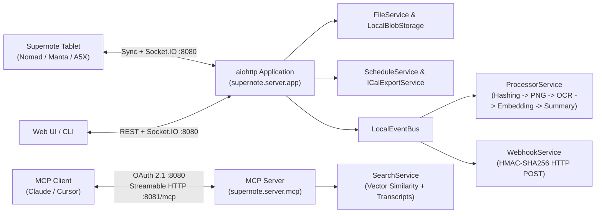

# Supernote Private Cloud & Knowledge Hub (`supernote.server`)

`supernote.server` is an asynchronous (`aiohttp` + `SQLAlchemy` + `SQLite`) self-hosted implementation of the **Supernote Private Cloud** protocol, extended with a 5-stage background `.note` processing pipeline, a single-page Web UI, signed outbound webhooks, RFC 5545 iCalendar task feeds, and a Streamable HTTP **Model Context Protocol (MCP)** server.

---

## Architecture Overview



### Package Structure

| Subpackage / Module | Responsibility |
| :--- | :--- |
| `supernote.server.app` | Application factory (`supernote.server.app.create_app`), middleware stack (proxy headers, Socket.IO Engine.IO v3/v4 compatibility, Prometheus metrics, structured trace logging, JWT verification), and lifecycle hooks. |
| `supernote.server.config` | Strongly-typed YAML and `SUPERNOTE_*` environment configuration (`supernote.server.config.ServerConfig`, `supernote.server.config.AuthConfig`, `supernote.server.config.AiConfig`, `supernote.server.config.WebhookConfig`). |
| `supernote.server.routes` | HTTP route handlers for hardware device sync (`file_device`), Web UI file APIs (`file_web`), local OSS signed blob transfer (`oss`), schedule/tasks (`schedule`), summaries (`summary`), search (`extended`), authentication (`auth`), and admin operations (`admin`). |
| `supernote.server.services` | Core domain services: `supernote.server.services.file.FileService` (transactional VFS), `supernote.server.services.blob.LocalBlobStorage` (content-addressable storage), `supernote.server.services.processor.ProcessorService` (5-stage `.note` pipeline), `supernote.server.services.search.SearchService`, `supernote.server.services.schedule.ScheduleService`, `supernote.server.services.ical_export.ICalExportService`, `supernote.server.services.webhook.WebhookService`, and `supernote.server.services.integrity.IntegrityService`. |
| `supernote.server.ai` | Provider-agnostic AI interfaces (`supernote.server.ai.models.ocr.OcrModel`, `supernote.server.ai.models.summary.SummaryModel`, `supernote.server.ai.models.embedding.EmbeddingModel`), prompt formatting (`supernote.server.ai.prompts`), and Google Gemini / OpenAI-compatible implementations. |
| `supernote.server.mcp` | OAuth 2.1 / IndieAuth Authorization Server (`supernote.server.mcp.auth`) and Streamable HTTP MCP Resource Server (`supernote.server.mcp.server`) exposing `list_notebooks`, `search_notebook_chunks`, and `get_notebook_transcript`. |
| `supernote.server.db` | Async SQLAlchemy 2.0 session management (`supernote.server.db.session.DatabaseSessionManager`), ORM models (`UserDO`, `UserFileDO`, `NotePageContentDO`, `SystemTaskDO`, `SummaryDO`, `ScheduleTaskDO`), and Alembic migrations. |

---

## Deployment Modes & Memory Footprint

| Mode | Idle RAM | Peak Active RAM | Configuration |
| :--- | :---: | :---: | :--- |
| **Bare Sync Server** | **~133 MB** | **~135 MB** | `web_enabled: false`, `mcp_enabled: false` (`SUPERNOTE_WEB_ENABLED=false`, `SUPERNOTE_MCP_ENABLED=false`). Hardware sync & task sync only. |
| **Full Knowledge Hub (Default)** | **~160 MB** | **~310 MB** | Enables Web UI (`/`), background `.note` page PNG rasterization, MCP server (`:8081/mcp`), and optional AI pipeline. |

---

## Quick Start

### 1. Start the Server

```bash
# Start on 0.0.0.0:8080 (MCP on :8081)
supernote serve

# Or start an isolated ephemeral test instance (pre-seeds debug@example.com / password)
supernote serve --ephemeral
```

### 2. Bootstrap the Admin User

`supernote.server` uses an **Admin-First** bootstrap model: when zero users exist in SQLite, the first registered account automatically receives administrator privileges and locks public registration.

```bash
supernote admin --url http://localhost:8080 user add you@example.com --name "Admin"
supernote cloud login you@example.com --url http://localhost:8080
```

### 3. Configure AI & Webhooks (`config/config.yaml`)

See `supernote.server.config.ServerConfig` for all options. Example using Google Gemini or a local OpenAI-compatible server (Ollama, vLLM, LM Studio):

```yaml
ai:
  providers:
    gemini:
      api_key: "your-gemini-api-key"
    openai:
      base_url: "http://localhost:11434/v1" # Ollama
  ocr:
    provider: gemini
    model: gemini-3.6-flash
    max_concurrency: 5
  summary:
    provider: gemini
    model: gemini-3.6-flash
    max_concurrency: 5
  embedding:
    provider: gemini
    model: gemini-embedding-001
    max_concurrency: 5

webhooks:
  enabled: true
  endpoints:
    - url: "https://n8n.homelab.local/webhook/supernote"
      user: "you@example.com"
      secret: "replace-with-random-secret"
      events:
        - "note.sync_completed"
        - "note.processing_completed"
```

---

## Documentation & Guides

- **[Self-Hosting & Quickstart Guide](../../docs/bootstrap_guide.md)**: Deployment modes, Docker Compose, Admin-First bootstrap, physical Supernote tablet setup, Nginx/Caddy reverse proxy configuration, and safe SQLite + blob backups.
- **[Configuration Reference](../../docs/configuration.md)**: Complete reference for `config/config.yaml`, `SUPERNOTE_*` environment variables, and priority resolution.
- **[AI Pipeline, Custom Prompts & MCP Server](../../docs/mcp.md)**: How the 5-stage processing pipeline works, mixing cloud/local models, filename-based custom prompts (`prompts_dir`), and connecting Claude Desktop or Cursor via OAuth 2.1 + MCP.
- **[Webhooks, Calendar (`.ics`) & Home Assistant Integrations](../../docs/webhooks_and_integrations.md)**: Subscribing to `/api/schedule/feed.ics` `VTODO` feeds, configuring outbound webhooks, verifying `X-Supernote-Signature` HMAC-SHA256 headers, and Home Assistant automations.
