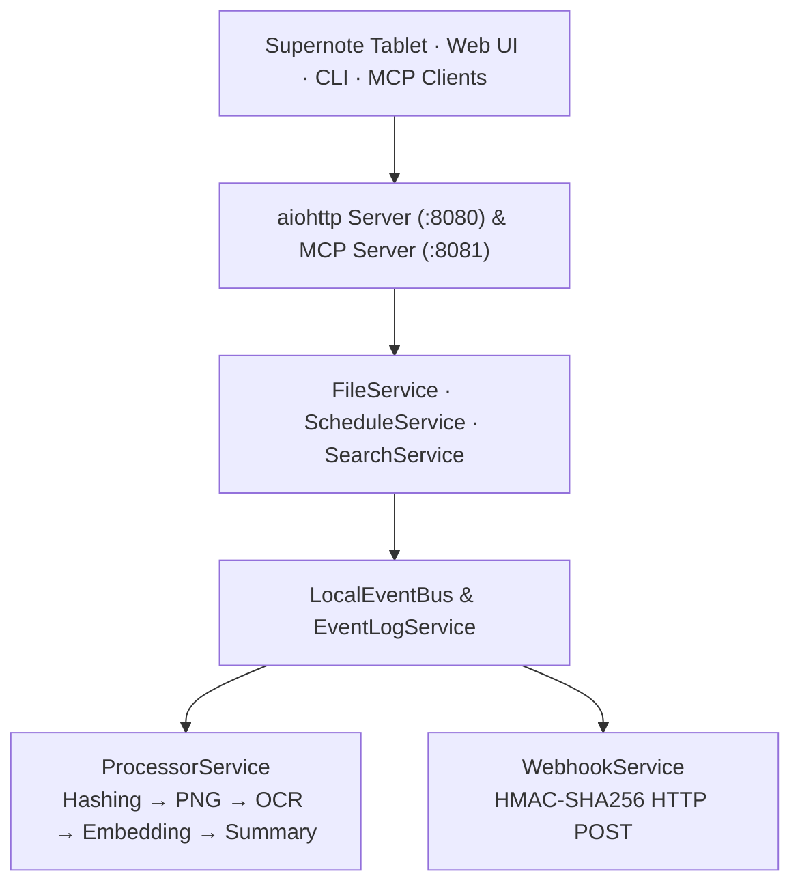

# Open Private Cloud for Supernote (`supernote.server`)

`supernote.server` provides a lightweight, self-hosted Python private cloud server for Ratta Supernote devices (`aiohttp` + `SQLAlchemy` + `SQLite`), enhanced with an optional 5-stage AI note processing pipeline, a single-page Web UI, signed outbound webhooks, RFC 5545 iCalendar task feeds, and a Streamable HTTP **Model Context Protocol (MCP)** server.

> **Unofficial Community Project:** Built in appreciation of Ratta's Supernote products; not affiliated with, endorsed by, or sponsored by Shanghai Ratta Smart Technology Co., Ltd.

---

## Architecture Overview



### Package Structure

| Subpackage / Module | Responsibility |
| :--- | :--- |
| `supernote.server.app` | Application factory (`supernote.server.app.create_app`), middleware stack (proxy headers, Socket.IO Engine.IO v3/v4 compatibility, Prometheus metrics, structured trace logging, JWT & `sn_...` API key verification), and lifecycle hooks. |
| `supernote.server.config` | Strongly-typed YAML and `SUPERNOTE_*` environment configuration (`supernote.server.config.ServerConfig`, `supernote.server.config.AuthConfig`, `supernote.server.config.AiConfig`). |
| `supernote.server.routes` | HTTP route handlers for hardware device sync (`file_device`), Web UI file APIs (`file_web`), local OSS signed blob transfer (`oss`), summaries (`summary`), search/metadata/API keys (`extended`), incremental domain event feed (`events`), authentication (`auth`), and admin operations (`admin`). |
| `supernote.server.services` | Core domain services: `supernote.server.services.file.FileService` (transactional VFS & two-tier storage quotas), `supernote.server.services.blob.LocalBlobStorage` (content-addressable storage), `supernote.server.services.processor.ProcessorService` (5-stage `.note` pipeline), `supernote.server.components.search.service.SearchService`, `supernote.server.components.schedule.service.ScheduleService`, `supernote.server.components.schedule.ical_export.ICalExportService`, `supernote.server.components.webhooks.service.WebhookService`, `supernote.server.components.events.service.EventLogService`, `supernote.server.components.metrics.storage.StorageMetricsCollector`, and `supernote.server.services.integrity.IntegrityService`. |
| `supernote.server.ai` | Provider-agnostic AI interfaces (`supernote.server.ai.models.ocr.OcrModel`, `supernote.server.ai.models.summary.SummaryModel`, `supernote.server.ai.models.embedding.EmbeddingModel`), prompt formatting (`supernote.server.ai.prompts`), and Google Gemini / OpenAI-compatible / macOS Apple Vision implementations. |
| `supernote.server.components.oauth` | OAuth 2.1 / IndieAuth Authorization Server (`supernote.server.components.oauth.provider`, also supporting static `sn_...` Bearer API keys). |
| `supernote.server.components.mcp` | Streamable HTTP MCP Resource Server (`supernote.server.components.mcp.server`) and `McpRegistrar` platform host for component-contributed tools (`events`, `search`, `transcript`, `schedule`). |
| `supernote.server.db` | Async SQLAlchemy 2.0 session management (`supernote.server.db.session.DatabaseSessionManager`), ORM models (`UserDO`, `ApiKeyDO`, `UserFileDO`, `NoteMetadataDO`, `NotePageMetadataDO`, `NotePageContentDO`, `SystemTaskDO`, `SummaryDO`, `ScheduleTaskDO`, `UserEventDO`), and Alembic migrations. |

---

## Deployment Modes & Memory Footprint

| Mode | Idle RAM | Peak Active RAM | Configuration |
| :--- | :---: | :---: | :--- |
| **Bare Sync Server** | **~133 MB** | **~135 MB** | `web_enabled: false`, `mcp_enabled: false` (`SUPERNOTE_WEB_ENABLED=false`, `SUPERNOTE_MCP_ENABLED=false`). Device sync & task sync only; disables Web UI, background PNG rendering, and MCP server. |
| **Full Server + Knowledge Hub (Default)** | **~160 MB** | **~310 MB** | Enables Web UI (`/`), background `.note` page PNG rendering, MCP server (`:8081/mcp`), and optional AI pipeline. |

---

## Quick Start

### Start the Server

```bash
# Start on 0.0.0.0:8080 (MCP on :8081)
supernote serve

# Or start an isolated ephemeral test instance (pre-seeds debug@example.com / password)
supernote serve --ephemeral
```

### Bootstrap the Admin User & API Keys

`supernote.server` uses an **Admin-First** bootstrap model: when zero users exist in SQLite, the first registered account automatically receives administrator privileges and locks public registration.

```bash
supernote admin --url http://localhost:8080 user add you@example.com --name "Admin"
supernote cloud login you@example.com --url http://localhost:8080

# Optional: Create a revocable static Bearer API key (sn_...) for scripts or MCP clients
supernote cloud keys create "local-agent"
```

### Configure AI & Webhooks (`config/config.yaml`)

#### AI Configuration

Configure AI providers and per-capability models (`ocr`, `summary`, `embedding`) in `config/config.yaml` (omitting any capability you want disabled). We recommend `gemini-3.5-flash-lite` (or `gemini-3.6-flash`; see `supernote.guides.ocr_benchmarks` and [Choosing an AI Provider](../../README.md#choosing-an-ai-provider)):

```yaml
ai:
  providers:
    gemini:
      api_key: "your-gemini-api-key"
    openai:
      base_url: "http://localhost:11434/v1" # Ollama
  ocr:
    provider: gemini
    model: gemini-3.5-flash-lite  # or gemini-3.6-flash
    max_concurrency: 5
  summary:
    provider: gemini
    model: gemini-3.5-flash-lite
    max_concurrency: 5
  embedding:
    provider: gemini
    model: gemini-embedding-001
    max_concurrency: 5
```

Gemini offers both a `$0` Free tier (which uses API data for model training) and a Paid tier when linked to a [Cloud Billing account](https://aistudio.google.com/docs/terms#paid-services) (which does not; see [API Privacy](../../README.md#api-privacy-training--data-retention)).

To run the models locally instead, use the `openai` provider with any server that implements the OpenAI API (e.g. Ollama, llama.cpp, vLLM, LM Studio). OCR needs a vision-capable chat model. Providers can be mixed per capability:

```yaml
ai:
  providers:
    openai:
      base_url: "http://localhost:11434/v1"  # Ollama; omit for api.openai.com
      # api_key: "sk-..."                    # required for hosted OpenAI
  ocr:
    provider: openai
    model: gemma3:27b
    max_concurrency: 1
  summary:
    provider: openai
    model: gemma3:27b
    max_concurrency: 1
  embedding:
    provider: openai
    model: embeddinggemma
    max_concurrency: 1
```

On macOS (`pip install "supernote[server,apple]"`), Apple's on-device `Vision` framework (`vision-accurate`) is supported as an offline fallback for basic prose search without an API key or model server. It is not recommended for diagrams, multi-column notes, or Bullet Journal Rapid Logging (see [Choosing an AI Provider](../../README.md#choosing-an-ai-provider)); avoid `vision-fast`, which only detects machine-printed text:

```yaml
ai:
  ocr:
    provider: apple
    model: vision-accurate
    max_concurrency: 2
```

Changing the embedding model re-embeds existing pages automatically.

A provider entry's type defaults to its name. To use more than one server of the same kind, give each entry its own name and a `type`, then point each capability at an entry by name:

```yaml
ai:
  providers:
    ollama:
      type: openai
      base_url: "http://localhost:11434/v1"
    llamacpp:
      type: openai
      base_url: "http://localhost:8080/v1"
  summary:
    provider: ollama
    model: gemma3:27b
  embedding:
    provider: llamacpp
    model: embeddinggemma
```

#### Outbound Webhooks

To send non-blocking HTTP `POST` notifications on server events (e.g., to Home Assistant, n8n, or Zapier), configure `webhooks` in `config/config.yaml` (or enable via `SUPERNOTE_WEBHOOKS_ENABLED=true`):

```yaml
webhooks:
  enabled: true
  endpoints:
    - url: "https://n8n.homelab.local/webhook/supernote"
      user: "you@example.com"
      secret: "replace-with-random-secret"
      events:
        - "note.sync_completed"
        - "note.processing_completed"
```

### Running with Docker

```bash
# Build the image
docker build -t supernote .

# Run the container (mounts /data for storage and /data/config for config.yaml)
docker run -d \
  -p 8080:8080 \
  -p 8081:8081 \
  -v "$(pwd)/data:/data" \
  -e SUPERNOTE_GEMINI_API_KEY="your-key" \
  --name supernote-server \
  supernote
```

### Connecting Your Device

1. Review the [official Private Cloud setup guide](https://support.supernote.com/Whats-New/setting-up-your-own-supernote-private-cloud-beta).
2. Ensure your Supernote device and server are on the same network (or reachable via VPN / HTTPS reverse proxy).
3. On your Supernote device, go to **Settings** > **Sync** > **Supernote Cloud**.
4. Select **Private Cloud** and enter your server's IP and port (e.g., `http://192.168.1.100:8080`).
5. Log in using the credentials created via `supernote admin user add`.
6. Configure folders to sync (e.g., `Note`, `Document`, `EXPORT`, `INBOX`, `SCREENSHOT`) in **Settings** > **Drive** > **Private Cloud**.

---

## Robustness & Maintenance

Open Private Cloud is built for long-term stability:

- **Database Migrations**: Uses Alembic for seamless schema and data updates (see [Alembic Migration History & Conventions](../alembic/README.md)).
- **Background Polling**: Automatically recovers stalled processing tasks and skips blank `.note` pages (`has_drawables == False`) without wasting LLM tokens.
- **Integrity Checks**: Periodically verifies file storage consistency (`supernote admin integrity --full-disk`).
- **Two-Tier Storage Quotas**: Enforces per-user quotas (`supernote admin user set-quota <email> <bytes>`) and server-wide default quotas (`SUPERNOTE_DEFAULT_USER_QUOTA`), bounded by actual storage volume free space.

---

## Security: Rotating Keys & Revoking Tokens

If an access token or signing secret may have been exposed (for example, in older log files prior to upgrading), you can invalidate active credentials at four levels:

### Rotate the Server-Wide JWT Signing Key (Invalidates All Session Tokens Globally)
Generate a new 256-bit secret and configure it via `SUPERNOTE_JWT_SECRET` (or `auth.secret_key` in `config/config.yaml`), then restart the server:

```bash
export SUPERNOTE_JWT_SECRET="$(openssl rand -hex 32)"
```

`SUPERNOTE_JWT_SECRET` and `auth.secret_key` take precedence over the auto-generated database key (`system:jwt_secret_key`). Restarting with a new secret immediately invalidates all previously issued device, web, CLI, and signed OSS URL tokens across every user. Devices and web clients will prompt to sign in again.

### Revoke All Sessions for a Single User
Every JWT is validated against persisted session state in `CoordinationService`. Changing or resetting a user's password immediately revokes all active web, CLI, and device sessions for that user without affecting other accounts:

```bash
supernote admin --url http://localhost:8080 user reset-password user@example.com
```

### Revoke a Static Bearer API Key (`sn_...`)
Static API keys (`ApiKeyDO`) can be inspected and revoked individually without resetting your password:

```bash
supernote cloud keys list
supernote cloud keys revoke <key_id>
```

### Revoke a Single Device's Token
Signing out and signing back in on the Supernote tablet (**Settings** > **My Account** > **Sign Out**) revokes all prior session tokens bound to that device (`equipmentNo`).

### Tighten Token Lifetimes & Purge Old Logs
- Configure shorter token lifetimes via `SUPERNOTE_DEVICE_EXPIRATION_HOURS` (`auth.device_expiration_hours`, default `87600`) and `SUPERNOTE_JWT_EXPIRATION_HOURS` (`auth.expiration_hours`, default `24`).
- After rotating keys, truncate or delete historical trace logs (`: > storage/system/trace.log`) and rotate container or systemd logs.

---

## Logging, Debugging & Tracing

By default, the server logs at `INFO` level and automatically redacts credentials, cookies, JWT headers (`x-access-token`, `authorization`, `channel`), and sensitive URL query parameters (`token`, `sign`, `signature`, `code`) across `storage/system/trace.log` and HTTP access logs.

- **Inspect redacted HTTP request/response traces**:
  ```bash
  tail -f storage/system/trace.log
  ```
- **Disable disk trace logging**: Set `SUPERNOTE_TRACE_LOG_FILE=""` (or `trace_log_file: ""` in `config/config.yaml`).
- **Change log verbosity**: Set `SUPERNOTE_LOG_LEVEL=DEBUG` (or `log_level: DEBUG` in `config/config.yaml`). Supported levels: `DEBUG`, `INFO`, `WARNING`, `ERROR`.
- **Log unredacted requests for protocol debugging**: Set `SUPERNOTE_TRACE_LOG_UNSAFE=true` (or `trace_log_unsafe: true` in `config/config.yaml`) to disable redaction across `trace.log` and HTTP access logs. Turn this off and rotate logs once debugging is complete.

---

## Documentation & Guides

- **[Self-Hosting & Quickstart Guide](../../docs/bootstrap_guide.md)** (`supernote.guides.bootstrap_guide`): Deployment modes, Docker Compose, Admin-First bootstrap, static API keys, physical Supernote tablet setup, Nginx/Caddy reverse proxy configuration, and safe SQLite + blob backups.
- **[Configuration Reference](../../docs/configuration.md)** (`supernote.guides.configuration`): Complete reference for `config/config.yaml`, `SUPERNOTE_*` environment variables, and priority resolution.
- **[AI Pipeline, Custom Prompts & MCP Server](../../docs/mcp.md)** (`supernote.guides.mcp`): How the 5-stage processing pipeline works, mixing cloud/local/Apple Vision models, filename and `page_style` prompt routing (`prompts_dir`), and connecting MCP clients via OAuth 2.1 or static `sn_...` keys.
- **[OCR Provider Benchmarks](../../evals/ocr/RESULTS.md)** (`supernote.guides.ocr_benchmarks`): Empirical CER/WER accuracy, structure preservation, latency, and cost benchmarks across cloud and local vision models.
- **[Webhooks, Calendar (`.ics`) & Home Assistant Integrations](../../docs/webhooks_and_integrations.md)** (`supernote.guides.webhooks_and_integrations`): Subscribing to `/api/schedule/feed.ics` `VTODO` feeds, configuring outbound webhooks, verifying `X-Supernote-Signature` HMAC-SHA256 headers, and Home Assistant automations.

---

## Development

- **Entry Point**: `supernote/server/app.py` (`supernote.server.app`)
- **Architecture & Wire Protocol**: [`ARCHITECTURE.md`](ARCHITECTURE.md) (`supernote.guides.architecture`)
- **Tests**: `tests/server/`
- **Ephemeral Mode**: Run `supernote serve --ephemeral` for a transient, pre-configured test instance.

For contribution guidelines, see [CONTRIBUTING.md](../../docs/CONTRIBUTING.md).
